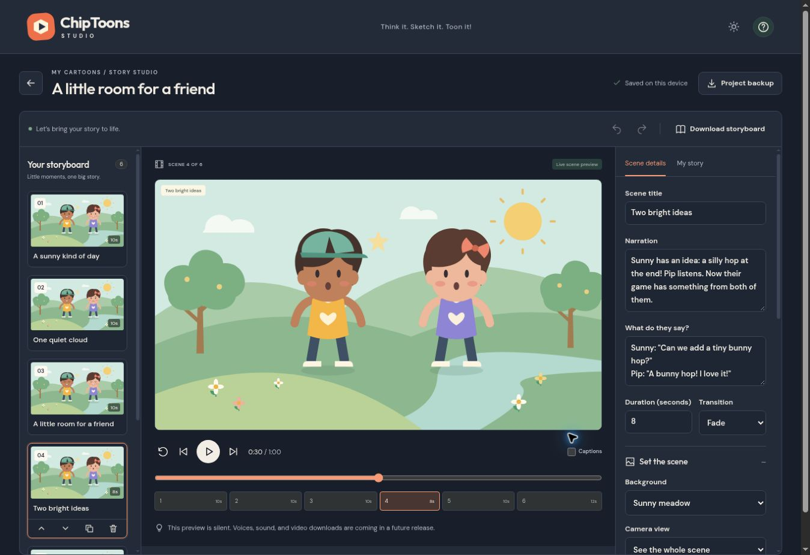
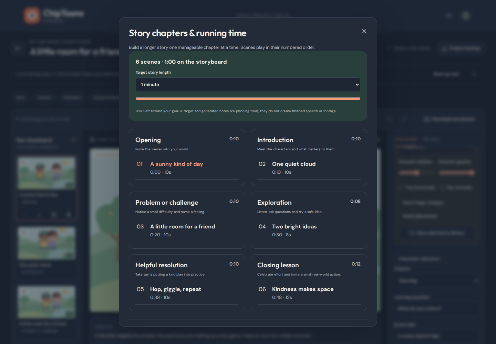
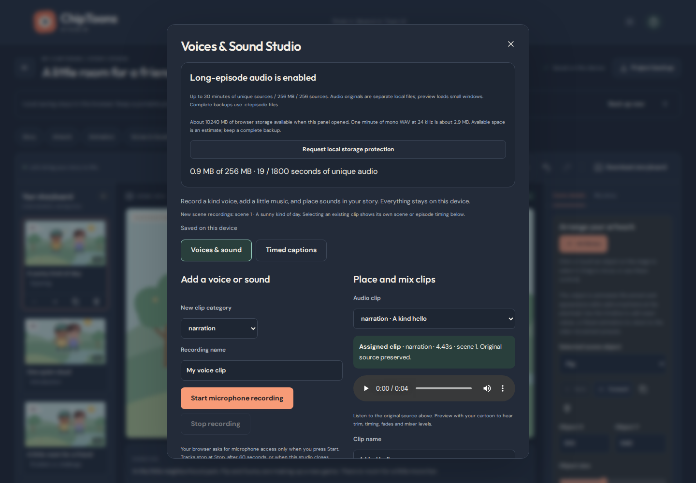

# ChipToons Studio

Think it. Sketch it. Toon it!

A beginner-friendly, local-first children's cartoon creation studio. Start with a thought, sketch or original image; build an editable story in chapters; reuse familiar characters; add animation, voices, music and captions; and export real WebM movies in manageable scene parts. No account or paid API is required.



## Run locally

Use Node.js 24 (minimum 22.13) and npm.

```sh
npm ci
npm run dev
```

Open the printed URL with `/ChipToons/` at the end. To test the production build:

```sh
npm run build
npm run preview
```

## Create a first cartoon

1. Choose **Start with a Thought**, **Start with a Sketch** or **Start with an Image**, pick an original story starter, or try the complete inclusion demo. **Save Draft · Edit Later** keeps a plan for another day.
2. Enter an idea, title, character names, setting and lesson. Local templates propose a short outline; every word can be changed.
3. Edit the scenes, their narration, dialogue and learning questions. **Story chapters** organizes six story phases and adds reviewed batches of scene drafts. Keep a 15–20 minute goal beside the actual running time. Use **Character reference** to apply a familiar appearance while preserving scene-specific animation.
4. Choose a background, expression, position and movement, then press **Play cartoon**. The episode uses each scene’s actual duration. Pause, seek, restart or jump between scenes.
5. Open **Voices & Sound** to record or upload speech, add original music/effects and edit timed captions. **Finish My Cartoon** reviews and exports a genuine WebM with mixed audio. See [the production guide](docs/AUDIO_PRODUCTION.md).
6. For twenty-minute narration, choose **Enable long-episode audio** in Voices & Sound before adding more takes. This allows up to thirty minutes of distinct sources within a 256 MiB original-audio budget, with bounded preview loading. See [Long-Form Episode Production](docs/EPISODE_PRODUCTION.md).
7. Changes autosave in this browser’s IndexedDB. Wait for **Saved on this device**. Download a **Project backup** for a portable copy, and restore it from the dashboard.
8. **Download storyboard** produces a genuine SVG contact sheet containing scene art, narration and dialogue. It can be opened in a browser or printed.

**Upload a sketch or image** imports an original PNG, JPEG or WebP (4 MB / 24 megapixels maximum) as a movable image character. **Draw a character** offers a transparent drawing pad with brush, color, eraser and stroke undo. Image movement transforms the whole picture; it does not automatically rig an arbitrary photograph.

Use the visual timeline beneath the stage to add editable motion, timed expressions and camera movement. See [Animation Studio](docs/ANIMATION_STUDIO.md).

On phones, use the **Scenes**, **Preview** and **Edit scene** tabs. All editors have readable light/dark themes. Original shape characters are a keyboard-accessible alternative to the pointer-based drawing canvas.

See the [complete creator walkthrough](docs/CREATOR_GUIDE.md) and the in-editor **Guided tutorial** for all eight production steps, longer story planning, segmented exports and recovery.

## What the studio includes

- Three guided creation paths, existing quick starts and a real project dashboard with thumbnails, dates, draft/ready status, duplicate, delete confirmation and restore.
- Six complete scenes in the original “A little room for a friend” demo; twelve original editable lesson starters covering kindness, friendship, differences, feelings, helping, responsibility, trusted-adult safety, personal-information safety, nature, problem-solving and teamwork.
- **Show What We're Learning** adds editable arrows, highlights, step numbers, and cards that follow objects or stay fixed in the video. [Visual Teaching & Focus Studio](docs/VISUAL_TEACHING_FOCUS.md).
- **Show How Something Changes** animates before-and-after appearances, reuses scene props and puppet attachments, and connects practical skills to Script Director. [Fix, Build & Transform Studio](docs/FIX_BUILD_TRANSFORM.md).
- **Make My Character Do Something** animates pickups, carries, handoffs and releases with editable events and puppet hand anchors. [Character & Object Interaction Studio](docs/CHARACTER_OBJECT_INTERACTIONS.md).
- **Build My Cartoon World** makes editable locations with reusable backgrounds, original props and optional layered depth. [Scene & World Builder](docs/SCENE_WORLD_BUILDER.md).
- **My Cartoon Series** connects a series bible, recurring cast, and up to 100 episode plans to the existing Assistant and editor. The optional Kind Hearts Crew starter includes 30 editable plans and six original library puppets. See [Series Studio](docs/SERIES_STUDIO.md).
- **Prepare My Complete Episode** checks the numbered WebM files you select, plays them in order, and makes a verifiable delivery ZIP with SRTs. [Episode delivery guide](docs/EPISODE_DELIVERY.md).
- **Make One Complete Movie** assembles verified VP8 exports into one locally built, seekable WebM on supported larger Chromium layouts. [Single-Movie Builder](docs/SINGLE_MOVIE_BUILDER.md).
- **Make My Character Talk** matches original character mouth movement to a recorded clip with local waveform analysis, editable cues, and the same stage preview and WebM export. See the [talking studio guide](docs/VOICE_MOUTH_ANIMATION.md).
- **Write My Episode Script** organizes numbered lines and speaker identities, estimates pacing, and connects each preferred take to the existing audio timeline. See the [Script & Voice Director](docs/SCRIPT_VOICE_DIRECTOR.md).
- Six story chapters, editable batch scene drafts, duration goals, character consistency controls, and undo/redo for the last 40 edits.
- Opt-in long-form narration, separate immutable local audio files, scene-level voice readiness, estimated space/protection controls, and complete checksummed episode-package backups with atomic copy restoration.
- Ordered whole-scene WebM parts with independent retry, part-local SRT and an order manifest; readiness checks and portable reusable art-library backups.
- Original SVG art and deterministic movement: enter left/right, walk, jump, rotate, grow and fade; shape-character expressions/blinks, wide/close camera and scene fades.
- Sequential cartoon playback with shared audio timing, progress, timed captions and transport controls; real WebM export with mixed sound.
- IndexedDB autosave, original asset preservation, full JSON/episode-package backup/restore and SVG storyboard download.
- Responsive interfaces, keyboard navigation and browser QA including accessibility checks.

## Honest limitations

- This studio follows the [studio roadmap](docs/ROADMAP.md). Editable keyframes, acting, camera tracks and background motion are now implemented alongside reusable art libraries, drawing tools, scene layers and non-destructive raster crops. Local recording, mixing, captions and video export are integrated with guided creation, longer-story chapters and production recovery.
- Video exports are WebM (VP8/Opus or VP9/Opus when supported). MP4 is not implemented. Browser speech synthesis is a preview only; recorded/uploaded audio provides dependable voice export. There is no automatic transcription or lip-sync.
- Real-time export is limited to 60 seconds **per file** on phones and 120 seconds **per file** on wider screens. Longer stories export as consecutive whole-scene parts, each independently playable. Matching VP8 parts can be assembled into one movie using the local builder on supported larger layouts. Scenes longer than a file limit receive an actionable warning. Keep the tab visible. 800×450 at 15 fps is the lighter default; wider screens also offer 1280×720 / 24 fps. The exporter stops with an explanation if timing or encoding is interrupted.
- The planner uses local, editable templates. It is not generative AI. Mood, art direction, age and desired episode length are planning notes. A longer episode goal still starts with six scenes (about one minute); add scenes to grow it.
- Changing an outline or action/prop note does not automatically rewrite narration or create new props. Each scene and its actual motion are edited separately.
- Raster uploads remain whole images. SVG uploads and remote image URLs are rejected. This avoids executing active imported SVG content.
- Work is local to this browser and origin. Clearing site data or using private browsing can remove it. Keep downloadable backups. A second tab opens a cartoon read-only where tab coordination is supported, and stale saves are rejected by the local revision check.
- Up to 120 scenes, 20 characters and 40 assets per project; project/art metadata remains capped at 64 MiB; long-episode packages can additionally hold up to 256 MiB of original audio. Very long text is supported in the data model but not automatically paced to match scene duration.
- Chromium desktop/phone/tablet automation and selected Firefox/WebKit workflows are provided. Physical iOS/Android/Safari microphone and export testing is still needed; emulation does not establish device compatibility.

## Architecture

| File                        | Responsibility                                                                              |
| --------------------------- | ------------------------------------------------------------------------------------------- |
| `src/model.ts`              | Versioned project, scene, character, asset and provider contracts; strict import validation |
| `src/planner.ts`            | Local template provider and original lesson starters                                        |
| `src/storage.ts`            | Atomic IndexedDB reads/writes, quota errors                                                 |
| `src/timeline.ts`           | Deterministic timeline sampling and movement math                                           |
| `src/files.ts`              | Validated raster import, embedded-asset backup, SVG storyboard download                     |
| `src/components/Stage.tsx`  | Data-driven original SVG rendering                                                          |
| `src/components/Editor.tsx` | Storyboard editing, properties and playback controls                                        |
| `src/App.tsx`               | Project lifecycle, autosave, history, import and dashboard navigation                       |

`StoryProvider` is the extension boundary for future optional story services. Core planning, editing and playback work without a backend. No secret key belongs in the Vite bundle; future paid/connected services require an explicit user action and a secure server adapter.

The long-media boundaries are in `src/audio-vault.ts` (immutable files and quota/atomic writes), `src/episode-package.ts` (versioned integrity-checked container), and `src/audio-engine.ts` (shared mixer, windowed preview and bounded range decoding). Project schema stays 4 with optional mediaVersion 1; IndexedDB upgrades to 4 without rewriting old originals. [Format and migration details](docs/EPISODE_PACKAGE.md).

## Privacy and reliability

Stories, images, drawings, original audio, mixer settings and captions stay in IndexedDB. Legacy backups embed original artwork/audio as validated data URLs. Opt-in long-episode mode keeps immutable audio binary data in IndexedDB and includes them in checksummed .ctepisode packages; artwork remains embedded. Microphone access is requested only at Start recording; tracks stop on Stop or closing the studio. There are no analytics, external font calls, accounts, cloud photo uploads or AI requests. Fonts are bundled locally with their license notices. Uploaded image type/signatures, dimensions and size are checked; imported project graphs validate IDs, references, types, enumerations, numeric bounds, date strings and asset encodings before replacing any state. Backups restore as a separate project.

The saved indicator updates only after the IndexedDB transaction commits. If saving fails or storage is full, the open work stays available and a working backup action is shown. Autosave is debounced by 650 ms; use the dashboard back button to explicitly await saving before leaving the editor.

## Checks

```sh
npm run check
npx playwright install --with-deps chromium firefox webkit
npm run test:e2e
# Requires FFmpeg/FFprobe with Flite. Complete real-time proof takes about 23 minutes.
npm run test:episode
```

Playwright starts the built production preview at `/ChipToons/`. Build first. `PLAYWRIGHT_BASE_URL` can target an already-running preview. Tests cover the idea wizard, persisted edits after reload, scene ordering and undo/redo, complete timed playback, actual backup/storyboard downloads, original asset preservation, drawing, rejected imports, quota failures, responsive layouts and WCAG A/AA scans. Automated accessibility scans supplement manual keyboard and visual review; they do not prove complete accessibility.

## GitHub Pages

The Vite base path is `/ChipToons/`. The intended public URL is:

<https://larrinamsalva.github.io/ChipToons/>

The separate complete-episode CI job restores/reopens a fictional 20-minute narrated story and records/decodes every whole-scene part; it runs alongside the existing regressions. See [PR #6 verification](docs/PR6_VERIFICATION.md) for actual results and remaining limits.

The owner must select **Repository Settings → Pages → Build and deployment → Source → GitHub Actions**. The workflow runs checks on pull requests, `main`, and the PR #6 feature branch so verification can finish before the pull request opens. Publication runs only on `main` after all unit/build/browser checks pass; PRs are not deployed or automatically merged. The `github-pages` environment may require an owner’s approval depending on repository settings. No custom token is needed.

All application navigation stays on the entry page, so static hosting needs no SPA rewrite rule. A fresh clone plus `npm ci` uses the committed dependency lockfile.

## Art and dependencies

Characters, backgrounds, lesson text, icons and illustrations were created for ChipToons. No licensed entertainment characters, commercial music or imitated character voices are included. Font credits and bundled license texts are in [THIRD_PARTY_NOTICES.md](THIRD_PARTY_NOTICES.md) and `public/licenses/`.

## Reusable Character & Art Studio (PR #2)

Open **Art library** from the dashboard or an episode editor. Create an original shape character, draw artwork, or upload a PNG/JPEG/WebP. Name it, assign a collection and tags, and explicitly choose **Save to library**. Search by name, collection or tag. Saved sources can be edited, renamed, duplicated or deleted with confirmation. The original starter set includes 11 settings (including all 10 requested settings), eight props and two customizable children.

Use **Add to scene** or **Add to three scenes** to place independent snapshots. Click/touch an object on the stage to select it; drag to move and drag its bottom-right handle to resize. Use arrow keys or **Object X/Y**, size, rotation, opacity, flips and crop controls as keyboard-accessible alternatives. **Back/Forward** changes layer order. Background uploads are ordinary embedded image layers, initially placed behind the cast. Character name, outfit and expression changes in an episode are scene-specific. Saving a selected object to the library creates a separate reusable source; library edits do not silently rewrite old episodes.

The Drawing Studio offers pencil, brush, eraser, circle, ellipse, rectangle, line and star tools, fill/outline colors, saved palettes, undo/redo, zoom, selection, move/resize/rotate, duplicate/remove, transparent PNG export and retained editable objects. Use **Insert shape** and the object inspector without a pointer. Library drawings can reopen their object document for later editing. Eraser strokes are editable compositing objects. Drawing history is limited to 40 undo steps and documents to 500 objects / 50,000 points. No image-to-puppet or subject extraction is claimed. Imported pictures move as whole images, and crops/transforms are settings over the preserved original.

Shape characters support happy, sad, calm, surprised, excited and worried expressions and standing, sitting, waving, walking and pointing poses. Uploaded images use whole-image transforms, not shape facial/limb controls. Drawing objects rasterize to a PNG for efficient stage playback while the portable project retains the editable source document.

### Compatibility and recovery

IndexedDB preserves earlier stores through database version 5: version 2 added `library` and `settings`; version 4 added indexed original-audio storage, and version 5 adds recording metadata and revision protection without rewriting project or audio records. Project schemas 1–3 are explicitly migrated in memory through 1→2→3→4 on read, preserving IDs, stage coordinates and timings; it is written back only on the next successful save. Schema 1–3 backups remain importable. Unknown versions, invalid graphs, duplicate IDs, missing assets, invalid crops, invalid drawing coordinates and active/disguised SVG data are rejected before editing state changes.

Every project embeds its own character and raster/drawing assets. Library deletion never cascades into project files. Portable project backups work without the original library and retain editable drawings and crop settings. Projects are capped at 64 MB, 40 assets, 20 character definitions, 20 objects per scene and 120 scenes; individual source uploads remain limited to 4 MB / 24 megapixels. The extra project budget supports multiple original images. When adding artwork would exceed a limit, the current project is unchanged.

Library writes update the saved list only after transaction commit. Errors keep the open draft available for retry and original images can be downloaded. Saved palettes are also local. The art-library backup includes personal artwork and palettes. Restore validates first and adds independent copies atomically without overwriting projects. The Recovery Center coordinates project editing tabs and provides separate-copy recovery. Keep backups of important episodes.

New validation covers source reuse across episodes, scene independence, persistence, source deletion, vector drawing round trips, legacy migration, quota failure and disguised active content, plus browser flows for artwork/PNG export, crops, props, library retry and responsive light/dark accessibility. Existing PR #1 tests remain in the suite. See [the art studio guide](docs/ART_STUDIO.md) for the beginner workflow.

## Animation & Timeline Studio (PR #3)

The existing editor now includes a time ruler, draggable playhead, element and acting tracks, camera/background tracks, editable keyframe diamonds, snapping, zoom and exact numeric timing. All transforms are deterministic; discrete acting changes hold until their authored moment. Actions generate editable data, offer a temporary preview and confirm before replacing existing motion. Scene-only looping and complete-episode playback share one clock. Stage movement on an animated object writes a keyframe at the playhead; other scenes and library sources remain independent.

Original shape characters have five poses, six expressions, closed/open/smile mouths, a manually timed silent talking cycle, blinking, optional idle motion and controlled wave/nod/shake/walk gestures. Optional empathy hearts have soft shape-based glow cues. Camera keyframes pan/zoom or follow an object. Original outdoor backgrounds support cloud drift, sway and gentle stars; parallax endpoints are editable. Props use whole-object transforms, and the original door has an opening control. Uploaded pictures retain whole-image behavior.

New projects use schema 4; existing schema 1/2/3 backups and saved projects migrate through 1→2→3→4 without moving artwork or rewriting legacy motion. IndexedDB preserves existing projects, the library, settings, and readable experimental file records. Explicit keyframes are limited to 120 per track and 12,000 per project; malformed times, references, IDs, values and animation types are rejected. Scene duration changes retime all tracks proportionally; clones remap their keys and follows. Backups embed motion and original artwork.

The fresh inclusion demo shows noticing a lonely friend, walking over, sadness, a wave and smile, friendship hearts, celebration and a smooth camera move. Existing saved copies are preserved. The shared frame sampler now renders the exported movie as well as live preview. Audio remains a separate editable track; the talking mouth cycle is manually timed. See the [beginner animation guide](docs/ANIMATION_STUDIO.md) for controls, migration, performance and limitations.

## Audio, Voices & Video Export (PR #4)

**Story → Artwork → Animation → Voices & Sound → Preview → Export** stays inside one editor. Record a local voice, upload WAV/MP3/Ogg/audio WebM, assign dialogue to a character, trim and place clips on four audio lanes, and mix master/voice/music/effects. The original synthesized collection supplies a melody and ten sound effects. Text-based timed captions support editing, styling and SRT; browser voice preview is clearly separate from exported audio.

**Finish My Cartoon** reviews the episode, warns about missing recorded narration, previews the mix and exports real stage frames plus mixed Web Audio to WebM. Capability detection, preload, shared timing, progress, cancellation, cleanup, encoder errors and playable-file verification are included. A fresh friendship demo has three sample speech clips, looping music, a sparkle and ten captions. See [the complete creator guide](docs/AUDIO_PRODUCTION.md).

[Watch an excerpt of the actual exported friendship cartoon](docs/friendship-preview.webm). [Verified media measurements](docs/media-verification.json) include the full demo's 901 decoded frames, finite 60.17-second duration and non-silent Opus mix.

Schema 4 adds explicit audio/caption validation and migrations without changing older art or animation. Portable backups contain original sound files and editable clip/mixer settings. Audio sections remain limited to 12 MiB /120 seconds, with 24 simultaneous clips. Legacy JSON mode has 24 sources /300 seconds /240 clips and a 64 MiB JSON cap. Opt-in long mode extends this to thirty minutes /256 MiB /256 sources /480 clips, using complete episode packages. Low-storage and quota failures retain the open work and offer backup/retry. Original uploads remain intact through trimming, replacement and timeline removal.

Chromium media proof tests export actual short and complete-demo movies, then verify browser playback, finite duration, dimensions, changing decoded video frames, Opus audio and non-silent PCM with FFprobe/FFmpeg. CI installs FFmpeg and retains the movies, decoded frames and measurements with its browser report. Selected Firefox and WebKit creation, save, accessibility and capability checks are now included; physical Safari/iOS/Android recording and export remain unverified. All PR #1–#4 regression checks stay in the suite.

## Creator experience and longer storytelling



[Creator Guide](docs/CREATOR_GUIDE.md) documents the thought/sketch/image wizard, editable chapter batches, reference appearances, original lesson starters, gentle sound fades/music ducking, readiness checklist, segmented movie export, portable art-library backup and eight-step friendship tutorial. [PR #5 verification](docs/PR5_VERIFICATION.md) records actual tests, media measurements, responsive screenshots and known limits.

Project schema remains **4**; IndexedDB is now **4** with separate original-audio storage. Optional chapter, learning-question, creation-source, starter provenance and mixer-ducking fields are validated additions. Existing schema-4 documents need no rewrite; the tested 1→2→3→4 import chain remains intact. Export range/status data lives outside the creative project and never trims source artwork, animation or audio.

Long stories show twelve memoized storyboard thumbnails at a time and offer direct scene navigation. Each movie part loads only referenced artwork and overlapping audio. A bounded 64 MB decoded-audio LRU reuses sources across consecutive part exports; closing the review clears it and revokes the retained movie preview URL. The existing output/timing safeguards remain.


## Long-form narration and reliable episode production (PR #6)



Open **Voices & Sound → Enable long-episode audio** to preserve existing originals and add narration for a twenty-minute episode within the device/storage budgets. Preview loads small windows; autosave checks metadata without reading every encoded source. **Project backup** creates a complete checksummed .ctepisode file. Restoration opens an independent copy in one atomic transaction. **Episode narration review** identifies missing voices/files and opens the relevant scene. A save-error recovery picker remains available when missing media prevents returning to the dashboard.

The [verified production run](https://github.com/larrinamsalva/ChipToons/actions/runs/41577239374) passed 113 unit tests, 153 browser regression cases and the complete twenty-minute production proof. Every one of ten numbered WebM parts was decoded with moving pictures and sound; all sixty narration sections were checked against their original waveforms. The fixture includes intentional response pauses. [Actual measurements, screenshots and limitations](docs/PR6_VERIFICATION.md) distinguish source duration from spoken time.

[Play an actual beginning excerpt](docs/episode-sample-part-01.webm), [middle excerpt](docs/episode-sample-part-05.webm), or [final-part excerpt](docs/episode-sample-part-10.webm). These short viewing copies retain the original encoded packets; complete originals and a portable episode package are in the linked CI artifact.

See [Make and keep a narrated episode](docs/EPISODE_PRODUCTION.md) and [package/migration contract](docs/EPISODE_PACKAGE.md). Project schema stays 4 with explicit optional mediaVersion 1; IndexedDB 4 preserves old stores and adds indexed binary-original storage. Numbered WebM files remain sixty seconds on phones /120 seconds on wider screens. Physical-device recording and export remain unverified. The optional [Single-Movie Builder](docs/SINGLE_MOVIE_BUILDER.md) uses the completed numbered WebMs.


## Project & Media Recovery

Open **Project & Media Recovery** from **My cartoons** to check backups, find and download originals, reconnect identical media, or preview a manual cleanup. Shared and draft recordings stay protected. If editing moves to another tab, use **Save as a Separate Copy** or download the open draft as a backup. See the [Recovery Center guide](docs/RECOVERY_CENTER.md).

### Idea-to-Cartoon Assistant

Choose **Help Me Make My Cartoon** to review a local story plan, audition real character and camera movement, and create an editable first draft. Try **The Playground of Kind Hearts** for an original walkthrough. The assistant uses transparent story patterns and action cues and works without an account or an AI service. See the [creator guide](docs/CREATOR_GUIDE.md#plan-an-animated-first-draft).

### Puppet Maker & Character Animation Studio

Choose **Create a Puppet Character** to assemble original parts, assign parts from a drawing or PNG/WebP files, move joints, and save reusable poses. Puppets use the existing timeline and WebM renderer. See [Make a puppet with Sunny](docs/CREATOR_GUIDE.md#make-a-puppet-with-sunny).
