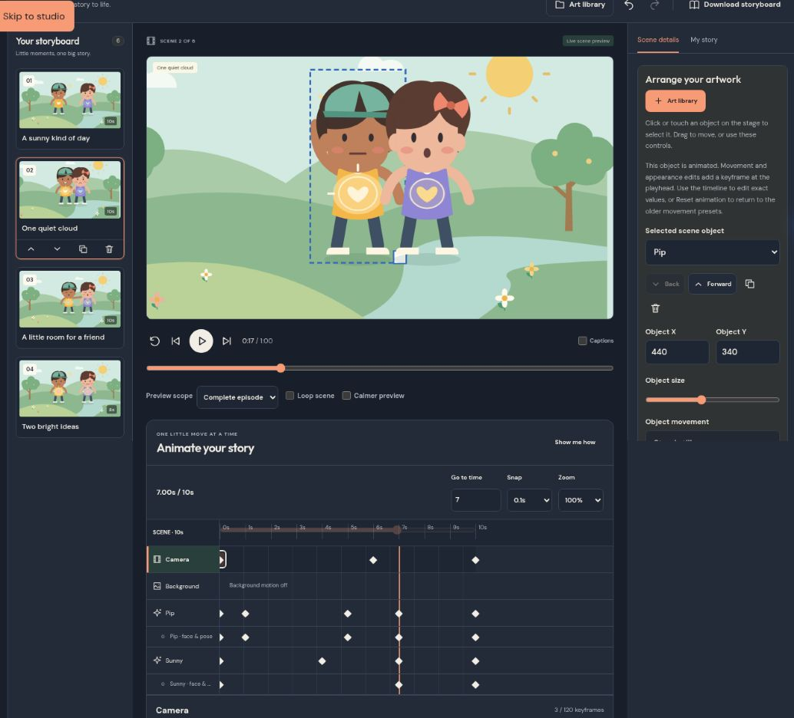

# Your first animated friendship

The timeline is part of the storyboard editor. No account, audio service or paid API is needed. **Try a demo cartoon** opens the original inclusion story with editable motion, timed expressions, friendship hearts and a camera pan. Existing saved copies are left alone; open a fresh demo to see the new sequence.

1. Select **Preview** on a phone, then choose a character directly on the stage or its named timeline track.
2. In **Choose an action**, pick Walk, Jump, Wave or another action. Set the start time, action length and speed. **Preview action** is temporary. **Apply action** creates editable diamonds. Replacing existing keyframes or an older preset asks for confirmation; Cancel keeps the existing motion.
3. Drag the ruler's playhead or type **Go to time**. Choose **Add keyframe at playhead** to say “move here.” Change the moment's X/Y, scale, rotation and opacity. Numeric fields commit with Enter or when you leave the field. Escape cancels an unfinished numeric edit.
4. Add another moment to say “stop here.” **Arrive with** controls interpolation into that moment: linear, ease in, ease out, ease in/out or bounce. Drag diamonds or focus one and use left/right arrows. Snap and Zoom help place them. **Choose a keyframe** and its exact time field provide alternatives to dragging. Two moments cannot occupy the same time on one track.
5. For original shape characters, choose a moment's expression, pose and mouth. **Talking cycle (silent)** opens and closes the mouth from this moment until another mouth state is set; it does not infer dialogue or use audio. Wave, nod, shake and walk use controlled original shape parts. Natural blinking and small idle motions can be turned off.
6. Set a **Heart glow** at a moment. Warm and sad halos, steady reassurance, helping rays and twin cooperation hearts combine shape cues with facial expressions. Strength can grow between moments. Choose Off at a later moment to stop the effect. Helping pulses are slow and soft, without strobing.
7. Select **Camera** to add a pan or zoom. Edit camera center X/Y and zoom on its diamonds. Follow an object to keep it in view; X/Y then add offsets relative to that object. Deleting the object clears the follow safely. Stage dragging uses the inverse camera transform.
8. Select **Background** to enable clouds, sway, stars or parallax. **Add gentle background motion** creates editable endpoints. Effects depend on the original setting: an indoor room has no outdoor clouds. Uploaded backdrops have their own ordinary object tracks. Props can use whole-object motion; the original Door also has an editable opening amount.
9. Choose **Selected scene** and **Loop scene** to practice one moment, then **Complete episode** to watch the story. Pause preserves time; Restart, Previous and Next remain available. Changes autosave after editing. Download a **Project backup** and reopen it to keep all motion and artwork together.

## A few useful habits

- Selecting a marker seeks to that moment. Moving an animated object on the stage, or changing its scene position/face/pose, writes a keyframe at the playhead. Base artwork and other scenes stay independent.
- The **face & pose** row marks acting changes; transform diamonds contain a complete editable snapshot. Numeric properties interpolate. Pose, emotion, mouth mode, gesture and heart mode switch at their exact authored time and hold until the next change.
- **Copy motion → select another object → Paste motion** works within the selected scene. Paths are offset to the destination object's base position, IDs are renewed and shape-only acting is removed for raster images and props. Replacement is confirmed. This clipboard is temporary, not a system clipboard or cross-project asset.
- **Duplicate keyframe**, Delete, Reset animation and project undo/redo work together. Reset returns the selected track to its original static placement, without deleting artwork or layers. Older movement menus are available when a character has no explicit keyframes.
- Changing scene duration proportionally retimes every element, camera and background keyframe. Duplicating scenes/objects renews keyframe IDs and remaps camera follow references.
- **Calmer preview** follows the device's reduced-motion preference initially. It stills idle motion, blinking, pulse modulation and procedural background effects; authored keyframe paths still play. It never changes saved animation. Pause and exact-time seeking remain available for inspecting motion without continuous playback.

## Data, compatibility and limits

Projects now use schema **4**. Imports/readback apply an explicit **1 → 2 → 3 → 4** migration chain. Schema 2 scenes retain their base positions, artwork, durations, layer order and older motion presets verbatim; explicit tracks are opt-in. IndexedDB is now version 4 for separately stored narration; existing project, library and palette stores are preserved. Animation still uses the established project store and deterministic sampler. Migration happens on a detached in-memory copy and is persisted only on the next successful save.

Each element owns its animation track; removing it also removes that track. Camera and background tracks belong to the scene. There are at most **120 keyframes per track** and **12,000 per project**, strictly increasing times within the scene, unique graph IDs, bounded numeric values and validated pose/expression/easing types. Missing follow targets, duplicate times/IDs, non-finite values, unknown schema versions and excessive tracks are rejected before imports replace editing state. The total portable-project limit is now 64 MB; original artwork limits remain in force.

The shared `timeline.ts` functions `frameAt`, `elementAt`, `cameraAt`, `backgroundAt` and `sceneAt` sample arbitrary timestamps without a wall clock, randomness or rendering state. They preserve layer order and are used directly by live preview and PR #4 video rendering. Creation allocates IDs; sampling never does. The preview clock publishes at up to 30 fps, and only the stage, transport and live playhead subscribe; static forms and thumbnails do not rerender every frame.

## Honest boundaries

Uploads remain whole raster images. They have position, scale, rotation, opacity and crop, but ordinary photographs are not rigged or given invented facial states. There is no subject extraction, automatic AI cartoon generation, automatic recorded-voice lip-sync or MP4 export. Audio tracks and real WebM export are described in the [production guide](AUDIO_PRODUCTION.md). The five original poses and controlled shape gestures are a simple illustrative rig, not professional skeletal animation. SVG imports remain rejected.

Work and the motion clipboard are browser-local. Portable project backups include every used artwork asset, drawing document and animation setting; a separate reusable library is not required to reopen them. Library sources never change when scene animation is edited. Chromium desktop, phone and tablet are covered automatically; Firefox and Safari still need separate manual coverage. PR #4 adds audio and video export; see the [production guide](AUDIO_PRODUCTION.md).

For narrated longer episodes and complete original-media backups, see [Episode Production](EPISODE_PRODUCTION.md).
