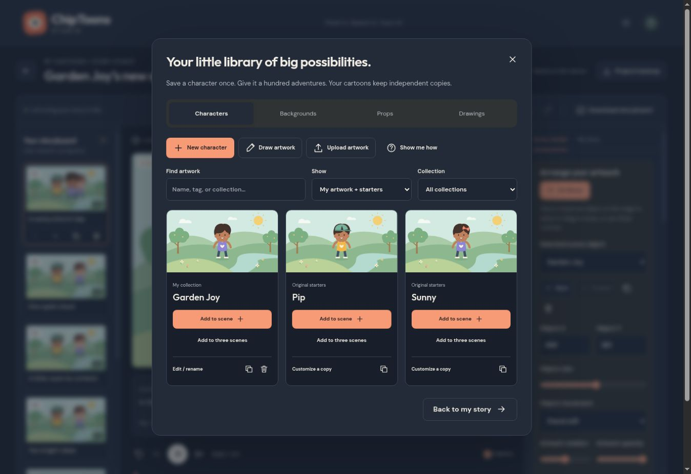

# A character, three little adventures

1. Open **Art library** on the home screen. Choose **New character** for an original shape character or **Draw artwork** for your own drawing. Choose **Upload artwork** for a PNG, JPEG or WebP. SVG files are rejected.
2. Give your creation a name, collection and optional comma-separated tags. Choose colors, expression and pose for shape characters, or choose an editable crop for images. Save to your library and wait for the saved message.
3. Open or start a cartoon. Choose a scene, then open **Art library** from the editor toolbar. Find the character and choose **Add to three scenes**. It is added to this scene and the next two available scenes, wrapping to the beginning at the end of an episode. With fewer than three scenes, each available scene gets one copy.
4. Close the library and select a character directly on the stage or through **Selected scene object**. Drag to move. Use the bottom-right handle or **Object size** to resize. Arrow keys move a focused object in 5-unit steps. All positions stay in the original 800×450 coordinate system.
5. On phones, switch between **Scenes**, **Preview** and **Edit scene**. The selected object can be edited from the properties tab. Position, pose, expression and appearance changes apply to the current scene. Your reusable source stays unchanged.
6. Add backgrounds and props the same way. The Back/Forward controls move selected objects one layer at a time. A background image is an ordinary image layer placed behind the characters; original settings change the scene background.
7. Download a **Project backup**. It includes the images and drawing documents used in the cartoon. Restore it on another browser without needing the source library.

## Keep editing a drawing

Choose Drawings, find the saved item and select **Edit / rename → Edit drawing objects**. Use Select to move an object or drag its bottom-right handle. The object inspector provides keyboard controls for X/Y, width, height, rotation, fill and outline. Insert shape is a keyboard alternative to dragging out a new shape. Undo/redo includes object transformations. Zoom changes the working view; exported PNGs retain the transparent 600×400 canvas.

Choose **Continue to save artwork**, then **Save to library**. Cancel leaves the previously saved source intact. Existing episodes keep their earlier copies. Use a selected episode object’s **Save selected to library** action to preserve a scene-specific variation under a new source name.

## Image originals and limits

Crop, flip, rotate and opacity settings never replace the original raster data. **Download original image** keeps a source copy. Uploaded photographs and sketches remain whole images; they are not automatically separated into limbs or rigged. Shapes and their source documents can be edited, while uploaded images use the image tools.

The personal library is browser-local. Clearing site data removes it. Keep portable episode backups, especially before changing browsers. If saving fails, keep the open draft, download its original image if needed and retry after making room. Library deletion requires confirmation and never deletes embedded artwork from an existing episode.
