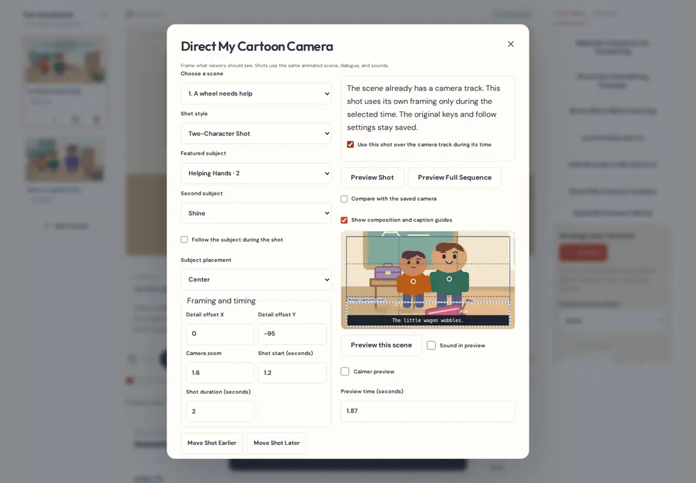
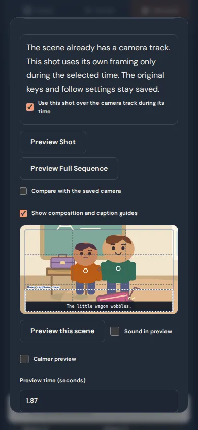
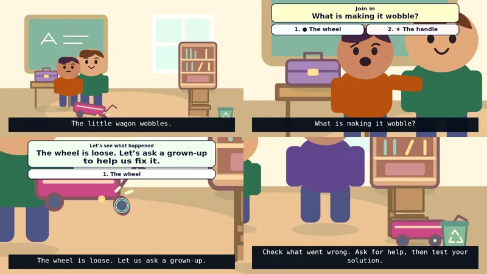

# Camera & Shot Director Studio

Use shots to decide what a viewer should look at while the cartoon keeps playing. A wide shot can show the whole playground. A close-up can show Shine’s expression, then a detail shot can draw attention to the wagon’s wheel.

## Direct a shot

1. Open a cartoon and choose **Edit scene → Direct My Cartoon Camera**. You can also use **Camera shots** in the animation timeline.
2. Choose a scene and a style. Start with Wide, Medium, Close-Up, Detail, Two-Character, Reaction, Follow, or Gentle Camera Move.
3. Choose one or two subjects, or frame a fixed part of the stage. For a face or wheel, use the detail offsets to move the center of attention. Turn on **Follow the subject during the shot** to track its animation, including a prop being carried.
4. Enter a start and duration in seconds. A **Straight Cut** changes the frame instantly. A **Smooth Camera Move** eases into the new view over the specified number of seconds.
5. Choose **Preview Shot** to watch that part, or **Preview Full Sequence** to see how it fits in the scene. Use **Preview time (seconds)** to inspect a cut. Sound preview uses your scene’s ordinary mix when enabled.
6. If there’s an existing camera track, use **Compare with the saved camera** and confirm that the shot can take priority during its own time. Then choose **Apply**. **Cancel** discards the draft. **Undo edit** and **Redo edit** work in the main editor.

The list shows the style, subjects, timing, transition, and directing note. Turn on **Show shot thumbnails** for representative Stage frames. Edit a saved shot from this list or select its bar in the timeline. Move a shot by a quarter-second with the Earlier/Later buttons, or type an exact start. Duplicate makes an editable draft and Delete asks before removing a saved shot. Each scene holds up to 24 shots. If two would overlap, shorten one or choose another start.

### Script and learning moments

In **Write My Episode Script**, select a line and choose **Review Camera Shot for This Line**. A speaker already in the scene can be suggested for a close-up. A narration line starts with a wide view. Use the linked recording’s start or the script’s estimate as a starting point, then review it in the director.

In **Connect to a script line or learning moment**, pick an interaction, object appearance change, teaching step or graphic, question/reveal, or keyframe. Events with an attached sound effect are marked in the list. **Use this event’s start time** copies the exact timing into the draft. If the linked event later moves, the shot keeps its approved timing and shows a review warning. A removed event leaves the shot in place. If a subject is removed, the shot keeps its saved fixed framing and prompts you to review it. Matching uses stable scene IDs.

### Try the example

From the dashboard, open **Try a Camera & Shot Director example → The Wobbly Wagon — A Closer Look**. Watch the workshop, Shine’s question, the loose wheel, the thinking pause, and the supervised repair. The second scene follows the moving wagon, then goes wide for the closing lesson. All shots are editable. The earlier wagon examples are still available.

## Rendering and compatibility

- **Foundation audit.** The animation timeline already has camera position, zoom, easing, follow targets, and playhead seeking. The World Builder and teaching graphics already project scenery depth and object targets. The Stage already renders both interactive previews and deterministic video frames. The director adds scene-local shot intervals to these systems and reuses the existing scene preview, audio scheduler, undo history, storyboard navigation, and export pipeline.
- **Sampling.** Shots use the half-open interval `start ≤ time < end`. During a shot, its framing controls the whole Stage. At other times, the existing camera is authoritative. A smooth shot starts from the prior contiguous shot’s framing at the cut, or the original camera when there’s a gap. It eases into the current shot using the existing easing calculation. Cuts are evaluated at scene time, with video displaying the first sampled frame at or after the cut.
- **Layers and sound.** World parallax and object-following teaching graphics use the sampled camera. Screen-fixed instruction cards and captions stay in viewer coordinates. Scene-level Cut and Fade, recordings, mouth timing, music, and sound clips retain their original timing. The same Stage supplies scene and episode playback, numbered WebMs, and Single-Movie Builder output.
- **Preview guides.** The thirds grid, safe edges, subject markers, and caption guides appear only in the director. Calmer preview avoids a smooth camera ramp and shows its composed framing. The saved movie uses the authored timing. The subject warning checks several representative moments. Check faces, hands, and small details visually when they matter.
- **Persistence.** Optional `scene.cameraShots` is validated under project schema 4 and stored in the existing IndexedDB database, version 6. Earlier projects use their original camera. Scene duplication remaps target, event, and script IDs. Changing a scene’s duration scales its shots. Project JSON and complete `.ctepisode` packages carry the shot data with the episode.
- **2D limits.** Panning, zooming, and following reframe existing artwork in the 800×450 stage. Zoom enlarges the same artwork. A subject near the stage edge can move away from the exact center because the camera stays within the composition. Keep the zoom wider when two actors move apart.

## Verification

The unit tests exercise cuts, gaps, easing, target follow, reference safety, duplication, retiming, and backups. Browser tests cover editing, overlap, original-camera review, cancel, history, reopening, keyboard controls, and light/dark accessibility on desktop, phone, and tablet viewports. The media test independently decodes both voiced WebMs and compares the Single-Movie Builder output with the source parts. Browser automation uses emulated phone and tablet sizes.

### Working director

### Decoded WebM frames

Read left to right across each row. Frames are from the workshop at 0.90 s, 2.93 s, and 8.25 s, then from the wagon test at 3.90 s. The export verification also samples both sides of the 3.50 s cut and compares audio before and after it.
