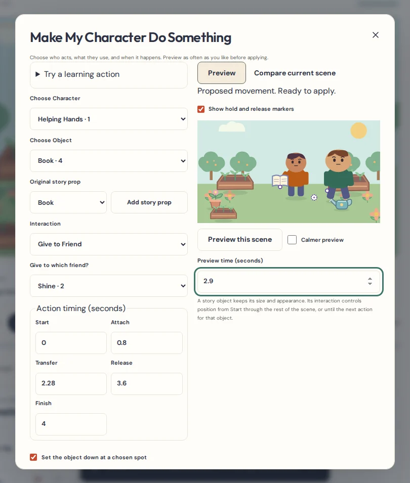
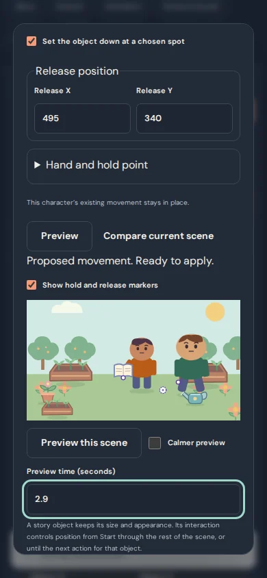
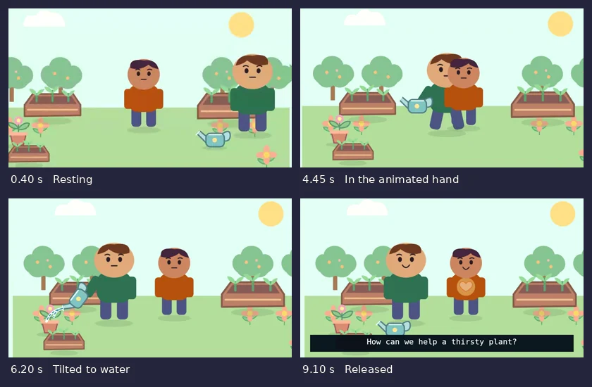

# Character & Object Interaction Studio

In the dashboard, open **Try Helping Hands Waters a Little Garden** for a working example. Helping Hands approaches the can, carries it by the animated puppet arm, tilts it toward a seedling, and sets it down. Shine’s heart glows as the scene ends with a learning question. Both characters and the Community Garden use existing original studio artwork.

## Pick up and carry a prop

1. In the storyboard, open **Edit scene** if you see the mobile tabs. Choose **Make My Character Do Something**.
2. Choose a character and a story object. **Add story prop** adds a small original item to the proposed scene. If the same kind of story prop is already there, the button selects it. To use your own drawing, place it in the scene through the Art Library first.
3. Choose **Carry It**. For a still character, the studio can add a walk made of ordinary editable animation keys. If the character already has movement, the object follows it. Use the existing character track to adjust the walk.
4. Set **Start**, **Attach**, and **Finish**. To leave the item somewhere, choose **Set the object down at a chosen spot**, set **Release**, and enter the stage position. X increases toward the right and Y increases toward the bottom. The stage is 800 × 450.
5. Choose **Preview**. Play, pause, enter a time, or switch to **Compare current scene** at the same timestamp. Preview is silent so you can focus on the action. **Cancel** leaves the cartoon and its artwork as they were.
6. Choose **Apply** and play the scene with the regular cartoon controls. The prop, motion and action are saved in the same edit. **Undo edit** reverses the full edit.

## Hands, handoffs and timing

- Open **Hand and hold point** to choose left, right, or a simple hold point. A puppet uses its animated hand when available, then the end of its forearm or upper arm. It accounts for the parent joints, pivot, rotation, scale and flips. Adjust X and Y offsets to line up the item with the grip. **Show hold and release markers** displays the attachment positions in the review preview.
- Shape characters use approximate positions on their illustrated arms. Flat pictures use a position on the whole picture. Puppets without a suitable arm use a simple hold point. The tools do not add joints or infer fingers from pictures.
- Choose **Give to Friend** or **Receive from Friend**, pick a distinct giver and receiver, choose both hands, and set **Transfer**. The object moves from the giving to the receiving hand across a short timed approach. The receiving character owns the attachment from Transfer onward. Choose where the friend puts it down, or let it finish at the final hand position.
- Expand the existing animation timeline. The interaction row shows **Start**, **Attach**, **Transfer**, **Release** and **Finish** where applicable. Open the row or one of its markers to edit exact times. Each interaction uses one story object. A hand or object cannot be committed to overlapping interactions. Deleting a participant clears just the linked actions and shows how to undo the removal.
- Attachments control the prop’s position from Start onward. A release position stays fixed until another interaction moves the prop. Base opacity, size, appearance and underlying keyframes stay editable. To change where an attached or released item goes, edit the interaction. Removing an interaction restores its underlying position animation.
- A held prop can rise directly above its owner if its ordinary layer would hide it. Fixed scenery keeps its order. Eligible small scenery can be converted explicitly into a story prop in the current scene. The saved location template is unchanged.

## Story suggestions and examples

The Idea-to-Cartoon Assistant and Script Director recognize a short list of visible phrases paired with existing prop names, such as “Helping Hands picks up a book.” Open **Review interaction suggestion** to choose participants and check the proposed animation before applying. If the object is missing, add it deliberately in the same panel. Ambiguous names and multiple matching props are left for you to review.

**Try a learning action** includes watering a plant, putting away a toy, sharing a book, helping clean a room, and showing a toy to an adult helper. The original water effect starts at the tilted can’s spout. The activity examples use harmless objects and supervised help. The studio does not simulate collisions, grasp physics, running water, or tool safety.

## Foundation audit and compatibility

| Existing system | How the studio uses it |
| --- | --- |
| art-model, library, CompositionTools, world-model, DrawingPad | Reuses the existing scene elements, original prop gallery, original image assets and placement controls. Explicitly separates the scene’s handheld copies from reusable scenery. |
| puppet-model, puppet-project, PuppetArt | Uses the rig hierarchy and the same resolved joint transforms as puppet artwork. Interaction reach respects authored hand/arm keys. |
| animation-model, presets, timeline, AnimationTimeline | Reuses timed sampling, the editable walking preset, the playhead, track layout, numeric timing and scene duplication. Adds a small scene-local event list. |
| CartoonAssistant, ScriptDirector, ScenePreview | Both planners open the same reviewed workflow. The interaction preview reuses the scene preview’s clock, controls and Stage. |
| model, Editor, storage, backup and recovery | Validates at most 24 interactions per scene and checks IDs, references, timing, grips and release positions. Uses the existing undo history, atomic project revision checks and project/package backup paths. Scene copies remap their object, giver, receiver and action IDs. |
| Stage, video-export, Complete Episode Delivery and Single-Movie Builder | Stage samples the same attachments, acting and camera in playback and in the WebM renderer. The delivery and movie tools use the resulting WebM bytes. |

The timeline’s existing **Point at something** preset moves a character without choosing a target. **Point to It** uses an actual scene object and adds a visible cue. The Art Library and World Builder already manage prop and scenery artwork. Interaction Studio adds time and attachment to those same elements.

Project schema stays at 4, IndexedDB stays at 6, and the complete episode package stays at version 1. The interaction list is optional. Old cartoons open with their existing scenes and animation. Both JSON backups and complete episode packages preserve interaction events. Older builds may display the underlying prop and character animation without the new attachment behavior.

## Export verification

The garden media check records two genuine WebM parts. FFmpeg decodes the garden segment at five scene times and checks that the can appears once, in the expected camera-relative position. Complete Episode Delivery accepts both files. Single-Movie Builder joins them, and an independent decode compares every output picture with the corresponding source picture. The original narrated 20-minute production proof remains in the regression suite.

