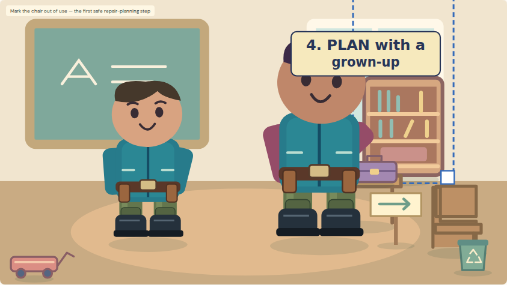
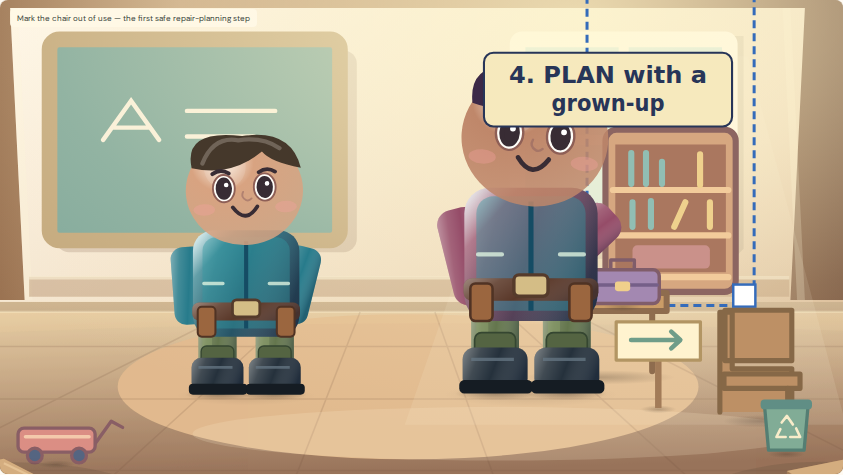
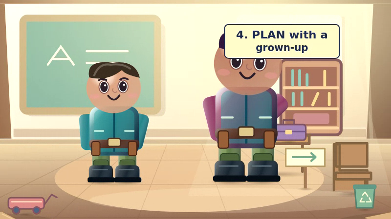

# PR #42 — Cinematic Workshop Depth & Character Grounding

Open **Watch Scout and Jo tidy up (4:30)**, then enable **Cinematic Storybook look** in the existing editor controls. The same Stage renders the preview and WebM. No new project, paid service, or renderer is required.

## What changes

- Background beams, inset wall edges and window/board cast shading add a back plane. Floor skirting and perspective planks form the middle plane. Low corner workbench edges provide a foreground plane.
- Decorative planes respond gently to the existing camera. Their offsets reuse the existing bounded scenery parallax; the middle plane stays with the scene. Additional zoom separation is small and bounded. **Calmer preview** holds this extra parallax still.
- Soft radial SVG shadows sit below Scout and Helper Jo's actual animated boots. Foot contact fades when a foot lifts, while the shadow stays horizontal through a lean or flip. Appropriate props have surface contact shadows; a carried object has none until it is released.
- The camera, authored objects, scenery depth settings and hand attachments keep their existing coordinate system. No keyframes, puppet parts, approved recordings, mouth tracks, captions or original artwork are rewritten.

This is optional for workshop/classroom scenes under the existing project style switch. Classic and other backgrounds retain their previous rendering. Saves, Undo/Redo, recovery and backups use the existing style flag and schema.

## Same-scene visual evidence

The actual fifth scene of the existing **4:30** cartoon, paused at **24.8 seconds**, with the same camera and authored elements. Captured from the real Stage; the editor's selection outline is visible in both. Each responsive browser run also retains its own images.

| Classic | Cinematic Storybook |
| --- | --- |
|  |  |

The decoded frame comes from a **64-second test excerpt** containing the unchanged 34-second voiced opening and unchanged 30-second safety-sign scene. It is not a new episode or an extension of the source cartoon.

## Verification

- `npm run check`: types, lint, all 242 unit tests and production build.
- Focused Chromium desktop/phone/tablet tests: actual camera transforms, both actors' boot shadows, held and released sign alignment, deterministic seeking, calmer preview, Stage accessibility, no horizontal overflow, save/reopen and unchanged backup/media data.
- Genuine 800×450 VP8/Opus WebM: browser playback, finite duration, independent FFprobe/FFmpeg decoding, changing frames, audible original approved narration and original SRT text. The browser report retains the playable movie and media measurements.
- The complete existing foundation/browser matrix and separate 20-minute production proof remain required in GitHub Actions; consult the PR checks for their current result. No workflow or test has been removed or cancelled.

The focused axe audit covers the live Stage. A broader exploratory scan also exposed existing label-in-name warnings in timeline controls; those controls are outside this renderer change.

## Limits

This is illustrated SVG depth, not 3D geometry, automatic floor recognition or physical lighting. Contact is estimated from each authored rig's feet and base position; it does not add inverse kinematics or correct an incorrectly placed/custom rig. Inverted artwork and decorative backdrops do not receive floor shadows. Existing Little Fixers animation stays **4:30**, with later voices still unrecorded. The separate 20-minute studio fixture remains an export benchmark.

Keep PR #42 in draft for visual review and passing checks. Do not merge or deploy automatically.
