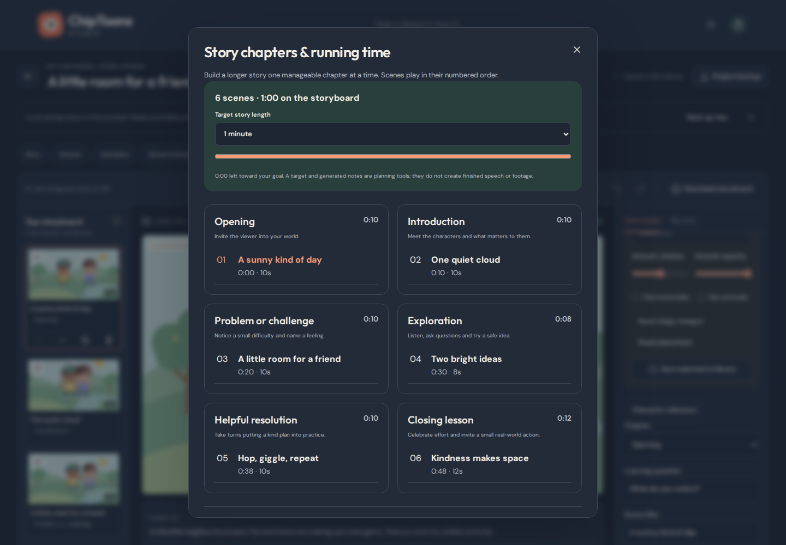
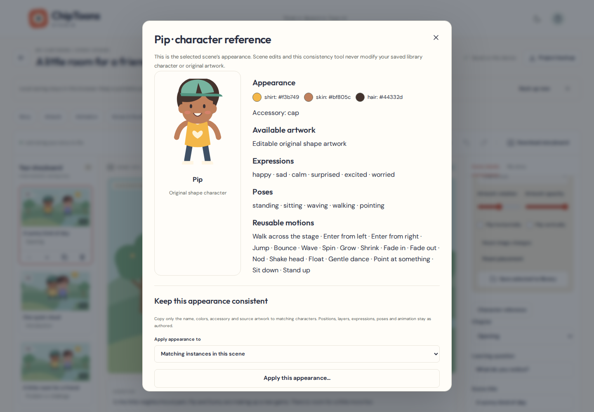
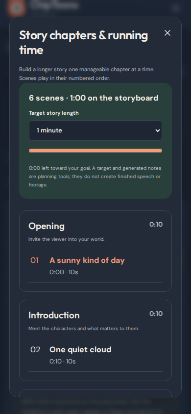
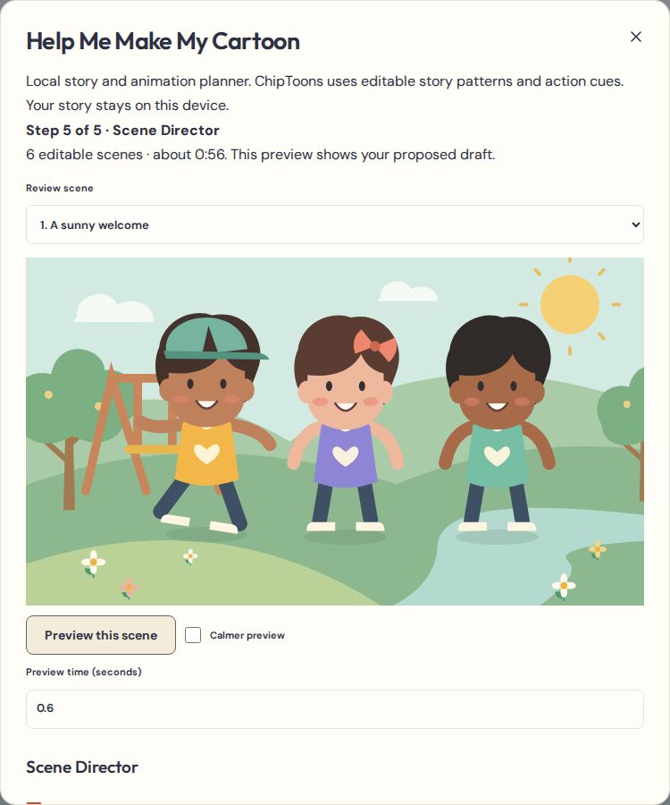
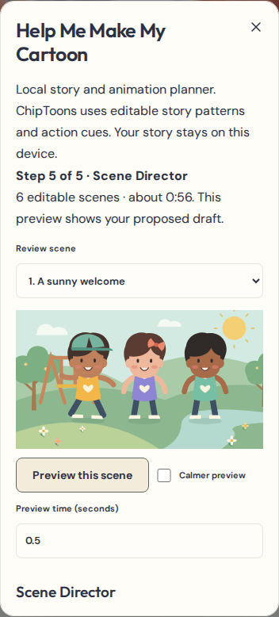
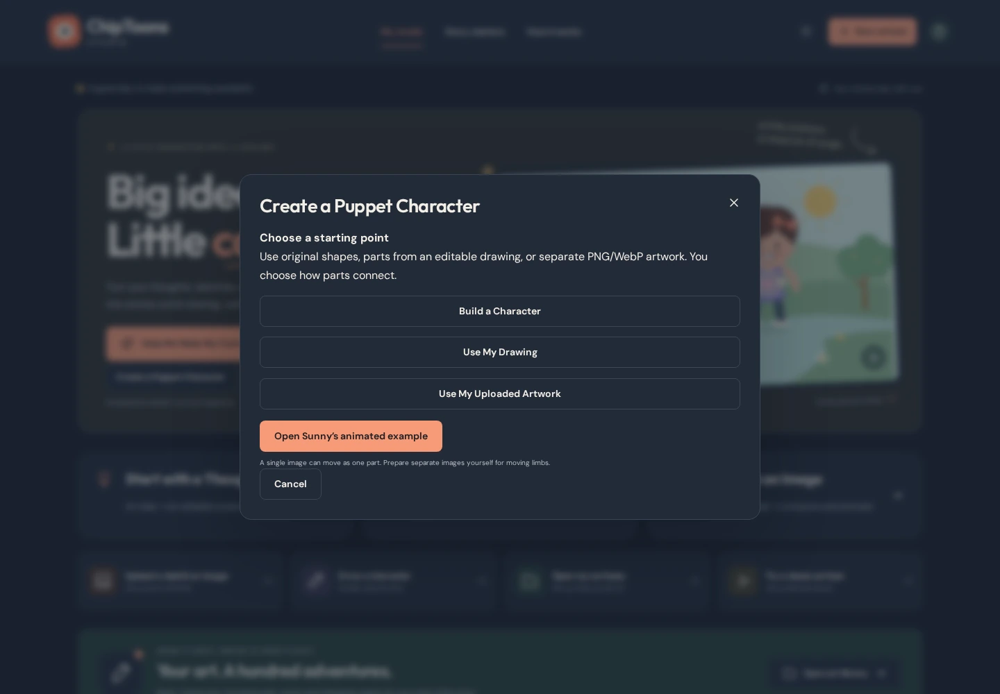
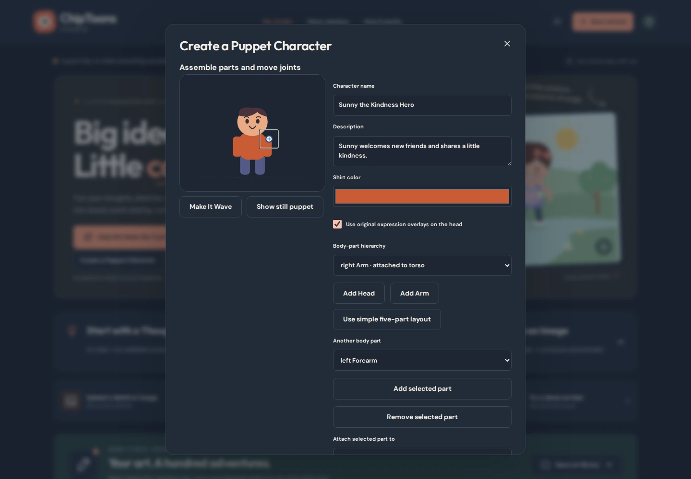
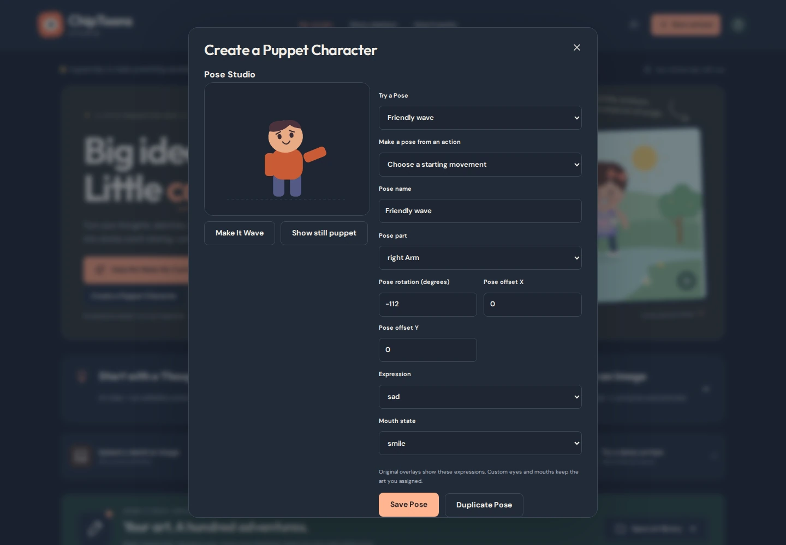
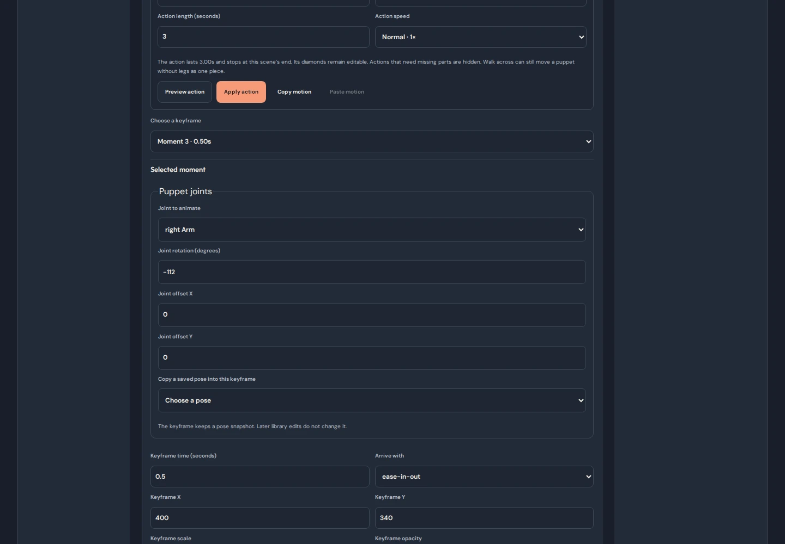
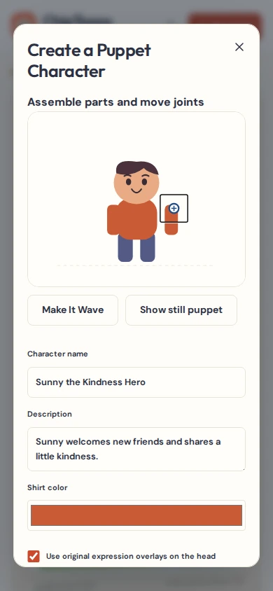

# A friendly path from a spark to a finished cartoon

ChipToons is a free, local-first studio for original educational cartoons. No login or paid service is needed. The planner uses local templates. You remain the storyteller: it does not interpret photographs, rig bodies, record voices automatically or produce finished footage from a duration goal.

## Add an opening or ending

Open **Finish My Cartoon’s Story** to preview an opening, title, chapter, recap, goodbye, or credits card. Review where it goes and how many seconds it adds before applying. A saved card works with the normal storyboard, Script Director, and movie export. [Titles and credits walkthrough](EPISODE_TITLES_RECAPS_CREDITS.md)

## Direct the camera

Open **Edit scene → Direct My Cartoon Camera**. Choose a shot style and subject, set the start and length, then preview it before applying. Use the **Camera shots** lane to edit it again. A shot keeps the scene’s animation and voices running. Try **The Wobbly Wagon — A Closer Look** to see a close-up, a wheel detail, and a moving follow shot. [Camera walkthrough](CAMERA_SHOT_DIRECTOR.md)

## Add sound to actions and locations

Open **Edit scene → Add Sounds to My Cartoon**. Choose a real action or a scene time, pick an original or saved sound, and preview it with animation. In **Build My Cartoon World**, review an optional location atmosphere and choose which consecutive scenes should share its loop. Keep effects quiet around voices. [Sound Director walkthrough](SOUND_EFFECTS_ATMOSPHERE.md)

## Invite viewers to participate

Open **Edit scene → Let the Kids Join In** to write a question, leave 3–10 seconds for thinking, and show a positive explanation. Link existing script lines and a teaching graphic when they help. Preview with sound and captions, then Apply. The exported video gives viewers time to think or speak aloud. [Pause, Think & Try walkthrough](PAUSE_THINK_TRY.md)

## Point out what children should notice

In **Edit scene**, open **Show What We're Learning**. Choose an arrow, circle, spotlight, step number, label, or instruction card. **Follow Object** follows an animated detail such as a wagon wheel. **Stay on Screen** holds text in one viewer position. Preview with the caption safe area before applying. In **Teach It Step by Step**, choose **Show This Step on Screen** to start from an existing teaching moment. [Visual teaching walkthrough](VISUAL_TEACHING_FOCUS.md)

## Show a repair, build, or other change

Choose **Show How Something Changes** in **Edit scene**. Pick one object, choose its starting and finished appearance, and enter a time or link an existing interaction event. Preview the result and select **Apply**. Open the appearance marker in the animation timeline to adjust it later. In **Write My Episode Script**, use **Teach It Step by Step** to match a lesson or spoken line to the real action. The dashboard examples include **Helping Hands and the Wobbly Wagon**. [Fix, Build & Transform walkthrough](FIX_BUILD_TRANSFORM.md)

## Animate a character using a story prop

Open **Edit scene** and choose **Make My Character Do Something**. Choose a character, add or select a story prop, and choose **Carry It**. Add a walk if the character is still, set the attach and release times, and use **Preview** to check the movement. Choose **Apply** when it looks right. Open the action row in the timeline to fine-tune timing, change hands, or set a new release spot. The dashboard example **Helping Hands Waters a Little Garden** shows the complete action. [Interaction Studio guide](CHARACTER_OBJECT_INTERACTIONS.md)

## Begin with what you have

The dashboard has three guided starting cards. Existing quick starts still work.

- **Start with a Thought**: write a sentence, choose character names, a setting, lesson and mood. Under **A few more creative choices**, choose the episode goal. **Find my story** proposes an outline and six editable scene drafts. Review the beginning/challenge/response/ending notes and the individual scene titles/narration. **Edit my idea** goes back; **Create my storyboard** opens the editor. **Save Draft** or **Save Draft · Edit Later** saves a local project and returns to My cartoons. A save error leaves the wizard open.
- **Start with a Sketch**: choose **Upload original artwork** or **Draw my artwork**. The latter uses the same transparent drawing studio as the art library. Save your named drawing, then identify it as a main character, movable object or scene background. **Next: plan my story** leads to the same editable story planner.
- **Start with an Image**: import an original PNG, JPEG or WebP, name it, and choose its role manually. The complete original is embedded in the project. Use **Image tools** after placing it to crop, flip, resize or reposition it. These settings preserve the source. A picture moves as a whole image; separate expressions and limbs need separately created artwork.

Image limits remain 4 MB and 24 megapixels. Unsafe SVG and remote image imports remain rejected. **Back** returns from the artwork planner without creating a project. A target duration is a planning note, not a promise of finished footage.

## Make the first friendship cartoon

Use **Try a demo cartoon** to open a fresh, original “A little room for a friend.” Existing saved copies stay unchanged. Pip notices Sunny feeling left out, makes room, listens, waves, shares glowing hearts and celebrates. Editable acting and a camera move already show how timing works.

The editor’s **Guided tutorial** has eight steps and buttons that open the actual tools:

1. **Start with a Thought** on the dashboard creates your own version of the invitation idea. Choose **Create my storyboard** after reviewing the drafts.
2. **Art library → New character**, **Draw artwork** or **Upload artwork** creates reusable art. Choose **Save to library**, then **Add to scene**. **Add to three scenes** makes independent scene copies. The original drawing/source stays in the library.
3. **Story chapters** shows all chapters, numbered scenes, durations and total running time. **Prepare scene notes** makes an editable batch; review the notes, then press **Add 3 reviewed scenes** (the number follows your chosen batch size). In **Scene details**, change the title, narration, dialogue, **Learning question**, **Chapter** and duration.
4. In the animation timeline, select a character track. Choose an **Action**, **Preview action**, then **Apply action**. Replacing existing animation asks first. Select keyframes and edit their exact time, X/Y, scale, rotation, expression and pose. Keyboard arrows and numeric fields are alternatives to dragging.
5. **Voices & Sound → Start microphone recording** asks for access only when pressed. Speak, **Stop recording**, listen to the original, then **Save audio clip**. You can also **Upload voice, music or sound**. Audio stays local. Browser voice preview does not become movie speech automatically.
6. Under **Original music & sound effects**, press **Kindness melody**, **Reassuring chimes**, **Tidy-up rhythm**, **Quiet garden breeze** or another original sound. Choose the clip, set start/play length, and try **Gentle clip fades**. **Lower music under recorded voices** enables gentle music ducking in both preview and movie export.
7. Choose **Preview scope**, turn **Sound** on and press **Play cartoon**. Pause to edit, seek with the playhead or numeric scene time, and review captions. **Calmer preview** accommodates reduced motion without rewriting the cartoon.
8. Open **Finish My Cartoon**. Review the checklist; optional suggestions can be acknowledged with **Keep my choice**. Export a complete short cartoon or the numbered whole-scene parts below. Play each result and download it. Keep a **Project backup** as well as the movie.

On phones, switch between **Scenes**, **Preview** and **Edit scene**. The toolbar’s chapter, library, sound and finish dialogs remain available in each panel. Escape closes a dialog and restores focus to its opener.

## Build a longer educational episode

Use six chapter labels: **Opening**, **Introduction**, **Problem or challenge**, **Exploration**, **Helpful resolution**, **Closing lesson**. Existing projects without chapter metadata receive a suggested grouping for display; opening them does not rewrite their scenes.

**Story chapters** shows a 15- or 20-minute goal beside the actual storyboard running time and remaining planned time. Sixty 20-second scenes total 20 minutes; begin with a smaller set and expand it as the story earns more time. A project supports up to 120 scenes. The scene strip displays twelve thumbnails at a time; previous/next page controls and **Jump to any scene** keep a large project manageable.

For each batch:

1. Choose a chapter, 1–12 new scenes, and 2–120 seconds per scene.
2. Choose the insertion point, then **Prepare scene notes**.
3. Edit each title, narration, dialogue and learning question. Notes suggest noticing, wondering, listening, trying, practicing and reflecting. They need your pacing, artwork, animation and recordings.
4. Add the reviewed batch. Existing scene IDs, positions, artwork, animation, captions and scene-anchored audio remain intact. Scene-anchored clips follow their scene’s new place. Episode-wide clips keep their absolute time, so review global music/dialogue after inserting or rearranging scenes.
5. Assign a different **Chapter** in Scene details when needed. The overview groups chapters for navigation; numbered scenes still determine playback order. Existing move, duplicate, remove and undo/redo controls work normally.

Twelve original editable starters now cover kindness/empathy, friendship/inclusion, differences, feelings, helping, responsibility, safety with trusted adults, suspicious personal-information requests, problem-solving/teamwork and nature. Starter-derived projects are labeled separately from personal creations. Prompts stay gentle and appropriate for ages 4–7; the privacy starter teaches pausing, keeping details private and showing an unexpected request to a trusted grown-up.

## Keep familiar characters consistent

Select a character in **Edit scene**, then open **Character reference**. It shows the scene instance’s name, appearance, original artwork, supported expressions/poses and reusable motions. Single raster images are explicitly described as whole-image artwork.

**Apply appearance to** chooses matching instances in this scene or throughout the episode. **Apply this appearance…** opens a confirmation. **Confirm appearance change** copies the name, colors, accessory, source image and crop to instances of the same character definition. Positions, layer order, poses, expressions and animation remain as authored. Undo reverses the operation.

This never edits a saved library character. **Open library characters** opens the separate library; library edits are deliberate saves and existing projects retain their independent copies.

## Export longer stories in safe parts

The existing real-time WebM encoder remains limited to **60 seconds per file on phones** and **120 seconds per file on wider screens**. It defaults to 800×450, 15 fps. To make one WebM from compatible numbered exports, use the [Single-Movie Builder](SINGLE_MOVIE_BUILDER.md).

In Finish My Cartoon:

1. Inspect **Longer story? Make it in parts.** Set **Maximum seconds per segment** within this device’s limit. The planner packs consecutive whole scenes into numbered parts. It lists every scene exactly once, the part duration and its absolute position in the story.
2. If any scene exceeds the chosen limit, the complete plan pauses and lists the affected scenes. **Review scene** opens the editor. Shorten/retime the scene or raise the limit within this device’s maximum. Nothing is silently cut. Valid shorter ranges can still be exported separately.
3. Press **Export segment 1**. Keep the tab visible and device awake. Progress and **Cancel video export** are visible. The exporter samples the original timeline, including camera/acting, correct trimmed/looped audio offsets and captions. Scene transitions inside a part use the same renderer as full playback.
4. Play **Completed segment video**, then **Download segment 1**. Only one completed part preview is retained in memory. Download it or explicitly **Discard this preview** before making another part. **Close segment preview** releases a downloaded part preview; **Close complete movie preview** releases a full-movie preview before starting a segment. Downloaded files remain in the browser’s Downloads even after closing the review.
5. Repeat for each part. **Segment 1 subtitles** downloads only that part’s cues with times rebased to zero. **Download part order** saves an ordered JSON manifest with scene IDs, numbers and durations. It is a checklist, not a movie archive.
6. **Choose a different whole-scene range** lets you retry an exact consecutive range independently. An interrupted planned part displays **Retry segment N**. The review remembers rendering/download status for the same saved project revision where local settings storage is available; it never stores the encoded movie in project data.

If the tab closes mid-export, reopen the saved project and retry the missing part. A status label means a download was initiated, not that ChipToons can inspect or guarantee your download folder. After a project edit, statuses reset so an old movie is not presented as current. The same-revision review also remembers your part limit and selected range, within this device’s current maximum.

Each numbered file is independently playable and includes the encoder’s short startup lead (about 0.15 seconds). The [Single-Movie Builder](SINGLE_MOVIE_BUILDER.md) can combine supported VP8 exports into one WebM. Export preserves the saved project.

## Readiness, saving and recovery

The finishing checklist checks empty scenes, missing artwork, narration without recorded audio, out-of-range captions/audio, oversized scenes and encoder support. It also reports local save status and low estimated browser storage. Optional text-only or silent scenes can be kept; required content/capability problems remain visible. Storage estimates and MediaRecorder support reports cannot guarantee available memory or successful recording; actual decoding and movie checks still run.

- Wait for **Saved on this device**. **Save failed** means the open work is still available. **Retry save** retries; **Project backup**, **Back up now** or **Download my work** preserves editable data immediately.
- Browser navigation warns while an editor project has unsaved changes. The dashboard back button explicitly awaits a committed save. Normal browser reload still requires the save to have completed.
- To restore a project, go to My cartoons, press **Restore a backup**, and choose its JSON or complete .ctepisode file. It opens as a separate project with embedded art, drawings, audio, animation and captions. Existing projects stay intact. If a save error prevents returning to My cartoons, **Restore backup as a new copy** in the error banner opens the picker directly.
- In **Art library → Back up or restore my reusable art**, **Download art-library backup** saves personal characters, backgrounds, props, drawings and palette. It excludes the built-in starters and project/audio data. **Restore art-library copies** validates the entire file first and inserts new copies plus merged palette colors in one atomic transaction. Existing entries and projects are never overwritten. Limits: 120 library entries / 16 colors / 64 MB per backup.
- Invalid imports and quota failures leave existing data intact. Sources are never silently deleted to free space. Delete or replace resources deliberately, and keep backups before clearing browser data or switching devices.

For fully narrated stories, open **Voices & Sound → Enable long-episode audio**. Existing originals are safely copied to separate local files. This opt-in mode supports thirty minutes of source audio / 256 MiB / 256 sources / 480 clips per project, sufficient for twenty minutes of narration plus shorter music/effects/dialogue. Microphone takes remain sixty seconds; uploads remain 12 MiB / 120 seconds each. Preview loads short windows, not the whole episode. **Project backup** then creates a complete .ctepisode file; restore it from My cartoons. Legacy JSON mode keeps its existing five-minute / 24-source / 240-clip limits. See [Make and keep a narrated episode](EPISODE_PRODUCTION.md) for exact working controls, space estimates and recovery. See [Audio Production](AUDIO_PRODUCTION.md), [Art Studio](ART_STUDIO.md) and [Animation Studio](ANIMATION_STUDIO.md).

## Browser and device boundaries

Chromium is the primary verified WebM export engine. Firefox and WebKit automation cover selected creation, saving, navigation, accessibility and actual capability detection. A WebKit build that cannot record WebM keeps project/storyboard/SRT downloads available. Automated WebKit is not a physical Safari device, and viewport/touch emulation is not physical iOS/Android microphone or thermal testing.

No cloud sync, multi-user editing, automatic AI interpretation, photo rigging, voice cloning, transcription, automatic lip-sync, MP4 or gapless long-form encoding is supplied. Keep one editing tab per project. See [PR #6 verification](PR6_VERIFICATION.md) for current measured coverage and remaining work.

## Plan an animated first draft

Choose **Help Me Make My Cartoon**. Enter your idea and a goal for the lead character, pick up to three original or saved characters, then choose the setting, lesson, and six to twelve scenes. **Try The Playground of Kind Hearts** fills in an original inclusion story with a walking approach, a close-up of a feeling, and a gentle celebration.

Review the scene text, background, cast, and duration before continuing to the Scene Director. Each scene offers one featured actor and a camera suggestion. Use **Preview this scene** or enter a preview time. You can change the character, motion, pose, expression, heart effect, placement, and timing. Clear **Include suggestions for this scene** to keep the scene without generated acting or framing. **Create animated first draft** opens the actual project with editable keyframes. Wait for **Saved on this device** before leaving.

In an existing cartoon, **Review animation suggestions** starts with every scene unselected. Only unused character and camera tracks can receive changes. Applying reviewed suggestions creates a single undo step. Cancel leaves the cartoon untouched.

The planner runs locally after the app loads. It matches cues against seven editable patterns for kindness, friendship, problem-solving, responsibility, cooperation, safety, and caring for others. Add a goal or story details if the initial idea is short or the proposed beats miss your intent. **Growing With the Story** offers richer audience questions in later episodes. Image characters use whole-image movement. Dialogue and narration are editable scripts for you to record. Longer duration goals are planning notes, and longer films use the existing segment export workflow.

## Make a puppet with Sunny

1. Choose **Create a Puppet Character** on the dashboard or in the art library. **Build a Character** starts with Sunny’s original head, torso, arms, and legs. You can switch to a five-part layout, add lower limbs or face artwork, or use a single image as one movable part.
2. Choose a part in **Body-part hierarchy**. Drag **Move joint**, use its arrow keys, or enter **Joint X/Y**. Change **Pivot X/Y** to move the art around that joint. **Reset Pivot** returns the selected part to its original pivot offsets. Connect forearms to arms or shins to legs to carry the child with its parent.
3. **Use My Drawing** lets you choose objects from a saved editable drawing and assign a copy to a part. **Use My Uploaded Artwork** accepts individual PNG/WebP part images and keeps the original bytes. For photo artwork, choose whole-image movement or prepare your own separate parts. The maker does not separate a photo automatically.
4. In **Pose Studio**, try **Standing**, **Waving**, or **Thinking**. Change the angle and offsets for individual parts. Try an expression, choose a mouth state, and save a custom pose. Original face overlays can show expressions and a talking cycle. Custom eye or mouth images display the art you assigned. A keyframe stores its own pose snapshot, so removing a library pose leaves existing episodes intact.
5. Choose **Preview**, then **Save Character** or **Add to Cartoon**. In the existing animation timeline, select Sunny’s track, preview an action, and apply it. Select a keyframe to edit its joint angles and offsets or copy a saved pose into it. The action list adapts to the available joints. Whole-image walk still moves the image across the stage when a puppet has no legs.
6. **Open Sunny’s animated example** builds a short cartoon with Sunny walking toward a friend, waving, and showing a glowing heart. Wait for **Saved on this device**, reopen the cartoon, or use **Finish My Cartoon** to export a WebM. The stage and video use the same joint sampling.
7. Use **Edit puppet / rename** in the art library to change the reusable original. Existing scenes keep their previous copies. Choose **Review scene puppet update** to update a specific instance. If the new rig removes a joint used by that scene’s animation, add it as a new puppet instead.

Puppets support up to 20 parts and 24 saved poses. Project and library backups include the rig and its required artwork. The maker works on the loaded studio with local storage. It supports simple parent–child joints, with authored angles and offsets you can edit in the timeline.

## Plan a cartoon series

1. From **My Cartoon Series**, choose **New series**. Name it, enter your audience and themes, then **Save series**. For a ready-to-edit example, choose **Add The Kind Hearts Crew**. The starter adds six reusable puppets and 30 editable plans.
2. Use **Series Bible** for the details that should carry across episodes, including who lives where, how characters help each other, and what the audience learns.
3. In **Recurring Cast**, choose **Add cast member**. Select an existing character or puppet under **Artwork or puppet from your library** and give that member a role and strengths. A cast member can share a name with another member. Roles make those members easier to distinguish.
4. Choose **Episode Plans** to add or edit a plan, assign cast, and set its lesson and learning question. **Move earlier** and **Move later** reorder plans with a keyboard or tap. **Use 30-episode template** in Overview fills an empty board with editable lessons.
5. Save your plan and choose **Create This Episode**. The Assistant starts from the plan, offers its recurring cast, and lets you review scenes, actions and camera. **Create animated first draft** saves and links a normal cartoon. Return to the plan and choose **Open linked cartoon** to continue.
6. Check **Continuity review** and production readiness on each linked plan. Mark production status yourself. To link a cartoon you already made, choose it under **Linked cartoon** and save. Choose **No linked cartoon** and save to remove the link while keeping the cartoon.
7. Choose **Download series plan** for the bible and planning board. Keep each cartoon’s **Project backup** and an **art-library backup** for its source artwork and recordings. **Restore series-plan backup** opens a separate series copy where you can relink your cartoons.

See [Series & Cast Continuity Studio](SERIES_STUDIO.md) for storage and restore behavior.

## Write the script and record a line

1. Open **Write My Episode Script** from a linked series episode or the episode toolbar. Pick a scene and use **Organize existing words**, **Add dialogue line**, or **Add narration line**. Choose the speaker and write a delivery note. Move lines with **Move line earlier** and **Move line later**. The pacing section shows an estimate beside actual storyboard time.
2. Open **Local dialogue suggestions** to add or skip individual ideas. Add an acting cue, preview it, and apply it to a supported, unused animation track if you like the result.
3. Choose **Record This Line**. Read the large prompt and start the microphone or upload a take. Listen, choose **Save take to this line**, and wait for **Saved on this device**.
4. Return to the script, listen to the available takes, and use **Use this take** to place the preferred recording. Approve it after listening. **Jump to an unfinished line** takes you straight to the right scene. If you change the words later, review the take again.
5. Use **Edit audio timing** for trims, fades and clip placement. **Add script caption drafts** fills open times. Review them in **Edit timed captions**. Preview the cartoon with sound before exporting.
6. Choose **Download script** for a printable copy and **Project backup** for your editable script and recordings. Try **Add A Hello Heart sample** in the matching Kind Hearts Crew episode to hear an original example.

See [Script & Voice Director Studio](SCRIPT_VOICE_DIRECTOR.md) for the recording and backup details.

## Make a recorded character talk

Open **Make My Character Talk** from the editor, or use **Animate This Voice** on an approved dialogue line. Choose the recording and character, analyze it, and compare the old and proposed motion. Use a talking style and sensitivity that suit the performance. Move the preview playhead to make a correction or add a pause, then apply the suggestion. Review a changed recording or trim before exporting. **Try Shine Says Hello** opens a short example with audible speech and a quiet pause.

See [Voice-to-Mouth Animation Studio](VOICE_MOUTH_ANIMATION.md) for supported characters, timing and backups.

## Deliver a complete episode

In **Finish My Cartoon**, download every numbered segment, then open **Prepare My Complete Episode**. Choose those WebM files, confirm any suggested assignments, and check the list for missing parts. **Watch My Episode** plays the checked files in order and can show separate subtitles. Download the delivery ZIP and verify it with **Check an Episode Package**. Keep your editable project backup separately. [Complete Episode Delivery guide](EPISODE_DELIVERY.md)

On a supported larger Chromium screen, choose **Make One Complete Movie** after all matching VP8 exports pass delivery checks. Preview and seek through the result, then download the complete WebM and its separate SRT. Keep the original numbered parts and project backup. [Single-Movie Builder guide](SINGLE_MOVIE_BUILDER.md)

## Reuse a cartoon world

Open **Build My Cartoon World** to start with one of six original locations, arrange objects with the existing scene controls, and save a reusable layout. Series Studio can copy the same location into the opening scenes of multiple episodes. [Scene & World Builder walkthrough](SCENE_WORLD_BUILDER.md)
