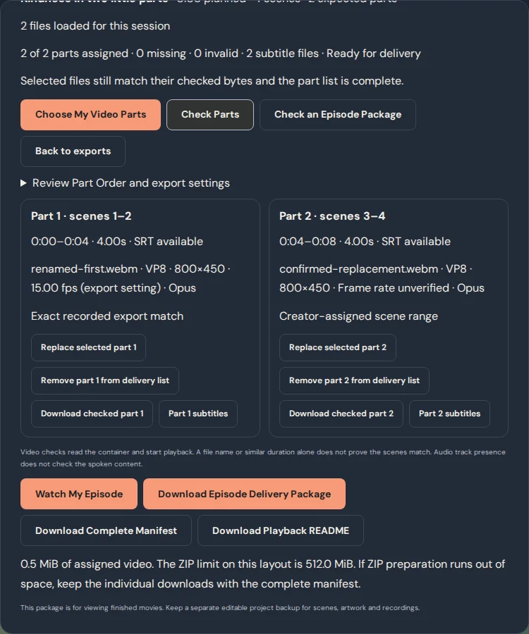
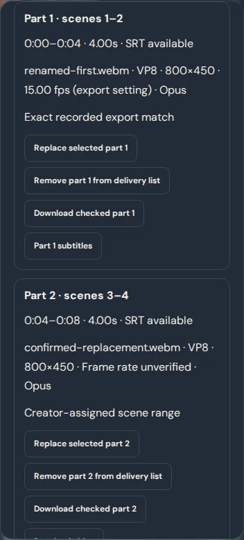

# Complete Episode Delivery Studio

## Audit and reuse

| Existing capability | How delivery uses it |
| --- | --- |
| `FinishCartoon`, `SegmentExports` and `planSegments` | The existing export modal and whole-scene ranges remain authoritative. Delivery returns to the existing export control for an individual missing part. |
| `video-export`, `webm` and `audio-engine` | The exporter, renderer and mixer remain the only way ChipToons creates movie frames and audio. Delivery reuses the WebM reader and existing browser playback probe. |
| `production` and `captions` | Part subtitles come from the existing SRT helper and use the original story timestamps. The timed text associated with the part can also play in the browser. |
| `storage` and complete episode backups | Finished movies stay separate from the editable project and original media. The same project schema and IndexedDB version 6 are used. |
| The long episode media test | Independent frame and sound decoding still covers all ten genuine exports. The test also collects those exact downloaded files for delivery verification. |

A finished delivery archive contains numbered movies and viewing files. Keep a separate **Project backup** (`.ctepisode` or project JSON) to reopen editable scenes and original sources.

## From exports to a complete delivery

1. Open **Finish My Cartoon**. Export and download each numbered whole-scene segment. The existing exporter allows up to 60 seconds per part on phone layouts and 120 seconds on larger layouts. If a scene exceeds that limit, shorten it or export on a larger layout.
2. In the same dialog, choose **Prepare My Complete Episode → Choose My Video Parts**. Select the downloaded WebM files. A download status does not tell the browser whether those files are still on your device.
3. The studio checks the WebM track information, starts playback in the current browser, compares duration with the plan, and reads the bytes to compute SHA-256 and CRC32. It also compares codec, resolution and known frame rates across parts. Duration can differ from the planned range by up to one second due to the recording boundary. The track or an exact export receipt may provide a nominal frame rate. Otherwise the rate is shown as unverified. An audio track being present does not establish the quality or contents of that recording. Playback checks the start of the file, and the watch-through is the place to review the rest.
4. An exact export receipt identifies the bytes and scene range from the same project revision. If the receipt is unavailable, a filename only suggests a place. Preview the file and confirm its assignment yourself. Clear unexpected or duplicate files from the list. Use **Add missing part**, **Replace selected part**, or **Re-Export Missing Part** to fix a specific gap. If the plan differs on this device, open **Review Part Order and export settings** and enter the original limit.
5. **Watch My Episode** plays the files in planned order. You can pause, replay, pick a different part, or toggle the separate subtitles when available. Only the current video is loaded. The handoff can briefly pause as the next WebM opens.
6. **Download Episode Delivery Package** saves the checked WebM files, range-relative SRTs, `part-order.json` and a playback README. **Check an Episode Package** reads an existing delivery ZIP, validates its structure, scene order, track metadata and checksums, and lets you watch those parts. Checking is local and does not import editable creative work.

If exporting again with different subtitles, use the same project revision to keep the new SRT aligned with the picture. When opening older downloads without a receipt, the studio can check their structure and timing, but you confirm what actually appears in them.

## Limits and joining feasibility

- Delivery is session-only. Closing the finish dialog releases selected file references and preview URLs. Returning to exports inside the dialog retains the delivery list. The browser stores only small export receipts keyed to the project revision. If receipt storage is unavailable, you can still assign verified files manually.
- The classic ZIP writer stores original bytes without recompression. Verification accepts the bounded, uncompressed ZIP format produced by ChipToons. It rejects unsafe paths, overlapping entries, malformed headers, extra files and checksum mismatches. Hashing reads at most 2 MiB of a file per chunk. Package checks do not authenticate the creator or certify that each scene was correctly assigned.
- Each part must be a playable VP8 or VP9 WebM under 81 MiB. Supported audio track metadata is Opus or Vorbis. The archive budget is 256 MiB on phone-width layouts and 512 MiB on larger layouts. Actual device memory and download space can be lower. For a large delivery, download the complete checksum manifest and playback README and keep the individual WebM and SRT files together.
- The optional **Make One Complete Movie** action checks compatible Chromium VP8 parts and prepares a seekable local WebM. The original playlist and ZIP continue to work with the original files. [Single-Movie Builder](SINGLE_MOVIE_BUILDER.md)

## Workspace and media evidence

| Desktop | Phone viewport |
| --- | --- |
|  |  |

The short proof exports two genuine voiced WebMs, intentionally leaves a gap, restores it, watches in order with subtitles, and checks the resulting ZIP again. An independent ZIP reader and FFmpeg verified the archive, decoded frames and sound, and confirmed the video and subtitle checksums. [Measured short-episode results](episode-delivery/short-episode-media-proof.json)
