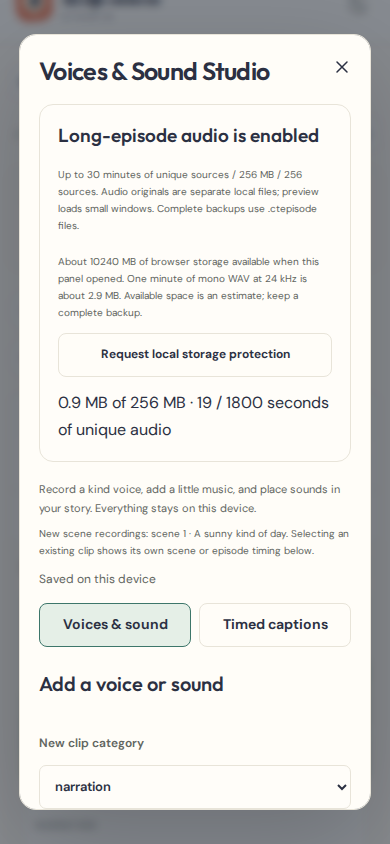
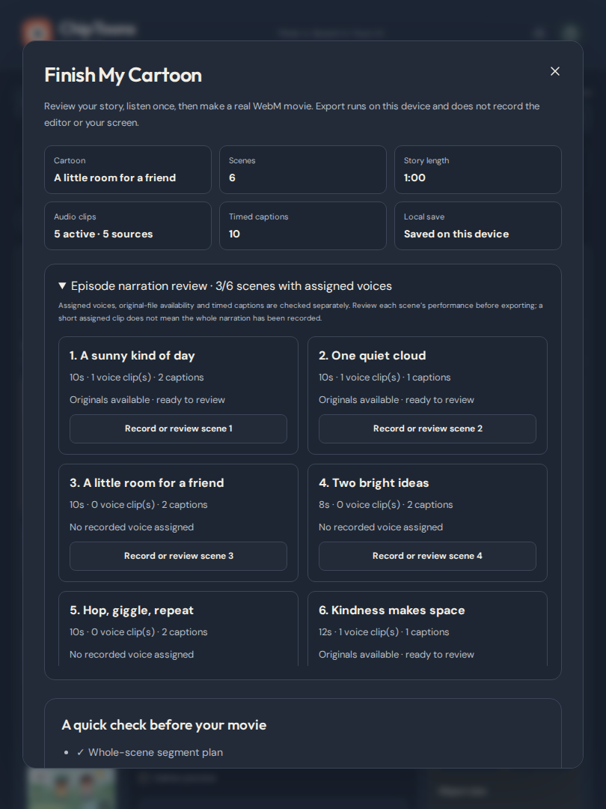

# Make and keep a narrated episode

ChipToons can keep at least twenty minutes of distinct narration in one editable project when the browser has sufficient storage and memory. Export creates **numbered WebM parts**. Matching VP8 parts can be combined with the [Single-Movie Builder](SINGLE_MOVIE_BUILDER.md). Everything stays local: no account, server upload, paid speech service or automatic recording.

## A practical twenty-minute workflow

1. Start a thought/sketch/image story. Use **Story chapters** to plan an opening, introduction, challenge, exploration, helpful resolution and closing lesson. Add reviewed scene batches and set actual durations. A duration goal is a plan; it does not generate finished speech or footage.
2. Open **Voices & Sound → Enable long-episode audio**. This atomically preserves existing recordings as separate local originals. Wait for the enabled heading and **Saved on this device**. The panel reports original bytes, source seconds and estimated free browser space. You can explicitly **Request local storage protection** where offered. A browser may decline; keep backups either way.
3. Select a scene, seek to the desired point and reopen Voices & Sound. Choose narration or dialogue; dialogue can name its character. Press **Start microphone recording** only when ready, then **Stop recording**. Listen, name the take and **Save audio clip**. Each microphone take is at most sixty seconds. Permission is requested only at Start; closing releases the microphone.
4. Alternatively **Upload voice, music or sound** in sections of at most 120 seconds / 12 MiB each. Sixty different twenty-second sections provide twenty minutes of original narration. Mono WAV at 24 kHz is about 2.9 MB per minute (about 57.6 MB for twenty minutes); stereo/high-rate WAV uses more. MP3, Ogg and finite-duration audio WebM may be smaller if the browser can decode them. Uploaded bytes are preserved. Recorded takes are normalized to portable mono WAV.
5. Select **Audio clip** to adjust scene/episode scope, start, play length, trim points, volume, fades, looping and character association. **Original audio source** listens to one unchanged source; cartoon preview plays its edits. **Replace selected audio** retains the earlier original. Other scenes keep their clips. Use a different clip when two scenes need different timing.
6. Add original gentle music/effects. Episode music can loop across scenes. Use **Lower music under recorded voices** and the existing mixer. Enter captions in **Timed captions**, listen, and adjust their windows. Generated caption drafts are text templates, not transcription. Mouth states remain manually timed animation.
7. **Finish My Cartoon → Episode narration review** lists every scene's voice assignments, caption count and missing local originals. **Record or review scene N** opens that scene's voice controls. A short assigned clip does not prove all its narration is complete; listen to the performance. Missing audio blocks movie export until recovered.
8. Use **Project backup** before exporting. File-backed projects download a complete **.ctepisode** package; small legacy projects still use JSON. Keep this editable master somewhere outside browser storage. It includes every referenced original, including unused retained project sources, artwork, chapters, animation, clip settings, mixer and captions.
9. Export and download whole-scene **Segment 1, Segment 2…** in order. Limits remain sixty seconds per file on phones, 120 seconds on wider screens. A twenty-minute story with sixty twenty-second scenes makes twenty phone parts or ten desktop parts. Keep the tab visible and device awake. Each part uses original animation/audio time, including trimmed music offsets and captions. Download its SRT and the part-order manifest if useful.
10. On My cartoons, **Restore a backup** accepts JSON or .ctepisode. A package is fully checked before a new project and its files are committed together. The existing story is never overwritten. Wait for restoration progress and Saved. Practice reopening a restored copy before clearing site data.

## Recovery you can act on

- **Storage is low/full:** keep the open editor. Download a complete package, free space outside ChipToons, then retry. Estimates are advisory; writes still fail safely if the actual quota is exceeded. Restoring needs space for another full copy. A package may need substantial download memory on a small device; keep source recordings separately too.
- **Save failed:** the last committed project remains intact. Open changes remain on screen, with backup/retry controls. Wait for Saved before reloading. The dashboard back button awaits a save. A browser crash can lose changes made since the last successful save.
- **Missing original:** restore a complete package as a separate project or replace the affected clip with its original file. If saving prevents returning to My cartoons, **Restore backup as a new copy** in the save-error banner opens the backup picker directly. A reference-only JSON cannot recover missing recordings. Readiness checks availability; playback/export/backup additionally check content integrity and decoding when used.
- **Invalid/interrupted restore:** the entire import is rejected. Existing projects/files are unchanged. Cancellation before the atomic transaction finishes also leaves no partial restored project.
- **Interrupted movie:** reopen Finish My Cartoon and retry just the affected segment. Downloaded movies stay in Downloads. Rendering status is recoverable for the same saved project revision; movie blobs are not saved inside the project or episode package.
- **Browser cannot record WebM:** keep the complete project and SRT; use a current supported Chromium browser for the verified exporter. In-app browser voice preview is never recorded into movies.

Sources removed from a project, replaced takes, cancelled recording drafts already stored locally, and originals belonging to deleted projects are deliberately **retained on this device**. This protects other project copies, undo and recovery; removing them does not reclaim disk space. Complete project backups include all sources still listed in that project, not unreferenced historical files or other projects. There is no automatic orphan cleanup or recovery-file browser yet. Back up every project and the separate art library before deliberately clearing site data. One editing tab per project is recommended; cloud sync and cross-tab conflict resolution are not implemented.

## Budgets and memory

| Resource                      | Long-episode mode                                                 | Legacy JSON mode                      |
| ----------------------------- | ----------------------------------------------------------------- | ------------------------------------- |
| Total source duration         | 30 minutes, counting unused retained sources                      | 5 minutes                             |
| Original audio bytes          | 256 MiB per project                                               | Within the 64 MiB JSON budget         |
| Sources / clips               | 256 / 480                                                         | 24 / 240                              |
| Each original                 | 12 MiB, 120 seconds, mono/stereo                                  | Same                                  |
| Each microphone take          | 60 seconds                                                        | Same                                  |
| Simultaneous clips / captions | 24 / 1,000                                                        | Same                                  |
| Scenes / artwork              | 120 scenes, 40 art assets, existing image limits                  | Same                                  |
| Project/art metadata          | 64 MiB                                                            | 64 MiB total JSON                     |
| Complete package              | Bounded to approximately 320 MiB plus a 1 MiB container allowance | JSON or package when containing files |
| Movie                         | 60s phone / 120s wider screen; 80 MB encoded limit                | Same                                  |

Twenty minutes of narration leaves roughly ten minutes of the source-duration allowance for different dialogue, music and effects. Reusing/looping an existing source does not add its duration again. Long mode does not promise every phone can hold all these upper bounds.

Opening a file-backed project does not fetch or decode its audio. Preview prepares eight-second windows, prefetching at most one future window about five seconds ahead. It uses the same Web Audio scheduling and deterministic timeline as export. Only sources overlapping the window/range are decoded. A 64 MiB LRU reuses buffers; each prepared range also checks estimated and actual decoded bytes against 64 MiB. Active scheduled buffers and browser encoder/media memory are additional, so this is a cache/range bound, not a whole-process RAM guarantee. A heavily overlapping mix of long originals can require shorter sections even if only a small portion is audible. Late preparation stops with an actionable error instead of silently dropping sound.

Exports retain one completed preview. Closing/replacing it revokes its URL. Source previews revoke their URLs on change/close, metadata probes clean up immediately, pending preview scheduling is cancelled on edits/seek, and the finishing cache clears on close. The voiced demo now loads only when explicitly opened; dashboard planning does not preload its embedded speech.

See [package format and migration](EPISODE_PACKAGE.md), [audio controls](AUDIO_PRODUCTION.md), [creator walkthrough](CREATOR_GUIDE.md) and [PR #6 verification](PR6_VERIFICATION.md). The movie builder preserves short recording lead-ins from the original parts. Physical-device microphone, memory, thermal and Safari export testing remain necessary.
