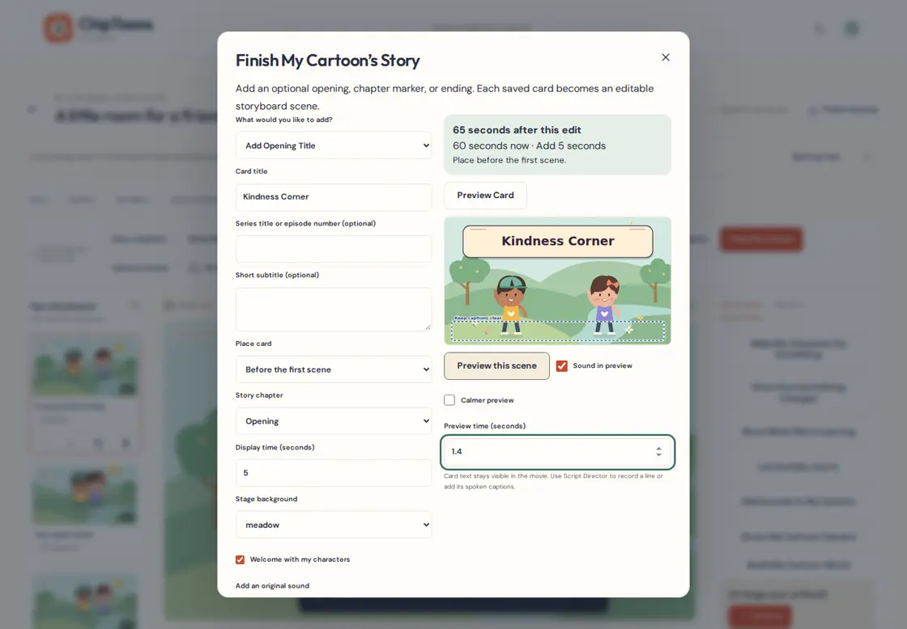
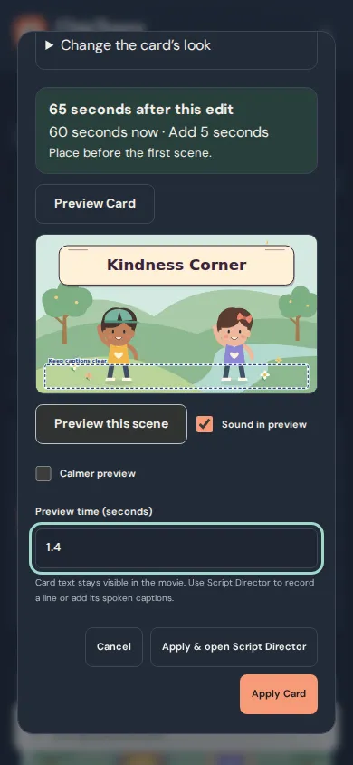
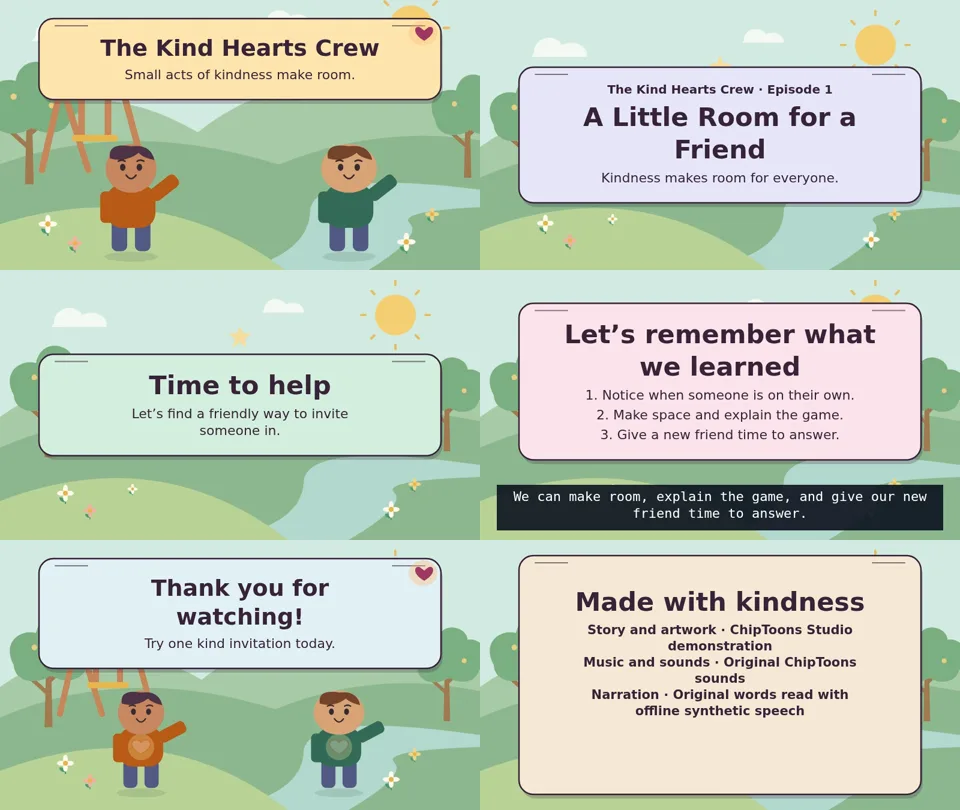

# Episode Titles, Lesson Recaps & Credits Studio

## Foundation audit

PR #21 is merged into `main` at `2d33143`. Both required [Studio checks](https://github.com/larrinamsalva/ChipToons/actions/runs/41925714504) passed, including 294 browser tests and independent verification of the complete 20-minute narrated episode and its ten WebM parts.

- Story chapters already label ordinary storyboard scenes, and **Story chapters** already inserts reviewed scenes. There is no authored opening, recap, or credits card. Dedicated cards will be normal scenes, with an explicit insertion point and a reviewed runtime.
- Stage is shared by the editor, ScenePlayer, ScenePreview, Shot Director, and SVG-to-canvas WebM export. Story cards will be native SVG in that Stage. The existing camera, characters, scene transitions, timing, and export remain in charge. Composition will reserve space for the existing caption bands.
- Script Director and Voices & Sound already author recordings, captions, and clips. Card text is visual. An ordinary scene can separately receive narration and captions. The current mixer will schedule any selected original sound.
- Series Studio already resolves episode identity by a linked project ID and saves revision-guarded series plans. Reusable presentation preferences will be optional suggestions. Applying one copies it into a normal project scene.
- Project history, IndexedDB v6, project schema 4, JSON, and .ctepisode already preserve optional validated scene metadata. No new store or separate delivery workflow is necessary.

## Give the story a beginning or ending

1. In the editor toolbar, choose **Finish My Cartoon’s Story**. The same action is available from **Finish My Cartoon**.
2. Choose an Opening Title, Episode Title, Chapter Card, What We Learned Recap, Thank-You Ending, or Creator Credits. Each card is optional. The studio inserts one ordinary scene at a time.
3. Choose a location in the storyboard and review the actual display time. Use the chapter menu for the story section. A linked series can suggest the actual series name, episode number, and title. A standalone cartoon can enter them manually.
4. Choose a background or an original saved background image. For a greeting or goodbye, invite up to two characters already in the project. Their wave and heart use the existing animation tools. After applying, arrange them with ordinary scene controls or frame them in **Direct My Cartoon Camera**.
5. Set a style, font, size, alignment, text color, paper color, and border. Preview the card and inspect the running-time change before you apply. The studio flags weak contrast and text that needs more space. Use **Cancel** to discard the draft. After applying, use the ordinary Undo, Redo, move, duplicate, and delete controls.
6. Use **Apply & open Script Director** to add a title narration, a recap, or a spoken goodbye. A card can be silent or add one of the original sounds. Adjust the sound’s trim, volume, fades, and timing in **Voices & Sound**.

## Recaps and accurate credits

- Add up to three short learning points. Pick an existing **Teach It Step by Step** entry to copy its wording, then change it if needed. A missing or changed source prompts review and preserves the saved recap.
- Leave credit roles blank or choose a suggested role and edit it. Enter only the names and sources you choose to publish. An optional license name and HTTP(S) URL are drawn as text. Use material you have permission to include.
- A still credits card fits short lists. Choose slow scrolling and allow the recommended time for longer lists. A recap followed by credits uses two independently editable scenes. A Thank-You Ending can show text alone or a character goodbye.
- From **My Cartoon Series → Overview → Opening and ending defaults**, save style, optional background art and opening sound, ending format, and role placeholders. Linked episodes offer these as suggestions. Applied cards carry their own independent settings and copied artwork. A series-plan backup contains preferences and artwork references. A complete episode backup includes the artwork actually used.

## Timing, accessibility, and export

Existing scene clips, animation and captions keep their scene-local timing. When you insert a card, later project-wide clips move with the story. A looping music bed spanning the insertion can continue through it. If a project-wide voice, effect, or non-looping music clip spans that spot, the studio asks you to choose another position or assign that sound to an existing scene. Scene reordering and removal still use the ordinary storyboard tools.

The existing Stage paints the cards into playback and WebM frames, including numbered parts and the joined movie. Titles and credits are separate from SRT. Authored speech captions keep their original timing and take priority in the caption band. Preview observes reduced-motion settings. In calmer preview, titles settle immediately and long scrolling credits can be inspected in stationary views with the time input. Export uses the selected authored animation. Fonts use local browser font families.

Optional scene cards and series preferences use project schema 4 and IndexedDB version 6. Existing projects and backups keep working. Prefer a complete `.ctepisode` backup for an episode with original recorded media. Card text and art remain independently editable after restoration.

The demo includes original ChipToons artwork, the existing Kind Hearts Crew puppets, original music and effects, and new offline-synthesized narration from original dialogue. It can be opened from **Try a complete episode with opening and credits** on the dashboard. The creator can replace the narration with a recording in Script Director.

## Working preview

## Independently decoded movie frames

Read across each row. These frames come from the 69-second example’s two genuine VP8/Opus exports. The media proof checks readable text, moving characters, scrolling credits, the spoken recap’s subtitle band, and audible opening music and narration. It independently compares the joined movie with both source parts, preserving their order and frames.
