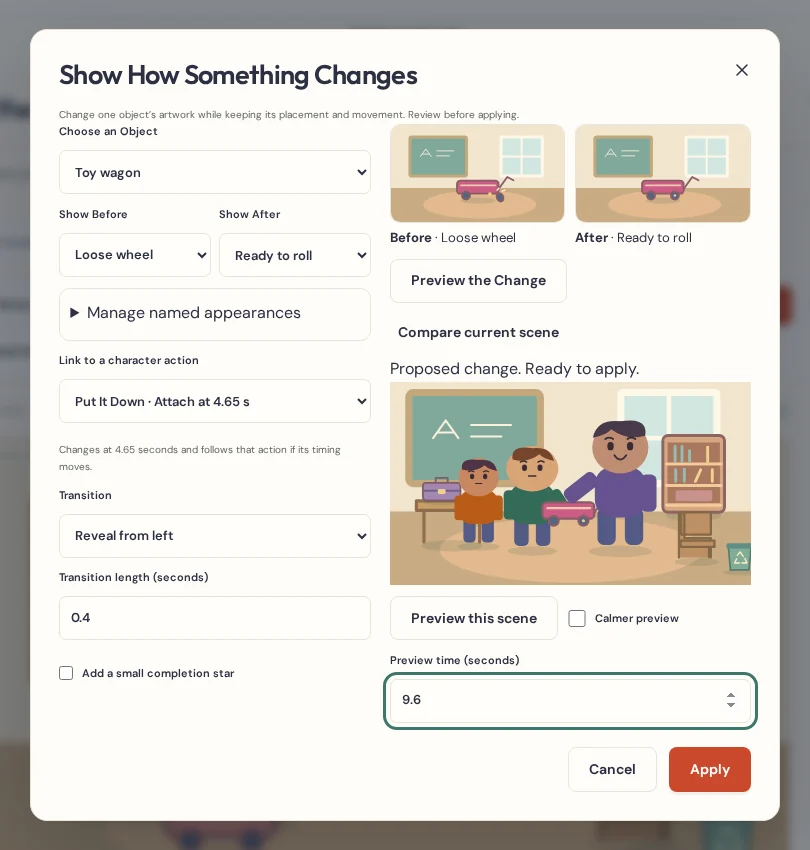
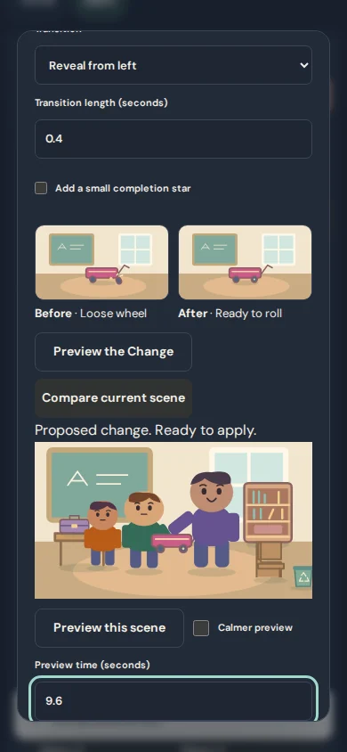
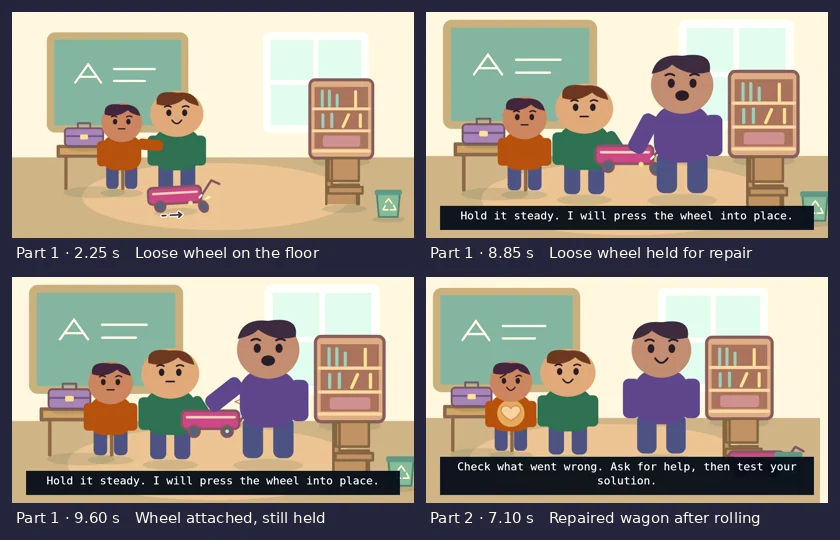

# Fix, Build & Transform Studio

Use **Show How Something Changes** to show a toy getting fixed, a tabletop getting tidied, or a drawing taking shape. The scene keeps the same object and its placement. Its artwork can change while it is on the ground or in a character’s hand.

## Create a before and after

1. Open **Edit scene** if you see the mobile tabs, then choose **Show How Something Changes**.
2. Use **Choose an Object** to select an existing prop, scenery item, drawing, or image. Add artwork in the existing Art Library first if the scene needs an object.
3. Use **Show Before** to choose how the object starts the scene and **Show After** to choose the appearance at the change. The preview tiles show the appearance just before this particular event and the finished result.
4. Open **Manage named appearances** to change a label, add a state, restore the original artwork for a state, or select another image. Each object can hold four named appearances.
5. Enter **Change at This Time** or link a moment from an existing interaction with that object. Choose an instant switch, a short fade, or a reveal from left. A small completion star is optional.
6. Select **Preview the Change**. Play, pause, seek numerically, or compare with the current scene. Select **Apply** to save one undoable edit. **Cancel** discards the scene draft.

## Reuse artwork and edit timing

**Choose artwork from my library** uses the existing Art Library. A scene takes its own copy of any imported pixels, drawing data, and crop. When a state uses an editable drawing, **Edit a copy of the artwork** opens the existing Drawing Pad on a separate copy. For a flat picture, choose a separate before and after image or draw a replacement. **Save appearance to Art Library** deliberately saves that artwork as an individual reusable entry. Timings and learning steps stay with the scene. Changing a saved entry later leaves earlier episodes alone.

The appearance track in the existing animation timeline has a star marker for each change. Open a marker to edit its timing or remove it. States used by the scene start or a remaining event must be reassigned before removal. The list supports up to 16 changes per object. **Restore the original object** removes the appearance track after confirmation and keeps the prop’s underlying artwork and motion. Short fades dim one artwork, switch at the dimmest point, and return to full opacity. Reveals uncover the new artwork with a clip. Both render a single object.

When you link an interaction cue, changes to that cue move the appearance marker with it. If you delete the interaction, the appearance change stays at the last cue time. Overlapping changes on the same object need different times or shorter transitions before Apply. Removing a scene object clears its track, with Undo available. Replacing the scenery affects the scene’s copies and leaves the World Builder source alone.

## Teach a practical skill

Open **Write My Episode Script** and expand **Teach It Step by Step**. Use the seven starter prompts or write your own steps. Choose a scene time, an interaction event, or an appearance change. You can link a numbered script line and open it using the same Script Director. **Check this moment in the scene** opens the existing Stage preview so you can see whether the animation illustrates the words. Steps remain editable directing notes. Recording, approved takes, narration timing, music, and captions use the existing production controls.

The dashboard’s **Try a Fix, Build & Transform example** gallery contains four editable cartoons:

- **Helping Hands and the Wobbly Wagon** shows a loose wheel, a grown-up helping with a safe hand adjustment, a visible repair while the wagon is held, then a gentle roll test. Shine’s heart glows and the narrator explains the lesson. The six original sample voice clips are prerecorded synthetic audio made locally for the example.
- **Clean Up Together** turns a cluttered tabletop into a clear work surface while the helpers tidy.
- **Watch a Seed Grow** shows a planted seed, a sprout, and a mature flower. Time-lapse captions make clear that the story skips days and weeks.
- **Finish a Paper Bridge** switches a paper bridge from unfinished to assembled and moves a lightweight toy across it.

Keep examples age-appropriate. Show a trusted adult where help is needed and use simple toy parts, paper, or other familiar materials. The studio animates changes a creator chooses. Real-world repair, collision physics, and automatic editing of a single photo are outside its scope.

## Foundation audit

| Existing system | Reused behavior |
| --- | --- |
| art-model, Art, SceneryArt, Drawing Pad | Existing vector props and raster crops stay the foundation. Only the affected original prop silhouettes gain optional variants. Original drawing documents still edit in the Drawing Pad. |
| library, world-model, project backups | Copies artwork using the existing content-based snapshot logic. A saved world retains its base art. Artwork chosen for a state is embedded in the project and stays available when a library entry disappears. |
| interaction-model, interaction-motion, Interaction Studio | Uses the existing object ID, puppet hands, timed events, and handoff rules. Appearance changes are a separate visual channel on the same object. |
| Stage, timeline, Animation Timeline | Uses the existing playhead, camera, layer ordering, SVG drawing, and shared frame sampling. The appearance lane adds markers to the same timeline. |
| Script Director, production, video-export | Links steps to existing script lines and cues. Recorded speech, original effects, caption timing, and the deterministic Stage-to-WebM renderer continue through the existing exporter, Episode Delivery, and Single-Movie Builder. |

The project stays at schema 4, IndexedDB stays at version 6, and the complete episode package stays at version 1. Older projects need no migration. Scene copies remap the relevant state, change, action, object, and script IDs. If a linked cue or line is removed, the written learning step is preserved. Older app builds may show the underlying object appearance and movement without the new changes.

## Export evidence

The wagon test exports two genuine, voiced WebM segments. An independent FFmpeg decode samples the loose wheel on the ground, the loose and fixed states while the object is held, its release, and the wagon after it rolls. The checks locate the wagon body and wheel in each decoded frame and check for extra copies. Episode Delivery and Single-Movie Builder use the same two files. The joined output is checked against both sources for video frames and sampled audio. The original narrated 20-minute production proof remains part of CI.

