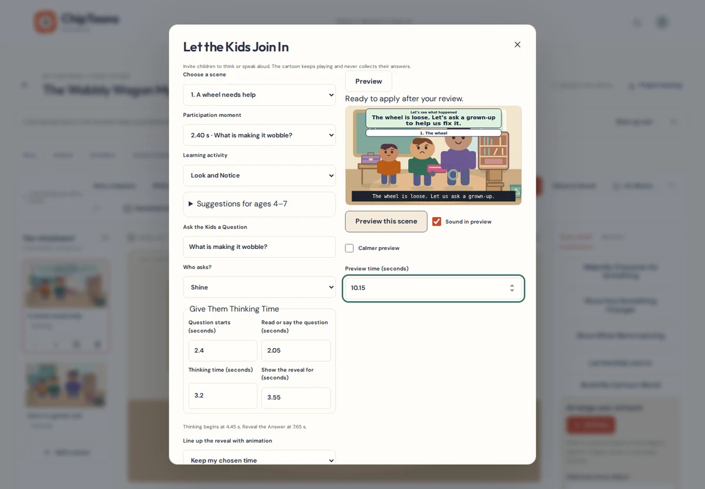
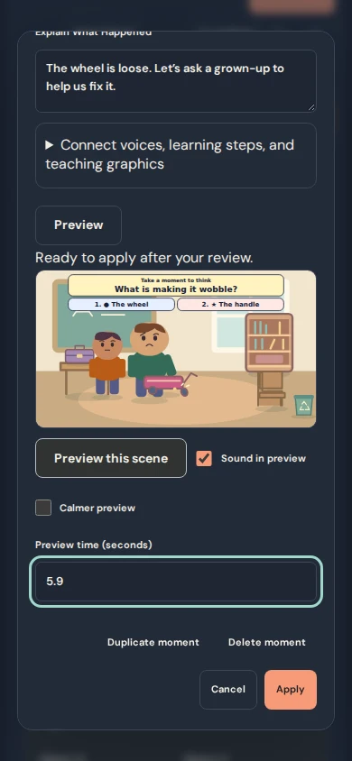
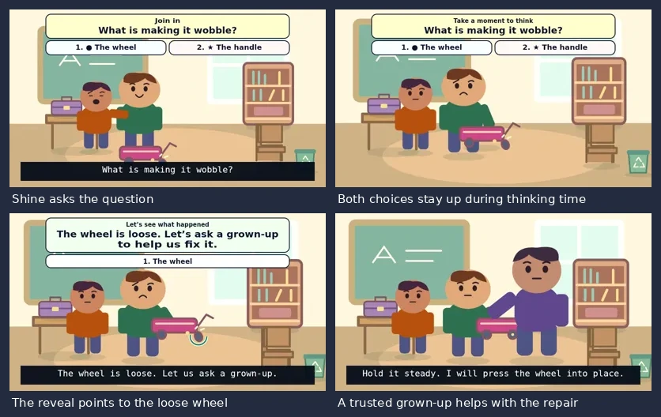

# Pause, Think & Try Studio

Invite young viewers to look, predict, speak aloud, or practice a safe action while the cartoon keeps playing.

## Make a participation moment

1. Open **Edit scene → Let the Kids Join In**, or select **Plan a participation moment** on a saved step in **Teach It Step by Step**.
2. Pick the scene and activity. Enter a short question and choose the narrator or a character in the scene.
3. Set when the question starts, how long it takes to say or read it, and how long viewers have to think. The thinking interval is 3–10 seconds. The reveal starts as soon as that interval ends.
4. Add a positive explanation. For a factual question, two or three short choices can have a small icon. Choose the option to show in the reveal and give a reason in the explanation. If you add a note for that option, it appears with the reveal.
5. **Preview** the moment and check the card, character actions, and spoken captions. Play from the question or enter a precise preview time to inspect a phase. Select **Apply** once you’re ready. **Cancel** discards the draft and **Undo edit** reverses the saved change.

If a moment runs past the scene end, use **Draft a dedicated participation scene**. It inserts a new scene only on Apply. The original scene, timing, recordings, and animation stay as authored. A participation marker in the existing animation timeline opens the saved moment for editing, duplication, or removal.

## Pick an activity

| Activity | A starting point |
| --- | --- |
| Look and Notice | Ask what children can see. Reveal the detail with an existing circle or arrow. |
| What Happens Next? | Invite a prediction, then show the outcome and explain what changed. |
| Choose a Helpful Idea | Compare two or three practical choices. Explain why one is safer or kinder. |
| Let’s Try Together | Invite one safe action, such as a slow breath or counting objects. |
| How Would You Feel? | Show one kind possibility and make room for different feelings. |

The editor suggests concrete words and familiar objects for ages 4–5. It suggests comparisons, reasons, and simple sequences for ages 6–7. Use these ideas to build on earlier Kind Hearts Crew lessons. Existing series plans stay independent.

## Record questions and responses

Open **Connect voices, learning steps, and teaching graphics**. Link an existing script line, or choose **Add missing words to Script & Voice Director when I apply**. Use **Open Script & Voice Director** on the saved moment to record, import, or choose a take. The wording is editable on the card and in the script. The studio never creates a recording on its own.

**Use question recording timing** copies the selected clip’s start and reading duration to the draft. Recording warnings identify timing that falls outside the question or reveal and other speech in the thinking interval. Use **Sound in preview** to listen to the existing mix. Adjust the recordings through the audio timeline and keep the thinking interval clear of unintended speech. Music and idle animation can continue.

## Connect the reveal to a lesson

Select a learning step and use **Match reveal to learning step** when the scene has time for the question and pause first. The step may point to an existing interaction or appearance change. You can open the exact step in Script Director. If its timing changes later, the moment keeps its saved seconds and prompts you to review the difference. **Line up the reveal with animation** can also copy a time from existing action, appearance, camera, or character keyframes.

Choose an existing **Teaching graphic on reveal** to show it for that phase. It keeps its authored target, style, and camera behavior. Unlinking restores its own timing. The combined limit is three visible teaching graphics or participation cards at once and one spotlight. Leave room for an unlinked graphic to return to its own timing. A moment can be edited independently of its script and art.

## Examples and real video

The dashboard opens independent, editable examples for the Wobbly Wagon, seed care, kind words, and the paper bridge. The wagon example reuses the existing demo voice recordings. It asks what makes the wagon wobble, offers two choices, leaves a 3.2-second thinking interval, highlights the loose wheel, and shows the trusted grown-up helping with the repair before the wagon is tested.

The Stage draws the question, choices, and reveal with the same instruction-card renderer used by Visual Teaching. Scene playback, episode playback, WebM parts, Episode Delivery, and Single-Movie Builder use that same art. Captions remain a separate layer and the cards avoid their authored band. Preview the whole moment to check faces, hands, and moving props.

FFmpeg independently decodes a real WebM export for the evidence below. The media test checks the question and both choices, measures the quiet thinking interval between spoken clips, and checks the reveal, caption, and moving wheel. It also compares the decoded picture and sampled audio in the joined movie against its two original parts.

## Privacy and safe activities

Viewers can think or speak aloud as the cartoon plays. A WebM cannot listen, receive choices, or score a response. ChipToons adds no collection of children’s answers, voices, names, locations, or profiles. Recording tools remain available to the creator and use the existing local recording workflow.

Keep questions about the story. Leave out private information. Choose safe practice such as naming a feeling, counting, or taking a slow breath. In a repair story, show a trusted adult handling work that needs supervision. Participation is an invitation to practice, with no grade or claim of mastery.

## Foundation audit and compatibility

| Existing feature | How Pause, Think & Try uses it |
| --- | --- |
| Scene model and story chapters | Optional scene-local participation records sit alongside the existing script, learning steps, and graphics. Dedicated scenes use storyboard insertion and history. |
| Script & Voice Director and audio mixer | Stable script IDs point to existing takes and normal audio clips. Preview uses the shared audio clock and the same mixer as export. |
| Teach It Step by Step and object transforms | Existing step and action times are available to line up the reveal. Puppet gestures, object attachments, expressions, hearts, camera, and appearance changes keep sampling normally. |
| Visual Teaching, Stage, and captions | The shared SVG instruction-card renderer draws the phases. An existing circle or other focus graphic may use the reveal window. Timed captions and SRT retain their original wording. |
| Timeline and project history | Existing scene time drives the participation markers and Apply/Undo. Moments retain their saved seconds during duration edits. A shortening that would cut off a moment is rejected until the creator moves or removes it. |
| WebM and episode backups | The same Stage reaches the established exporter and delivery pipeline. Metadata travels in schema 4 project backups and version 1 complete episode packages. IndexedDB 6 remains unchanged. |

The scene’s moment is the source of truth for the question, thinking interval, reveal, and participation card. The card is derived at render time. No second graphics record or copy of the artwork is created. A scene copy receives new moment IDs and remaps its local script, learning-step, and focus references. Removing a source detaches the link and leaves the question and timing available for review.

Participation cards always use the same accessible palette and a compact top layout. In scenes with top captions, the card moves below the caption band. Review this placement over the animation. Choices and reveal text are limited to short phrases. No database migration is needed.
