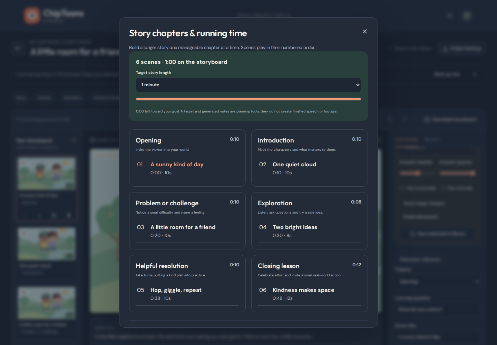
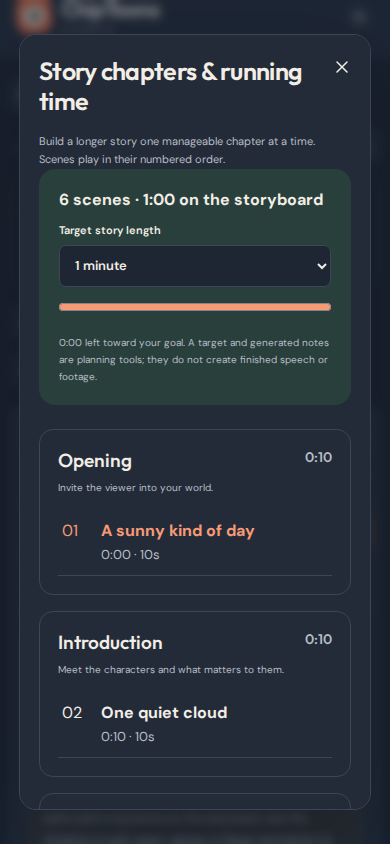
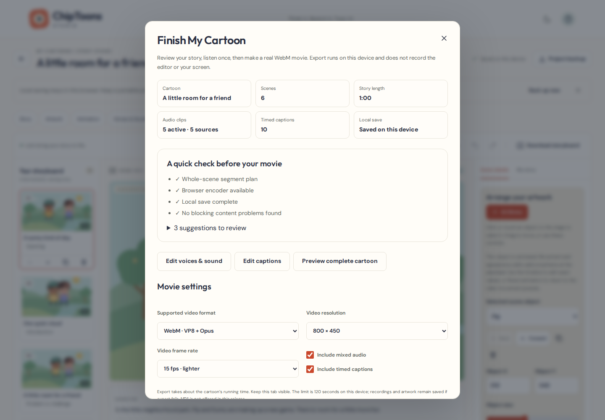
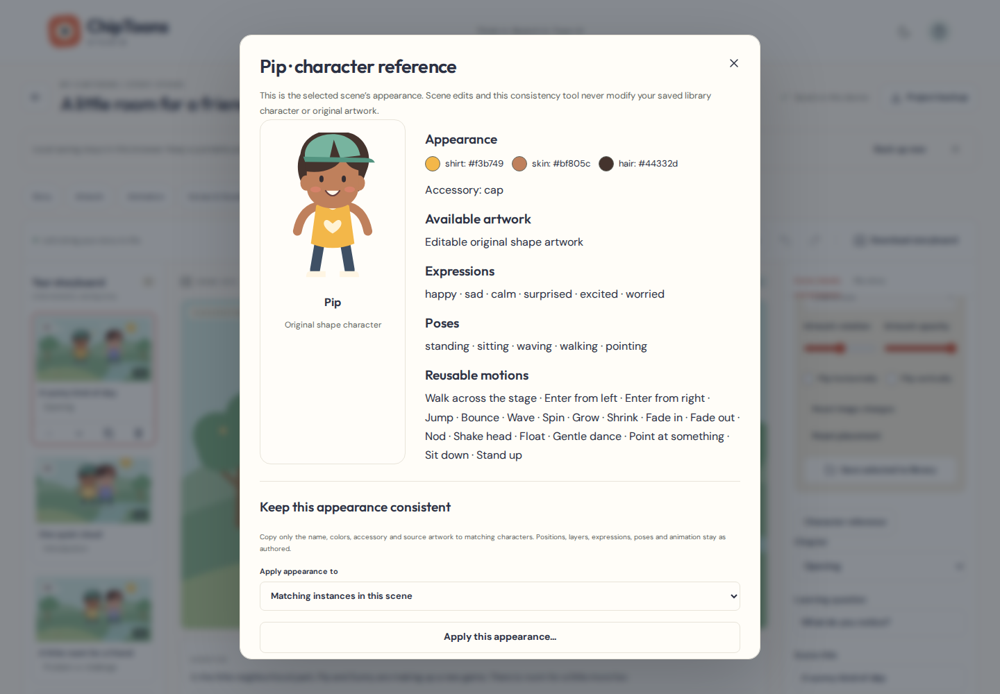

# PR #5 — Creator Experience & Longer Storytelling verification

The creator flow is **guided thought/sketch/image → editable scene/chapter plan → local project and art library → animation/audio preview → whole-scene WebM parts → downloads and portable restore**. All editing, original media, recording, planning and encoding remain in the browser. No login, paid API, server upload or second animation engine was added.

The [recorded full verification run](https://github.com/larrinamsalva/ChipToons/actions/runs/41562947610) passed **93 unit tests and 134 Playwright cases**, with **zero failures, skipped cases, flaky cases or retries**. TypeScript, ESLint and production build passed. [Machine-readable measurements and retained-file hashes](creator-verification.json) identify the exact recorded commit; follow-up branch commits run the same full workflow before review. The existing 78 unit tests, 87 creator browser cases and four original export proofs remain in the suite.

## What is complete

- Guided thought, sketch and image workflows, manual artwork role selection, Back/Next flow, editable per-scene notes, Save Draft/Edit Later, and an immediate draft-backup escape hatch after quota errors.
- Six story chapters, actual versus planned running time, 1–12 reviewed new scenes per batch, chapter assignment, learning questions, numbered navigation and preserved old scene/media data.
- Character reference with supported appearance/artwork/expressions/poses/motions; confirmed consistency changes copy appearance without touching scene positions, layers, acting or library sources.
- Twelve original educational starters, including differences, personal-information requests, nature and household responsibility; eight-step tutorial with buttons opening working tools.
- Original gentle sound additions, clear clip/source status, audio preview, quick fades and shared deterministic music ducking.
- Readiness checks, optional-warning acknowledgement, missing-resource/timing/capability guidance, low-storage estimates, backup reminders, unsaved-navigation protection and portable art-library/palette copy restoration.
- Whole-scene WebM segment planning, exact range selection, ordered durations, independent cancellation/retry, one-preview memory policy, recoverable same-revision range/status, segment-local SRT and an order manifest. Source project data remains unchanged.

## Coverage

| Browser project                  | Cases | Coverage                                                                                                                                           |
| -------------------------------- | ----: | -------------------------------------------------------------------------------------------------------------------------------------------------- |
| Chromium desktop, 1440×1000      |    39 | All existing creator flows plus wizard, chapters, consistency, recovery, long project and new-dialog accessibility                                 |
| Chromium phone, 390×844, touch   |    39 | Same workflows, mobile panels, existing touch timeline/stage operations and no horizontal clipping                                                 |
| Chromium tablet, 810×1080, touch |    39 | Same workflows and tablet layout                                                                                                                   |
| Firefox desktop                  |     3 | Wizard draft/reload, chapter navigation/editing, portable project/SRT downloads, actual encoder detection, dark library/tutorial and accessibility |
| WebKit desktop                   |     3 | Same selected compatibility workflows; unsupported WebM recovery                                                                                   |
| WebKit phone layout              |     3 | Selected compatibility workflows at 390×844 with touch                                                                                             |
| WebKit tablet layout             |     3 | Selected compatibility workflows at 810×1080 with touch                                                                                            |
| Chromium media export            |     5 | Four retained original proofs plus actual consecutive segment decoding                                                                             |

Native dialogs support Escape and focus return. Automated WCAG A/AA scans cover new chapter, reference and tutorial dialogs in both themes, alongside the existing dashboard, library, timeline, voices, captions and finishing checks. Numeric timing/position inputs, native selects and keyboard alternatives complement dragging. Automated scans do not establish complete assistive-technology compatibility.

Firefox reported one supported WebM format in this runner. WebKit reported zero, correctly disabled movie encoding, and retained working project/SRT downloads. This is capability detection coverage; Firefox and WebKit movie encoding were not decoded in this release.

## Genuine movie evidence

No recorder mocks were used for these proofs. Playwright drove the production build, waited for real MediaRecorder output, played and sought the resulting videos, then used FFprobe and FFmpeg to inspect/decode them. Microphone workflow tests use Chromium's synthetic test microphone, never a person's microphone.

| Export                               | Actual duration | Decoded frames | Picture                         | Sound           | RMS / peak        |
| ------------------------------------ | --------------: | -------------: | ------------------------------- | --------------- | ----------------- |
| Original complete friendship cartoon |     60.171609 s |            898 | VP8, 800×450                    | Opus            | 0.04364 / 0.95045 |
| Short mixed cartoon                  |      4.159274 s |             61 | VP8, 800×450                    | Opus            | 0.07726 / 0.81450 |
| Muted cartoon                        |      4.159274 s |             61 | VP8, 800×450                    | Opus, silent    | 0 / 0             |
| Captions/audio unchecked             |      4.188299 s |             90 | VP9, 1280×720, requested 24 fps | No audio stream | —                 |
| Scene segment 1                      |      4.191201 s |             59 | VP8, 800×450                    | Opus            | 0.02981 / 0.43491 |
| Scene segment 2                      |      4.170884 s |             61 | VP8, 800×450                    | Opus            | 0.03256 / 0.34223 |

Encoded frame counts vary with real-time browser scheduling; the renderer's timing and memory safeguards remain enabled. The original full 60-second movie proof is still mandatory. The [original friendship viewing excerpt](friendship-preview.webm) remains available.

[Play calibration segment 1](segment-proof-part-01.webm) and [segment 2](segment-proof-part-02.webm). These small permanent proof files deliberately use a magenta original raster marker so position/camera results can be measured, with original demo speech, a trimmed looping melody and numbered timed captions. They are calibration fixtures, not replacement story content.

The two parts cover scenes 1–2 and 3–4 of the original eight-second fixture. Tests verify:

- Whole-scene plans cover every scene exactly once; unit cases also partition a 1,200-second story under both phone/desktop limits. Oversized scenes produce actionable warnings and no partial plan with dropped content.
- At the sampled frame, expected artwork X positions were **242.5 / 526.5**. Decoded magenta centroids were **242.5 / 525.5** pixels, verifying animation and camera transforms at the original times.
- Actual decoded music frequencies were **349 / 440 Hz**, matching the different expected original-timeline notes (**349.23 / 440 Hz**). Restarting the music at the beginning of part 2 would fail this check. An assigned speech clip crosses the segment boundary.
- Burned captions appear in their intended windows and disappear afterward. Part 2's SRT starts scene 3 at **00:00:00,250**, scene 4 at **00:00:02,250**, and contains no scene-2 cue.
- Cancellation retains original art/audio/animation; the affected segment can be retried independently. Portable project data before and after export is deeply equal.

Each file includes about 0.15 seconds of encoder startup lead, reflected in actual durations. This is independent playback, not gapless concatenation. No uninterrupted 20-minute video, MP4, offline or accelerated encoder is claimed.

## Measured long-project behavior

A synthetic **120-scene / 1,200-second / 40-asset / eight-elements-per-scene** project was imported, navigated to scene 120, edited numerically, autosaved and backed up in each Chromium layout. Twelve thumbnails were retained in the scene list. The fixture uses small raster assets; it is not a large-photo or physical-device memory benchmark.

| Layout        | Import plus visible editor | Scene title edit and reflected stage label |
| ------------- | -------------------------: | -----------------------------------------: |
| Desktop       |                     650 ms |                                     147 ms |
| Phone layout  |                     566 ms |                                     122 ms |
| Tablet layout |                     810 ms |                                     125 ms |

These are individual CI-run observations, not device speed guarantees. Tests require the measured edit to stay below two seconds. Thumbnail paging bounds visible scene SVGs to twelve; memoization keeps unchanged thumbnails from rerendering during another scene edit. The player also limits its scene strip and offers direct scene navigation.

Part exports preload only referenced artwork and overlapping audio. A 64 MB decoded-buffer LRU reuses sources across consecutive parts and clears when the review closes. One completed movie preview is retained; replacement/close revokes its object URL. Actual recording output remains capped at 80 MB, with the existing slow-frame/interrupted-clock safeguards. The production build still reports the inherited large main-bundle warning, largely from bundled demo speech; lazy demo-media loading is a useful future improvement.

## Persistence and migration

Project schema remains **4** and IndexedDB database version remains **2**. Optional `chapter`, `question`, `creationSource`, `templateId` and `mixer.duckMusic` fields have explicit validation. Older schema-4 projects need no rewrite. The tested **1→2→3→4** chain remains importable without changing source artwork, scene coordinates, durations or legacy motion.

New tests verify detached artwork reuse, preserved acting/layers during consistency edits, scene batch preservation, saved/reloaded chapter/source data, portable art-library copies and palettes, complete import rejection before writes, and transaction rollback on quota errors. Project backups continue embedding all required artwork/audio/animation. Library backup restore never overwrites existing entries or touches project stores. Export checkpoints have their own version and project-revision guard; they do not change the creative project or store movie blobs.

## Known limits and useful next work

- Physical iOS/Android/Safari microphones, touch accuracy, memory pressure, thermals and background-tab behavior remain untested. Automated browser builds and touch/viewport emulation are not real devices. Broader screen-reader/manual keyboard testing is also worthwhile.
- Movie files remain 60 seconds maximum on phones / 120 seconds on larger screens. The complete 20-minute episode has not been encoded end-to-end on physical hardware. Tests prove twenty-minute planning/editing and exact range partitioning, plus actual short consecutive movie parts and the original full one-minute movie.
- Existing media budgets remain: 24 audio sources, 300 seconds total decoded source duration, 240 clips, 40 art assets, 120 scenes and 64 MB project imports. Long timelines can reuse sources, music loops and captions; extended unique narration may require separate episode/chapter projects.
- Template notes need the creator's pacing, acting, recordings and editing. A duration goal does not generate finished footage. Learning questions are editable notes; add their spoken/caption timing deliberately.
- WebKit WebM encoding was unavailable in the runner. Firefox only has capability detection here. Validate real device encoders before claiming broader export parity.
- Exported files stay in Downloads, not in project JSON. A “Downloaded” status records the button action and cannot inspect the download folder. A new creative revision resets export status. Low-storage estimates are advisory.
- Cloud sync, cross-tab conflict resolution, AI interpretation/rigging, automatic lip-sync/transcription, voice cloning, MP4 and automatic movie joining remain outside this change. Useful next work is real-device testing, deliberate long-form narration storage, lazy demo-media loading and optional joining after a genuinely tested encoder exists.

The Pages base remains `/ChipToons/`; deployment still runs only for verified `main`. Feature and PR checks do not deploy or merge automatically. See [Creator Guide](CREATOR_GUIDE.md), [Audio Production](AUDIO_PRODUCTION.md) and [Roadmap](ROADMAP.md).
