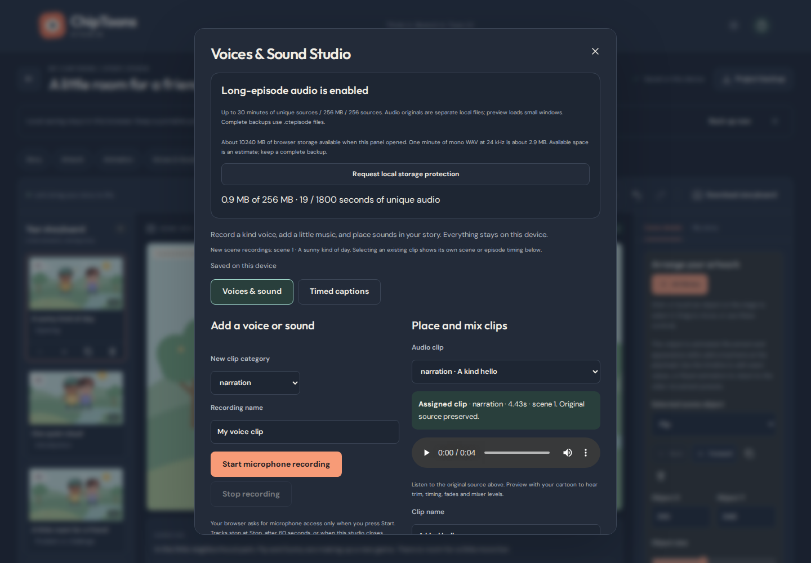
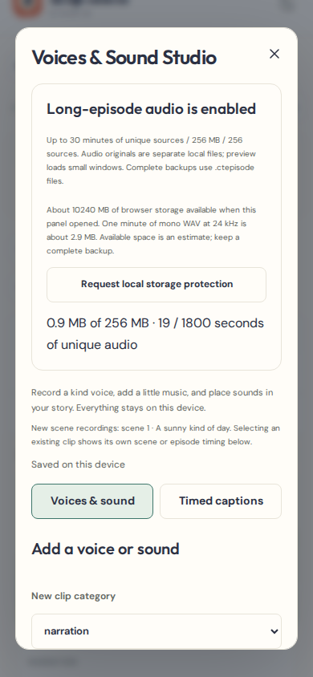
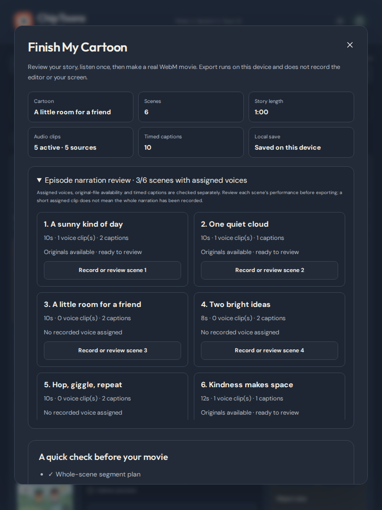
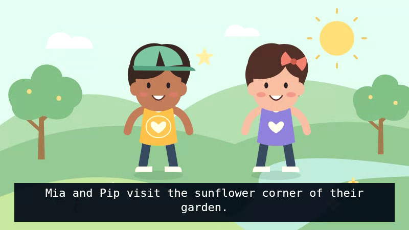
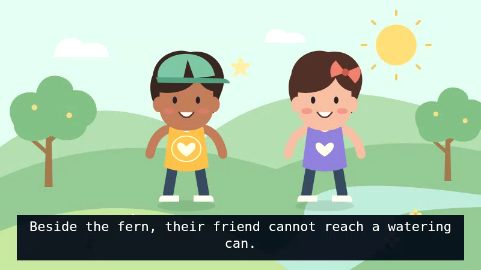
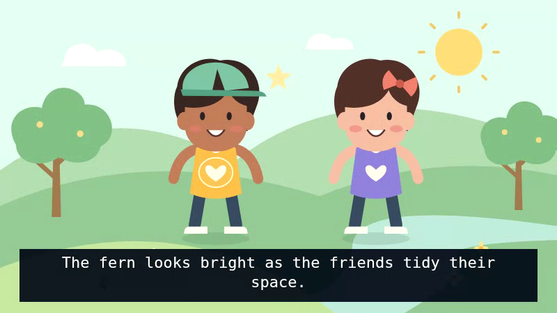

# PR #6 — Long-Form Narration & Reliable Episode Production

[The complete verification run](https://github.com/larrinamsalva/ChipToons/actions/runs/41577239374) passed **113 unit tests, 153 Playwright regression cases and one complete twenty-minute production proof**, with **zero failures, skips or retries**. TypeScript, ESLint and the production build passed. The WebKit binary-storage preflight also passed. The verified implementation is commit **26b5f86f0cf7695e4aa8f231dbec26f94cf2cc68**; subsequent evidence/documentation commits retain the same application and test code.

[Machine-readable measurements and retained-file hashes](episode-verification.json) identify that commit and the original artifact digests. [Read-only evidence extraction](https://github.com/larrinamsalva/ChipToons/actions/runs/41579959031) retained the screenshots, decoded frames and packet-preserving viewing excerpts. No recorder mocks were used for media proofs. Microphone workflow tests use Chromium's synthetic test device, never a person's microphone.

## Completed behavior

- Enable long-episode audio without destroying old inline originals; record/upload scene voices, associate dialogue with characters, preview/replace individual clips and retain editable timing, trims, fades and mixer settings.
- Thirty minutes of source duration within 256 MiB /256 sources /480 clips. Source limits remain 12 MiB /120 seconds, microphone takes sixty seconds and simultaneous clips twenty-four.
- Immutable binary originals, indexed metadata checks and atomic conversion/restoration. Project opening does not decode its audio. Preview uses small windows, range memory limits and a bounded LRU with the established mixer/clock.
- Complete checksummed .ctepisode backups, fresh project/file keys on restore, pre-write integrity/graph validation and transaction rollback. Earlier JSON backups and the existing migration chain remain supported.
- Scene voice/caption/original review, direct scene navigation, explicit missing-file blocking/recovery, estimated available space, optional storage protection and backup progress/cancellation.
- Existing numbered 60s/120s exports, segment-local captions, independent retry and original-timeline offsets. Lazy voiced-demo loading reduces the main entry bundle from roughly 1,073 kB to 486 kB; the separate 610 kB example chunk loads on request.

## Browser and accessibility coverage

| Browser project | Cases | Coverage |
| --- | ---: | --- |
| Chromium desktop, 1440×1000 | 44 | All prior creator workflows plus file-backed recording, replacement, complete restore, quota/missing-file recovery and accessibility |
| Chromium phone, 390×844, touch | 44 | Same workflows, mobile panels, touch/keyboard alternatives and no horizontal clipping |
| Chromium tablet, 810×1080, touch | 44 | Same workflows and tablet layout |
| Firefox desktop | 4 | Creation, chapter editing, saving, complete package recovery, checksum fallback, accessibility and actual encoder detection |
| WebKit desktop | 4 | Selected compatibility workflows including binary-original/package persistence |
| WebKit phone | 4 | Same selected workflows at phone/touch dimensions |
| WebKit tablet | 4 | Same selected workflows at tablet/touch dimensions |
| Chromium media regression | 5 | Four original proofs plus consecutive-part calibration |
| Chromium complete episode | 1 | Full twenty-minute restoration, preview, retry, all ten real exports and independent decoding |

Automated WCAG A/AA scans cover the new voice/readiness interfaces in light/dark modes alongside the existing editors. Numeric inputs, native selects, labeled buttons and direct scene navigation complement dragging. Manual desktop inspection included reopening a previously saved file-backed project after the database upgrade and checking direct navigation to an unrecorded scene. Automated scans do not prove complete assistive-technology compatibility.

Firefox reported one supported WebM format; WebKit reported none and correctly retained package/SRT downloads while disabling unsupported movie encoding. Genuine encoding/decoding is verified in Chromium. Automated WebKit and viewport/touch emulation are **not physical iOS/Android/Safari tests**.

## Complete twenty-minute fictional episode

The original engineering fixture, **Mia and Pip's Garden of Welcome**, contains:

- Sixty twenty-second scenes, six chapters and editable original shape animation/camera movements.
- Sixty different narration files totaling **1,200 source seconds**, with deliberate response/reflection pauses; actual spoken narration is **561.444 seconds**, not twenty minutes of continuous speech.
- Six additional character dialogue recordings, one original melody and one gentle effect: **68 distinct sources**, plus **186 captions**.
- A complete **58,821,217-byte package**, with original art, animation, audio, captions, chapter organization and timing.

The scripts and generic Flite voice are generated offline for verification; the application does not offer automatic voice generation. This is a reproducible production fixture, not a promise that entering a duration produces finished educational footage.

The browser imported the package, saved/reopened it, downloaded a complete backup and restored that backup into fresh browser storage with independent project/file keys. All original hashes and creative fields survived. Before preview, **zero AudioContext decodes** had occurred. Twenty-five seconds of preview crossing a scene boundary decoded only **5 sources /51.91 source seconds**. Seeking to 600s and 1,100s brought the cumulative count to **7 /91.91 seconds**, without decoding the intervening episode.

An initial segment was cancelled and retried independently. Every part then used the original timeline. Segment SRT downloads matched the expected original caption ranges exactly; final backup data and original-file hashes equaled the pre-export backup.

## Actual complete-part measurements

All ten files contain **VP8 video at 800×450** and **non-silent Opus audio**, requested at 15 fps. Each yielded 120 distinct one-second decoded frame samples. The complete story covers logical time 0–1,200 seconds exactly once.

| Part | Scenes | Original timeline | Container duration | Decoded frames | Audio RMS |
| --- | --- | --- | ---: | ---: | ---: |
| 1 | 1–6 | 0–120s | 120.171972s | 1801 | 0.08339 |
| 2 | 7–12 | 120–240s | 120.169070s | 1801 | 0.08495 |
| 3 | 13–18 | 240–360s | 120.169070s | 1801 | 0.08213 |
| 4 | 19–24 | 360–480s | 120.169070s | 1801 | 0.08404 |
| 5 | 25–30 | 480–600s | 120.169070s | 1801 | 0.08214 |
| 6 | 31–36 | 600–720s | 120.180680s | 1797 | 0.08814 |
| 7 | 37–42 | 720–840s | 120.180680s | 1800 | 0.08890 |
| 8 | 43–48 | 840–960s | 120.180680s | 1796 | 0.09098 |
| 9 | 49–54 | 960–1080s | 120.169070s | 1800 | 0.08461 |
| 10 | 55–60 | 1080–1200s | 120.209705s | 1796 | 0.08017 |

Total decoded frames: **17,994**. Total independent-file container time: **1,201.769067 seconds**, including each file's startup lead. These are separate playable movies, not gapless joins.

For **every one of sixty narration sections**, actual decoded Opus was compared to its original PCM waveform. Correlations ranged from **0.995891 to 0.998225**; all measured the same **0.163219-second encoder lead**. The measurement searches sample-level timing and refines fractional offsets; an independent known-delay/unrelated-sound calibration test prevents false matches. The correlation/timing assertions were retained. Burned captions share the renderer clock; SRT preserves logical part-local times.

[Play the beginning excerpt](episode-sample-part-01.webm), [middle excerpt](episode-sample-part-05.webm), and [final-part excerpt](episode-sample-part-10.webm). These five-second excerpts remux the original encoded packets; they are not editor recordings or generated mock videos.

The [complete episode report artifact](https://github.com/larrinamsalva/ChipToons/actions/runs/41577239374/artifacts/13205193086) retains every full WebM part, the portable project, decoded frames and report for fourteen days. The excerpts, images, fixture source and measurements here remain in the repository after artifact expiry. Reproduce with **npm run test:episode** and FFmpeg/FFprobe with Flite.

## Original regression media proofs retained

The original full friendship demo exported again as a **60.160-second** VP8/Opus movie with **900 decoded frames**, RMS **0.043638** and peak **0.950452**. Short mixed, muted and 720p/24fps VP9 proofs also passed; the muted PCM remained zero and the audio-disabled file had no audio stream.

The retained consecutive-part calibration measured original-timeline music at **349 /440 Hz**, correct raster/camera positions and caption windows, source preservation and segment-local SRT. This separately catches restarted music offsets. All prior drawing, library, animation, migration, backup, storage-error and long-project responsiveness assertions remain in the suite.

The [regression report artifact](https://github.com/larrinamsalva/ChipToons/actions/runs/41577239374/artifacts/13204652010) contains the full browser matrix, screenshots and original media proofs.

## Compatibility and original preservation

Project schema remains **4**, with explicit optional **mediaVersion 1**. IndexedDB upgrades **2→4**, adding media storage and an identity index while preserving project/library/palette stores; readable experimental version-three Blob records are also supported. WebKit's Blob/File persistence failure was reproduced and fixed by storing new encoded payloads as ArrayBuffers. Multi-source writes keep one bounded read/write in flight inside one atomic transaction. Normal saves verify index keys without loading encoded payloads.

Tests cover migration, native/fallback SHA-256, corrupted/truncated/trailing packages, missing/duplicate references, blocked capacity, cancellation while opening the database and while reading files, quota/interrupted writes, metadata-only saves, unchanged original bytes and rollback after a final metadata-save failure.

The tested **1→2→3→4 project-backup chain** remains importable. Old projects are not automatically converted. Fixture imports moved to the explicit voiced-demo wrapper so runtime template planning no longer preloads sample speech; old assertions were not weakened.

Complete backups include every listed source, even unused replaced takes. Removing sources/projects does not garbage-collect original files, protecting project copies and undo. Unreferenced draft/history files are not included in a project's package; orphan cleanup and a recovery-file browser remain future work. The separate art-library backup remains available.

## Remaining limits

- Independent WebM files remain sixty seconds on phones /120 seconds on wider screens, with a short startup lead. No MP4, automatic joining, gapless guarantee or uninterrupted twenty-minute movie.
- Per-source/microphone bounds, thirty-minute cumulative source budget, 256 MiB originals and 64 MiB project/art metadata remain enforced. The 64 MiB cache/range limits are not a whole-browser RAM guarantee; active nodes, storage, output Blobs and encoders use additional memory.
- Storage estimates/protection cannot guarantee durability. Keep complete downloaded backups. One editor tab per project; cloud sync and cross-tab conflict resolution are absent.
- Invalid duration/codec metadata fails explicitly. Captions and mouths remain manually timed; no automatic transcription, lip-sync, voice cloning or photo rigging.
- Physical-device microphone/touch accuracy, memory pressure, thermals, backgrounding and Safari export still need testing. Firefox/WebKit package compatibility is not a claim of movie-encoding parity.

The Pages base remains **/ChipToons/**. Feature/PR checks do not deploy; main publication waits for both regression and complete-episode jobs. MIT licensing, original media and the no-login experience are preserved. See [Episode Production](EPISODE_PRODUCTION.md) and [Package Format](EPISODE_PACKAGE.md).
