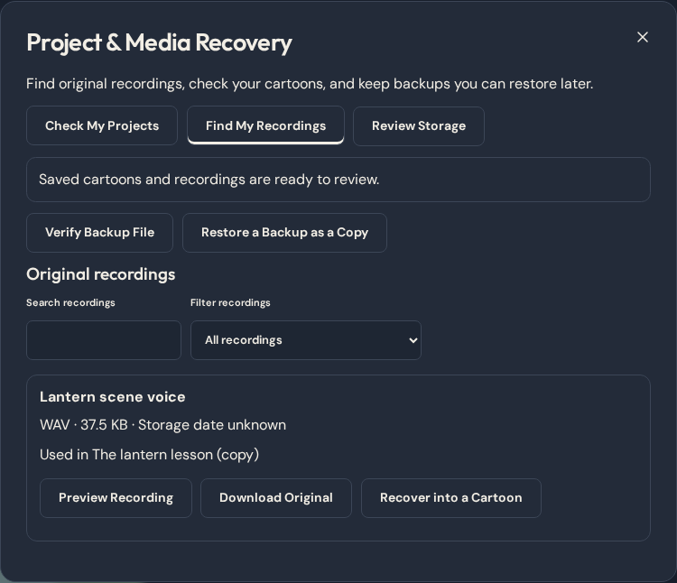
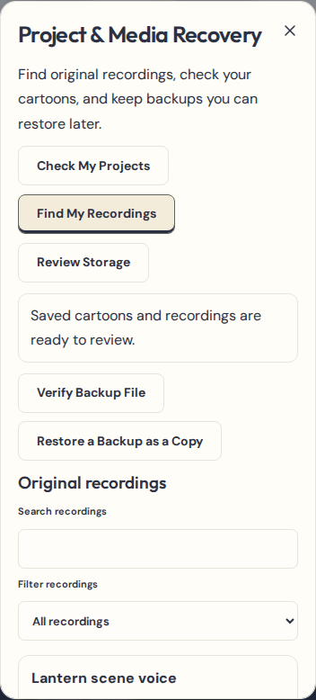

# Project & Media Recovery

From **My cartoons**, open **Project & Media Recovery**. Use it to check your cartoons, find original audio, verify a backup, or review storage.

## Saving and reopening

ChipToons keeps cartoons in the browser profile that created them. Wait for **Saved on this device** before leaving the editor. The back button waits for the local save to finish. A storage failure keeps the open draft available. Download your work while it is still on screen, or retry the save after making space.

Opening an already edited cartoon in a second tab shows the last saved version in **Open Read-Only** mode. Choose **Edit in This Tab** and then **Take Over Editing** if you want to move editing to that tab. The other editor keeps its draft on screen and pauses saving. Use **Save as a Separate Copy** to keep that draft as its own cartoon, or download its backup. Both versions remain separate for you to review. A closed tab releases its editing lock. Changes that had only existed in a tab at the time of a crash may be lost.

## Back up a cartoon

1. Choose **Check My Projects** to check the original recordings. The Recovery Center shows the last recorded successful save for newer writes and the saved version date for older cartoons.
2. Choose **Download Complete Backup** for the cartoon you want to protect. File-backed audio uses a checksummed `.ctepisode` file. Projects with embedded audio and artwork can use a JSON backup.
3. Keep the downloaded file somewhere outside this browser. Use **Verify Backup File** to check a chosen file without importing it. Episode packages check the project data and original hashes. Older JSON files get their existing format and data validation.
4. Use **Restore a Backup as a Copy** to reopen it as a separate cartoon. If a restore runs out of space or is cancelled before it commits, the existing cartoons and art library stay intact.

Verification checks the bytes you select. It cannot verify the safety of a drive or other external storage.

## Find and reconnect recordings

- Choose **Find My Recordings**. Search by recording name, format, or the title of a saved cartoon that uses it. Filters show used originals, unreferenced retained originals, or files that failed a check.
- Use **Preview Recording** to listen in the browser and **Download Original** to keep its bytes. Some formats may download even when your browser cannot play them. Dates describe when an original was stored, when known. Older recordings can lack a date or name, and the origin of an unreferenced original can be unknown.
- Use **Recover into a Cartoon**, choose a cartoon, and confirm **Add Original as an Audio Source**. Open **Voices & Sound** in that cartoon to use the source.
- In **Check My Projects**, select a missing or damaged source and choose the exact original from your device or a matching retained copy. ChipToons verifies the original’s format, size, and content fingerprint before reconnecting it. Existing clip placement, trims, fades, and captions stay in place. If the exact original is unavailable, restore a complete backup.

## Review storage and clean up manually

**Review Storage** shows an estimate where supported. Browser-wide site usage can include the art library and other site data. Per-cartoon estimates can include the same shared original in multiple cartoons.

1. Download complete backups for your important cartoons and copies of any originals you might want again. Deleting a saved cartoon retains its separate original audio files. Audio embedded in a deleted legacy project is part of that project’s backup.
2. Close open editors in other tabs before confirming cleanup. Select individual originals and choose **Review Cleanup** to see the file list and estimated bytes. You can cancel the preview without changing anything.
3. Choose **Permanently Remove Selected Originals** only when you are sure. ChipToons checks for open editors, rechecks references across all saved cartoons, and reports the files removed after the transaction commits. If saved references change, reopen the review.

An unreferenced original may still matter. ChipToons protects unfinished takes, originals with unknown saved history, invalid or damaged files, and originals still used by any saved cartoon. Cleanup never runs automatically. It does not delete projects or artwork.

## Browser and storage limits

Saving uses the existing project schema 4, optional media version 1, and episode-package format 1. The local database moves from version 4 to 5 to add recording metadata and guard project revisions. Existing project and media records stay in place and old project schemas still migrate on read. If the upgrade is blocked by another tab, close older ChipToons tabs and reload.

In browsers without tab coordination, the editor still detects stale saves against the stored revision. Permanent cleanup is disabled in those browsers because ChipToons cannot reliably rule out an open draft. Private browsing, browser eviction, and clearing site data can remove local work. A downloaded, verified backup kept outside the browser is the recovery path for those cases.

## Recovery Center on desktop and phone

