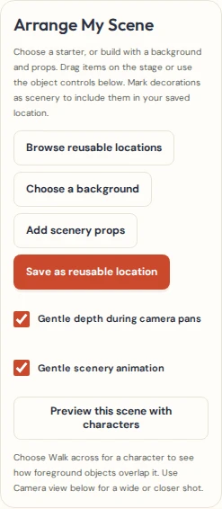
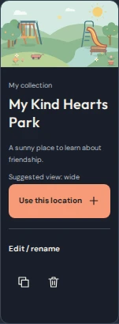
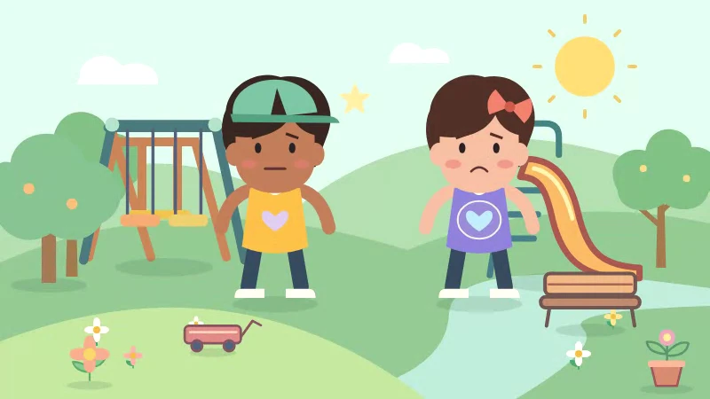

# Scene & World Builder

## Build and reuse a location

1. Open a cartoon and choose **Build My Cartoon World** in the scene editor. On a phone, open **Edit scene** first.
2. Choose **Browse reusable locations** to begin with one of six original locations, or choose a background and add scenery props from the Art Library. Imported illustrations and original drawings use the same library tools.
3. Select an object on the stage or in **Selected scene object**. Use **Scenery placement** to put it behind, alongside, or in front of the characters. Choose **Story prop (keep separate)** for an item you want to keep out of the location. Use **Move forward** and **Move backward** for finer ordering.
4. Move an object by dragging or entering its coordinates. Adjust its size and rotation in the existing artwork controls. The **Camera view** control sets the current shot.
5. Set a character’s **Object movement** to **Walk across** and choose **Preview this scene with characters**. Foreground scenery can cover the character as it moves. **Undo edit** and **Redo edit** work on these scene changes.
6. Choose **Save as reusable location** and add a name, description, collection and tags. The layout remains editable. Open the **Locations** tab to rename, duplicate, search, or delete a saved location.
7. In another episode, choose **Use this location** and review the replacement before confirming. You can then move individual props or save the edited layout as another location.

The six starters are **Kind Hearts Playground**, **Little Learning Classroom**, **Friendly Neighborhood**, **Helping Hands Workshop**, **Community Garden**, and **Cozy Family Home**.

## Series and backups

In **My Cartoon Series → Episode Plans**, select a **Reusable location for the opening scene**. Creating the episode takes an independent copy into its first scene and offers the location’s camera suggestion during draft review. Each episode can reuse the same location. Editing a template later applies to future placements. A project backup carries the scene’s copy, including any artwork. A library backup carries the reusable location itself. Series plan backups carry the location ID, so reselect a personal location after restoring a library backup as new copies.

Replacing scenery keeps the cast, story props, dialogue, captions, and audio. It keeps existing camera framing and authored camera tracks, clearing a follow target only when the targeted scenery is removed. A location stores its backdrop, marked scenery, editable transforms, suggested framing and optional ambient style. Character performances and episode-specific keyframes stay with the episode. The scene and library retain their existing object, asset and size limits.

## Audit and implementation

| Existing capability | How the world builder uses it |
| --- | --- |
| Editor, composition controls and undo history | The world panel opens the existing Art Library. Its selection, movement, dimensions, rotation and order use the existing composition controls and scene edit history. |
| Stage, background artwork, prop art and camera | Location thumbnails, scene preview, and genuine video exports all use the same Stage and SVG artwork. Layer order is the existing scene object array. Props are original vector artwork in the existing prop catalogue. |
| Drawing Pad, original image import and asset validation | Imported and drawn backdrops remain editable source assets. Locations copy the referenced raster or drawing data into each project using the existing asset placement path. |
| Timeline and background animation | Gentle scenery animation reuses the existing deterministic background styles. Optional layered depth offsets designated scenery during animated camera pans. Reduced-motion preview suppresses the additional drift. |
| IndexedDB, art library and backups | Locations are an additive artwork kind in the existing local library. Legacy project, series-plan, and library backups are still readable. There is no new database store or project schema version. |

Gentle depth is layered 2D scenery. It is off by default. Background items move slightly less during an animated camera pan, and foreground items move slightly more. The offset is deterministic and bounded so the animation exports as previewed at the same timestamp. A camera pan is available in the existing animation timeline.

## Browser and movie examples

| Arrange My Scene on desktop | Saved location on a phone |
| --- | --- |
|  |  |

