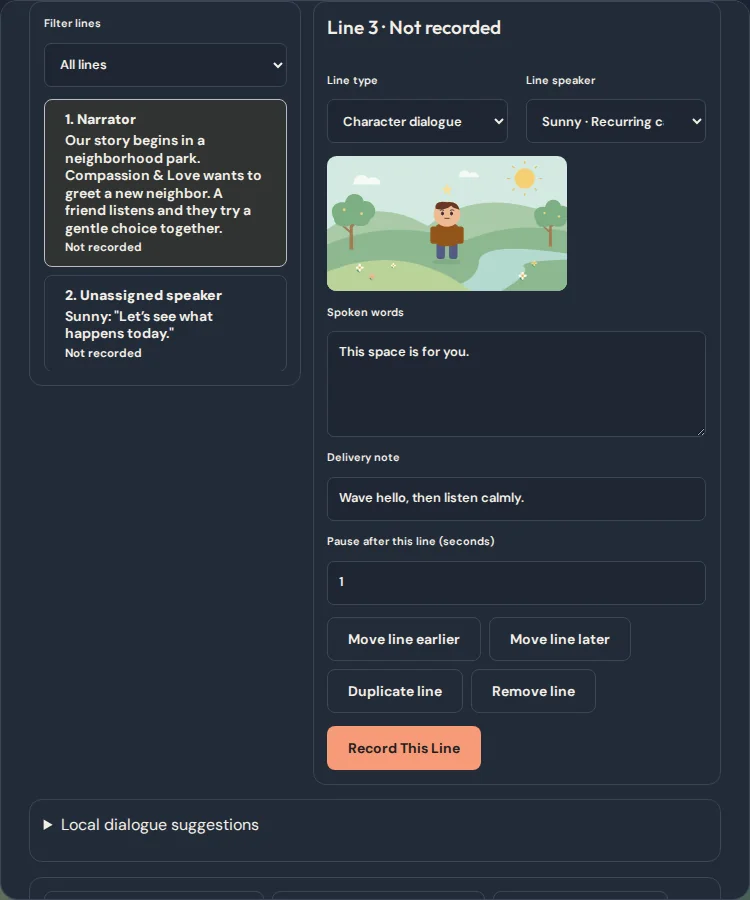
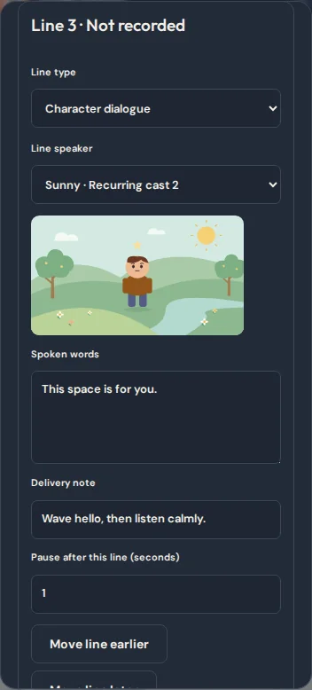
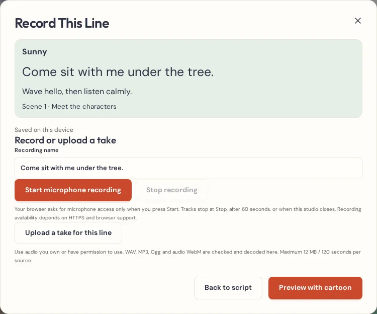
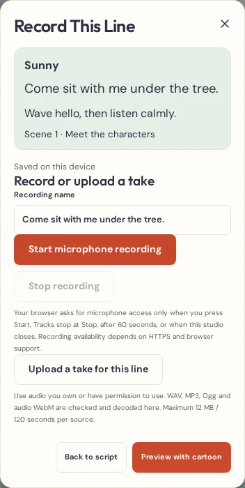

# Script & Voice Director Studio

## Foundation audit

This change starts at `f67619a`, the merge of the Series & Cast Continuity Studio.

| Existing capability | Integration |
| --- | --- |
| Episode plans and stable recurring cast IDs in Series Studio | Carry the series title and the existing cast identities into the episode. Use the episode's own character IDs for line assignments. |
| Cartoon Assistant and story chapters | Draft optional lines from the actual episode idea, cast, scene chapter, setting and lesson. Each suggestion is reviewed independently. |
| Scene narration and dialogue in the Editor | Keep both plain-text fields for existing readers. Once a scene uses numbered lines, edit those words from the script workspace. |
| Voices & Sound | Reuse its microphone permission, recorder, import, preview, trim, timing and mixing controls. Guided recording locks the line and its speaker when adding a take. |
| Audio vault, recovery, project revisions and undo | Save the whole edit through the same project session. Keep original sources when changing takes. |
| Captions, scene preview, readiness and WebM export | Use normal timed captions and one ordinary audio clip per preferred take. The same player and exporter render that clip. |
| JSON and complete episode backups | Validate the optional script metadata with the existing project graph. Both backup formats carry it. |

The overlapping prose fields in the Assistant and scene editor already serve different stages of the same workflow. Guided script editing uses that text and the existing templates. No separate recorder, story planner, timeline, cast library, or storage engine is needed.

## Editing and timing

Open **Write My Episode Script** from a linked series plan or the episode editor. Pick a scene, organize its existing words or add a new line. Organizing keeps the exact legacy text in one initial line per speech type. Existing speaker prefixes stay in that text until you edit them. Audio clips and captions already in the project stay where you put them. Assign speakers by selecting their episode character. Similar names appear in separate choices with their cast position.

After a scene has numbered lines, the numbered lines own its words. The scene details still show the plain narration and dialogue used by older readers. The app derives both fields together on each edit and rejects a backup with divergent fields. The normal editor history covers script edits. Earlier projects open without any automatic rewrite.

An episode can have up to 120 scenes and 80 lines in each scene within the existing project size and text limits. The timing estimate divides whitespace-separated words by a configurable 60–240 words per minute, then adds the default or per-line pause. Estimated speech, planned pauses, and actual storyboard time are shown separately. Review scenes that exceed their available time.

**Local dialogue suggestions** add editable, individual lines based on the episode idea, current chapter, cast, setting and lesson. Skip any suggestion. **Preview acting suggestion** uses supported actions on an unused character track and waits for approval. Your current animation and camera stay in place. **Add script caption drafts** uses clip times where present and the pacing estimate elsewhere. It fills open times and preserves existing captions. The timed caption editor can adjust every draft.

## Recording, voice continuity, and backup

**Record This Line** shows the speaker, exact text and delivery note. Start the microphone or upload an original recording, preview it, and save the take. This is the same microphone and validated file workflow as Voices & Sound. Return to the script to listen, choose the preferred take, or approve it. Only a real linked clip counts, and the studio shows when a save is pending or an original is missing. Leaving with an unsaved take requires an explicit discard. A new take starts near its estimated cue when it fits, and starts earlier when needed to give it room.

Each line can retain up to 12 takes within the project’s audio source budget. One clip per line reaches preview and export. Alternatives remain original sources, including when a preferred take is replaced. Changing takes retains clip placement and mix level, resets trim and fades for the new source, and leaves existing captions for review. Changing words, speaker, or delivery makes an earlier take need review. If you deliberately move or remove a linked clip in advanced audio editing, the line keeps its originals and needs review. Duplicate lines start without a recording. Duplicate scenes copy their line and clip IDs and share the existing originals.

For recurring performers, enter voice notes in **Recurring Cast**. Future episode drafts copy them by cast identity. Episode voice notes can be edited independently. Longer episodes can still enable the existing 30-minute audio-source storage mode from Voices & Sound.

Project schema stays at 4 and IndexedDB stays at 6. Optional scene script, pacing, cast voice notes and validated source references go into standard JSON or complete episode backups. No new stores or media format changes are needed. **Download script** writes a plain-text document. Keep a project backup to restore editable data and recordings.

**A Hello Heart** offers a short sample with two cast dialogue lines, a directing cue and an embedded narrator take. The narration is an original line rendered with the local CMU Flite synthetic voice in FFmpeg. It is a normal audio file used by preview and WebM export. The rest of the starter season remains editable episode plans.

The script does not transcribe audio or infer who recorded it. Check the timing against your spoken performance and review the independently editable captions before export.

## Studio screenshots

| Desktop | Phone viewport |
| --- | --- |
|  |  |
|  |  |
