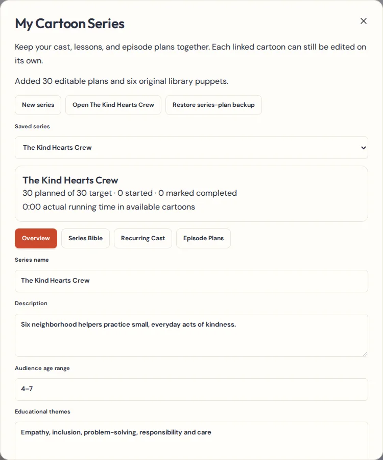
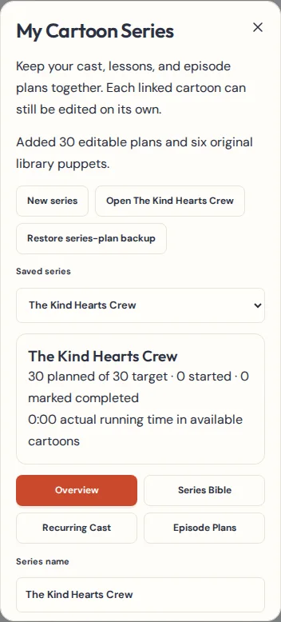
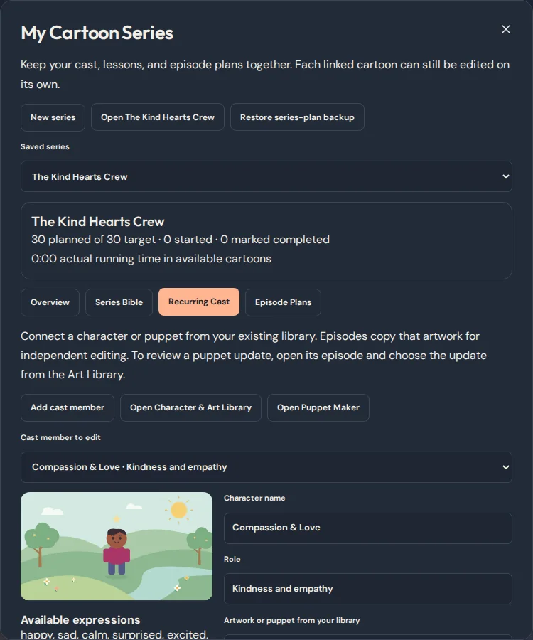
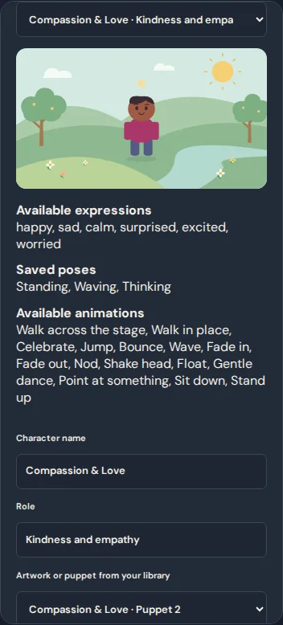

# Series & Cast Continuity Studio

## Foundation audit

This work starts at `5a11ede`, where the Puppet Maker and Idea-to-Cartoon Assistant are each merged once.

| Area | Existing implementation reused |
| --- | --- |
| Story planning | The Idea Wizard, artwork starts and Cartoon Assistant overlap as entry points for new stories. They produce the same project model. Series plans seed the existing Assistant and its scene and motion review. |
| Chapters and episode editing | The planner, chapter tools, Editor, timeline and stage already manage a single episode. Series ordering operates on plans only. |
| Cast and art | The Character & Art Library owns character artwork. Puppet Maker and Pose Studio own reusable rigs and poses. Library placement takes an independent snapshot for a scene. |
| Continuity updates | The editor already offers reviewed puppet updates through the Art Library. Episode creation uses the current cast sources, while finished episodes retain their own snapshots. |
| Production | Finish My Cartoon already checks scene readiness. The series uses those checks and counts linked project runtimes. |
| Storage, recovery and tab conflicts | Existing IndexedDB projects, revisions, recording protection, Recovery Center and episode backups remain authoritative. Series metadata uses an additive store in the same database. |

The audit found overlapping creation entry points and two existing CSS rules for `.visually-hidden` in `src/styles.css`. The series uses the existing utility class. There is one editor, library, puppet rig model and production pipeline.

## Storage and backups

IndexedDB version 6 adds the `series` store. The upgrade leaves existing projects, art, media and settings intact. Each series record includes a revision. A save compares that revision inside its write transaction, so an older tab cannot overwrite newer metadata. On conflict the workspace retains the local edits, offers a plan download, and lets the creator discard the local edits and reload. There is no persistent series lock.

Episode creation commits the new cartoon, its normal project revision and the plan link together. A second attempt finds the existing link and opens that cartoon. If another tab edits the unlinked plan before creation commits, creation stops and the Assistant stays open. A deleted project leaves a visible broken link. Unlinking or archiving retains all projects and media.

The project schema stays at 4. An optional `seriesCastId` identifies a recurring cast member in project and episode backups. The library continues to hold artwork and rigs. Scenes and projects retain independent snapshots, including when a library source is changed or removed.

A `.series-plan.json` download is version 1. It contains the series bible, cast references, lesson sequence, production labels and linked project IDs. Restore validates the metadata, creates a new series and plan IDs, retains the cast IDs, and clears the project links for deliberate relinking. Use complete episode backups for individual cartoons, including original audio and artwork. Use an art-library backup to protect reusable source artwork and rigs. If a library source has a new ID after restoration, choose it again in Recurring Cast.

## Review and limits

- Create This Episode opens the same Assistant as the dashboard. It seeds the story details and up to three recurring roles, ordered by main cast then supporting cast. Additional roles stay on the plan and can be added in the editor. A cast member with unavailable artwork stays on the plan for review.
- Continuity review checks recurring identities on placed characters and compares the saved appearance and rig to the current library source. A manually linked project may need review if it predates cast IDs. Names alone are insufficient to confirm a character's identity.
- In a linked cartoon, use the Art Library’s reviewed puppet update to change a chosen scene. Any resulting differences across scenes remain visible in continuity review. A series cast edit leaves earlier project snapshots intact.
- Production status is a creator choice. Creation can advance an Idea or Planned card to Storyboard after the project is saved. Actual running time comes from linked project scenes. The current readiness checks appear on the selected episode. Downloaded movies and their destinations are outside the series workspace.
- The starter has six original shape puppets built with the existing rig model and 30 editable episode plans. The plans contain no finished episodes. Real-time segmented WebM export, episode backup format, and audio recovery continue to use the existing workflows.

## Workspace screenshots

| Desktop | Phone viewport |
| --- | --- |
|  |  |
|  |  |
