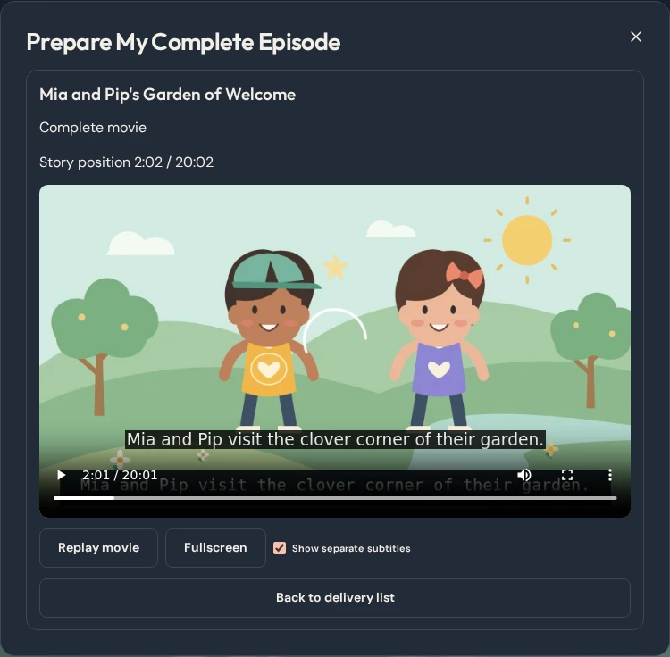
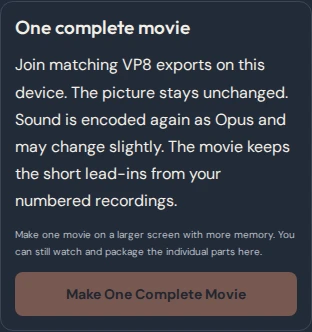

# Make one complete movie

1. In **Finish My Cartoon**, choose **VP8** and use the same picture size, frame rate and sound settings for every segment. Download the numbered WebMs.
2. Open **Prepare My Complete Episode**. Choose the actual video files, confirm any suggested assignments, and check the list for missing or invalid parts.
3. On a supported larger Chromium screen, choose **Make One Complete Movie**. The worker assembles the parts locally, then the browser checks playback and seeks across every join. You can cancel and try again without changing your originals.
4. Choose **Preview Complete Movie** and use the video timeline to review the whole episode. **Download Complete Movie** saves a single `<episode-title>-complete.webm`. Leave the tab open until the browser finishes saving the download.
5. Choose **Download Complete Movie Subtitles** for a separate SRT with timestamps on the joined movie clock. If captions were drawn into the exported frames, those captions are also part of the picture.

Keep the original numbered exports and complete episode ZIP for recovery and for viewers using separate parts. Download the editable **Project backup** separately. The finished WebM and viewing ZIP contain finished picture and sound. A `.ctepisode` preserves the editable cartoon and original recordings.

## Browser, format and size

Use current desktop Chromium with WebCodecs and local file storage available. The first version accepts matching VP8 exports from Chromium with stereo 48 kHz Opus sound or with sound turned off for every part. It handles up to 20 planned minutes and 256 MiB of source video and output. It keeps the source video frames and encodes the mixed audio again as Opus, which can slightly change sound quality. The saved WebM can be opened in a player that supports VP8/Opus WebM. Subtitles are available as a separate file.

The browser needs temporary space for the output and its staging copy. The largest supported jobs can need about 544 MiB of available site storage. Narrow or low-memory layouts, unsupported formats, and insufficient browser space keep **Watch My Episode** and **Download Episode Delivery Package** available.

The 20-minute fixture produced one WebM that reopened and sought across all nine joins. The verification compares every decoded frame with the original exports and measures audio around the joins and throughout the story. Short recorder lead-ins remain between the parts, so the file can be slightly longer than the storyboard. [Technical feasibility and measurements](SINGLE_MOVIE_FEASIBILITY.md)

## Workspace

| Desktop preview | Phone fallback |
| --- | --- |
|  |  |
