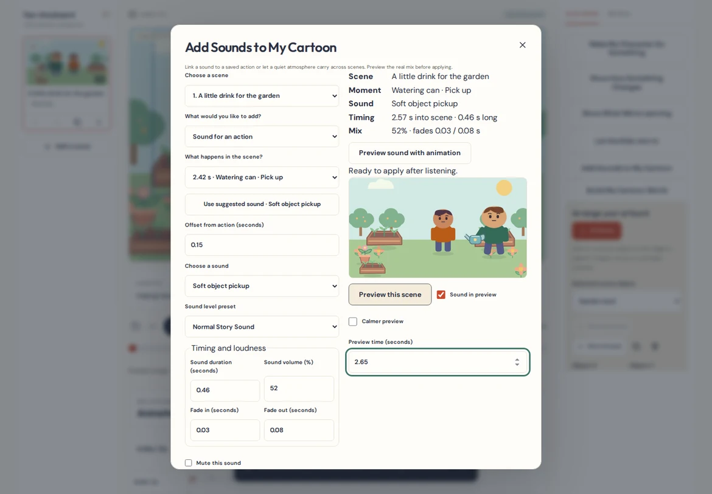
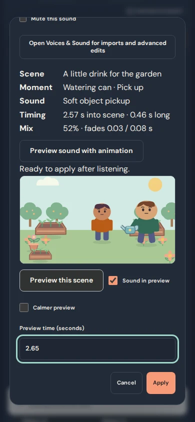
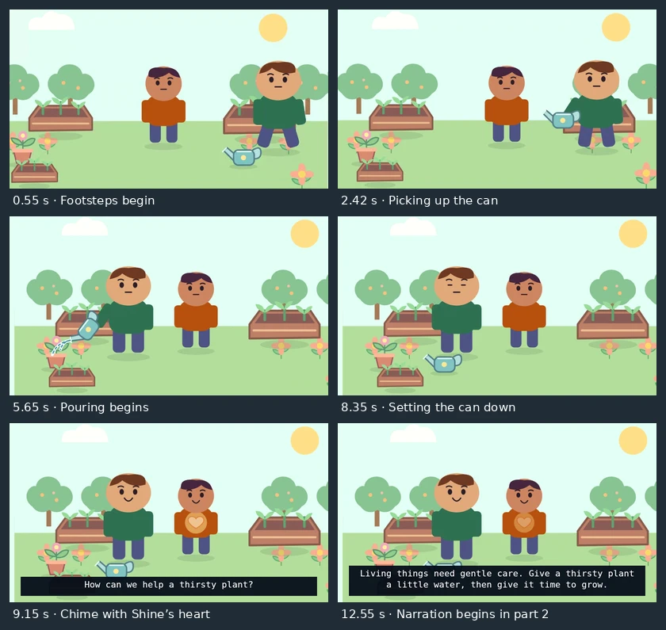

# Sound Effects & Atmosphere Director

Use **Add Sounds to My Cartoon** to hear a pickup, footsteps, pouring water, or a quiet location atmosphere at the right point in an animated scene.

## Add an action sound

1. Open **Edit scene → Add Sounds to My Cartoon** and choose the scene.
2. Under **What happens in the scene?**, choose a saved action, appearance change, learning step, participation phase, or animation key. You can also place the clip at a scene time.
3. Use a suggested sound or choose an original effect or an audio source already in the project. Use **Voices & Sound** to import a new original or record a voice.
4. Set an optional offset. Negative seconds start before the event. Positive seconds start after it. Choose the duration, volume, and fades.
5. Select **Preview sound with animation**, then **Preview this scene**. The shared scene player uses the real project mix. Pause, seek, or play the preview again. **Apply** saves one timeline edit. **Cancel** discards it and **Undo edit** can reverse it.

You can start from a saved action, an appearance change, or a participation reveal. Existing motion can suggest footsteps or rolling. Pickup, transfer, and release use the saved object interaction. A watering sound can use **Pour water**, which matches the actual stream in the animation. A heart-glow key can suggest a success chime. Suggestions always need your approval. Leaving a moment silent is a valid choice.

Use **Saved sound** to adjust or replace a clip. Replacement keeps the clip’s identity and keeps the earlier source available. The same saved effect cannot be added twice to the same event. **Voices & Sound** provides source trimming, fades, volume, and mute. A direct move on the audio lane releases the event link. To keep the link, change the offset in Sound Director.

## Add or continue atmosphere

Open **Build My Cartoon World → Review location atmosphere**, or choose **Location atmosphere** in Sound Director. Community Garden, Kind Hearts Playground, Little Learning Classroom, Helping Hands Workshop, and Cozy Family Home carry optional suggestions. You can also choose Rainy Day or use any saved source.

A reusable location keeps its suggestion only. Applying its scenery creates no audio. In Sound Director, select **Use this atmosphere**, choose the starting scene and **Continue atmosphere through**, then preview and apply. A single loop keeps playing across the chosen range. Set fades for the start and end. To replace the atmosphere, select the saved clip and choose another source. For a gradual transition between atmospheres, give both clips short fades and preview the scene boundary.

## Balance with dialogue

Start with **Quiet Background**, **Normal Story Sound**, or **Gentle Emphasis** and listen against the existing dialogue. Atmospheres use the music bus, so the existing ducking option can lower them while characters speak. Action sounds use the effects bus. The Finish My Cartoon checklist gives optional reminders for changed event timing, abrupt ambience transitions, duplicate sounds, and effects that may compete with dialogue. Missing original files remain a separate source availability check.

## Foundation audit and timing

| Existing system | How this feature uses it |
| --- | --- |
| Original sounds and source vault | Existing generated sounds and imported originals stay available. The director reuses matching inline or file-backed sources and leaves originals available after clip edits. |
| Audio clips, timeline, and scene editing | An optional stable event reference and offset are resolved into the clip’s saved scene-local start. Atmosphere endpoints resolve into one ordinary episode-wide loop. These placements are updated before saving. |
| Interaction, transform, and participation models | Existing event and animation times drive attachments. Pour timing shares the visible water motion’s phase. Scene duplication creates new references for its copies. |
| Scene preview and exporter | Playback, audio lanes, WebM parts, delivery, and the joined movie all use the ordinary audio schedule and mixer. Export retains absolute trim and loop phase across segment boundaries. |
| Finishing, backups, and revision checks | Existing readiness, local saving, undo/redo, recovery, and complete episode backups carry the edits. Project schema 4, IndexedDB 6, and episode package version 1 remain compatible. |

If an event is removed, the clip stays at its last valid placement and asks for timing review. If an offset would put a clip outside its scene, the editor fits the clip within the scene and shows a reminder. If you reverse or remove the endpoints of an atmosphere range, its clip keeps a valid episode placement and asks for review. Its original audio stays in the project. Complete episode packages retain file-backed originals and event links. A reusable location contains no recordings or episode audio.

Long-form projects support up to 256 audio sources, 30 minutes of original audio, 256 MB of original media, and 480 clips. Older inline projects retain their 24-source, five-minute, and 240-clip limits. Each original is limited to 120 seconds and 12 MB. Both project types allow 24 overlapping clips at once. Reuse a source or replace a clip when limits approach. Preview decodes bounded windows from the existing cache.

## Original demo and sound credits

**Helping Hands — A Garden Full of Sounds** opens a separate editable cartoon using Community Garden and Kind Hearts Crew art. Birds and a breeze continue between scenes. Footsteps, pickup, pouring, placement, and a soft chime accompany the real actions. The final scene includes genuine audible narration and captions.

The added effects are original deterministic waveform syntheses in `src/sounds.ts`. The short garden lesson is original text synthesized offline with the Carnegie Mellon Flite SLT voice through FFmpeg and saved as an MP3. The app plays the audio file through the usual pipeline. It requires no speech service. The repository remains MIT licensed. [CMU Flite project](https://github.com/festvox/flite)

## Decoded export evidence

FFmpeg sampled the genuine garden WebM parts near each authored cue. The check distinguishes the repeated footsteps and the pouring texture from nearby quiet audio. It measures the pickup, placement, and chime using distinct frequency signatures. It also checks the visible water, ambience on both sides of the scene boundary, spoken lesson, and captions. The joined movie is compared against decoded picture and sampled sound from both original parts.

## Practical limits

The editor works with saved animation events. Older motions without a key or event can use a manually placed sound. A cue moves the clip’s start when its event moves. It keeps the clip’s authored length, so review duration after substantial animation changes. Ambience ranges use whole consecutive scenes. Volume and overlap reminders are estimates. Listen on the device you’ll use to watch the finished cartoon.
