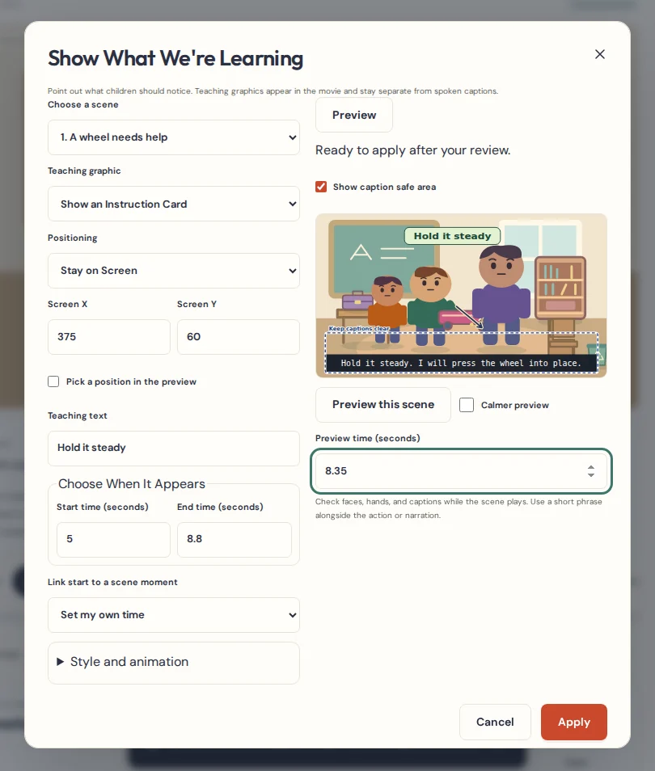
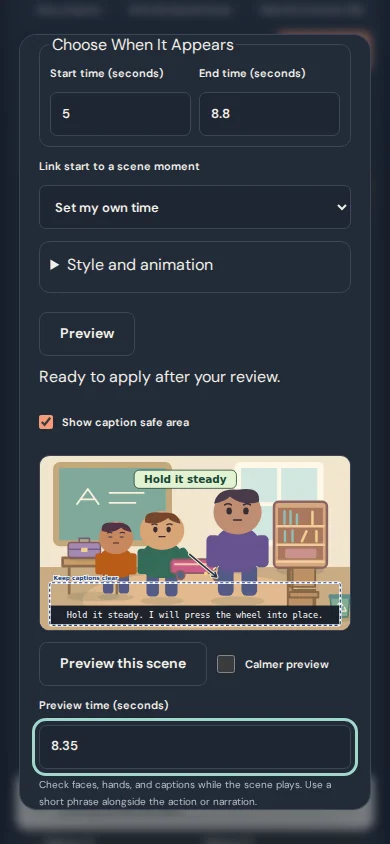
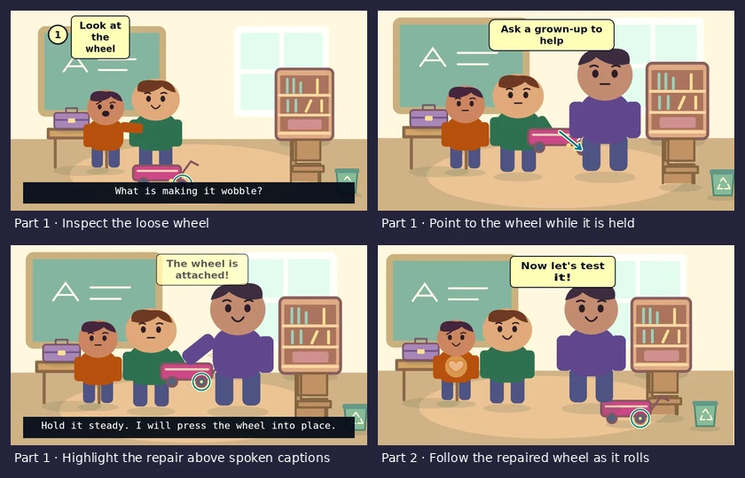

# Visual Teaching & Focus Studio

Add a teaching graphic when children need to see a detail, follow a small action, or remember a step. Teaching graphics are part of the movie. Timed captions still carry dialogue and narration.

## Add a graphic

1. Open **Edit scene** on smaller screens, then choose **Show What We're Learning**. Pick the scene you want to edit.
2. Choose **Point to Something**, **Circle This**, **Highlight This Object**, **Show a Step Number**, **Add a Learning Label**, or **Show an Instruction Card**.
3. Select **Follow Object** and choose the exact prop, scenery item, character, image, or drawing. Use **Detail offset X/Y** to aim at a part of it. For a fixed card or marker, choose **Stay on Screen** and enter X/Y, or pick a point in the preview.
4. Enter a short phrase if it helps. Set the start and end, or choose a linked scene moment. Open **Style and animation** for size, colors, optional fades, and gentle drawing-on for arrows and circles.
5. Select **Preview** and check the motion with captions on. Use the playback button or enter a precise preview time. Select **Apply** when ready. **Cancel** discards the draft, and **Undo edit** reverses a saved change.

A **Teaching graphics** lane appears in the existing animation timeline. Select a marker to edit its graphic. Each scene holds up to 24 graphics, with three visible at a time and one spotlight. Scene copies receive new graphic IDs and remapped object and cue references.

## Follow the scene or keep text steady

**Follow Object** uses the object’s sampled position, rotation, scale, hand attachment, scenery depth, and camera. For example, offset a circle toward the right wheel instead of centering it on the entire wagon. A following graphic disappears while its anchor is off-screen. If its target is removed, its marker asks for review and uses the last reviewed screen position. Choose another object or select **Keep this screen position**.

**Stay on Screen** keeps a card or marker at the same viewer position while the camera pans or zooms. Text boxes and numbered markers are kept within the frame and away from the authored caption band where possible. Arrows and circles can still point into that band, so preview them with actual captions. **Show caption safe area** is an editing guide. The movie includes the teaching art and the selected captions.

## Link teaching to an action

- Open **Write My Episode Script → Teach It Step by Step**. Apply any learning-step draft first, select the step, and choose **Show This Step on Screen**. ChipToons suggests the step’s current wording and time. You can change the text and choose any graphic type. A later step edit marks the suggestion for review and leaves your customized wording and manual timing intact.
- On a saved appearance change, choose **Show this change on screen**. The draft follows the affected object and suggests the saved transformation moment. Review the detail offset and timing before applying.
- Use **Link start to a scene moment** to follow an existing learning step, interaction event, or appearance change. Linked starts track the source event. If a cue is removed, the graphic keeps a manual time based on that cue. Duration is limited by the end of the scene.

## Styles and accessibility

**Soft Classroom**, **Playful Learning**, **Gentle Nature**, and **Simple High Contrast** pair dark ink with a light backing. The studio warns about low text contrast and a possible caption or cast overlap at the start. These are placement checks. Review the whole moving scene, especially faces, mouths, hearts, hands, and props.

Use short wording alongside narration and action. Text is limited to 88 characters and wraps to three lines, with an ellipsis if the chosen size would make it longer. **Calmer preview** honors reduced-motion preference by default and removes teaching fades and draw-on effects in that preview. The saved motion remains available for video. Keyboard users can use dropdowns, numeric fields, timeline markers, and preview-time input.

## Educational examples

The dashboard’s **Try a Visual Teaching example** gallery opens new editable versions of the original wagon, seed, paper bridge, and tidying examples. The wagon lesson adds a numbered inspection step, marks the loose wheel, points while Helping Hands holds it, and highlights the repaired wagon. The seed lesson labels the seed, sprout, and flower with days and weeks indicated. The bridge shows where to fold and test, and the tidying lesson numbers the tasks.

## Foundation audit and compatibility

| Existing system | What this feature reuses |
| --- | --- |
| Stage, timeline, interaction-motion | The same SVG renderer and sampled transforms drive editor preview, playback, and WebM. Teaching art is drawn in viewer coordinates after the camera-transformed artwork. |
| Animation Timeline, Scene Preview, Editor | The existing playhead, timeline lanes, preview controls, undo/redo, autosave, and project revisions remain the editing path. |
| Learning Steps, Script Director, Transform Studio | Graphics reference the existing learning steps, action events, and appearance changes. |
| Captions, Caption Overlay, video export | The existing caption layout provides the safe band. Caption overlays and burned-in captions draw above teaching graphics, and SRT continues to use authored speech captions. |
| Project backups and artwork | Optional scene-local records contain the text and geometry. They add no new image or video assets. Existing artwork, media, and backup workflows are reused. |

Project schema 4, IndexedDB 6, and complete episode package version 1 remain compatible. Existing projects need no migration. Location templates keep their own original scenery, independent from the graphics in a scene. Earlier app builds may show the original scene without the newer teaching graphics.

## Export evidence

The voiced wagon lesson renders to two genuine WebM segments. FFmpeg independently decodes the frames and checks for the numbered step at its authored time, the arrow at the held wheel, the highlight following the rolling wagon, the loose and repaired wheel positions, and visible spoken captions. Episode Delivery and Single-Movie Builder use those same segments. The verification compares decoded frames and sampled audio from the joined movie against both originals.

