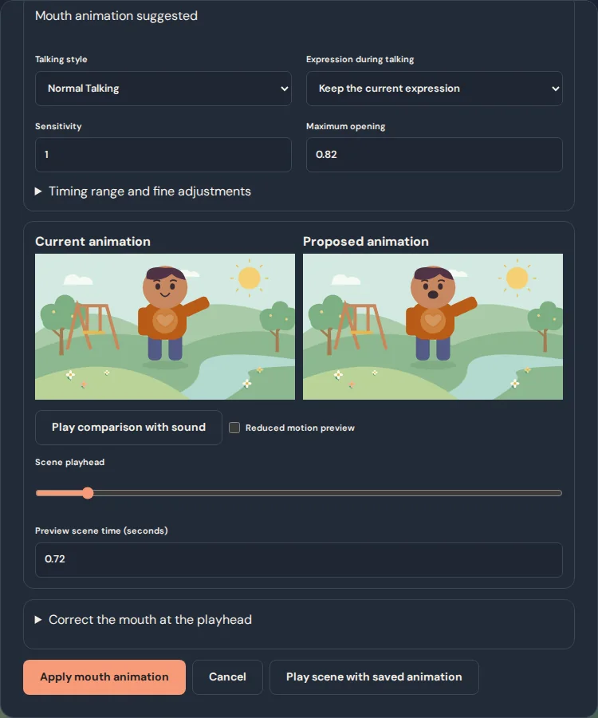
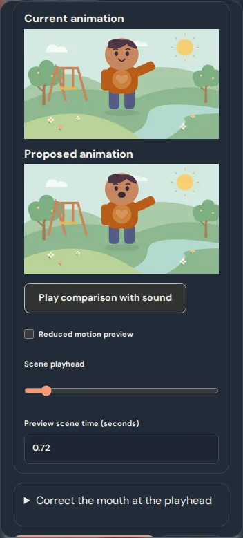
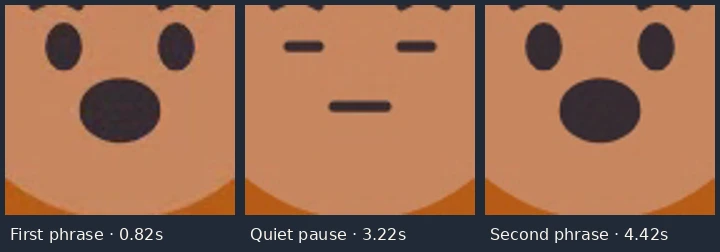

# Voice-to-Mouth Animation Studio

## Foundation audit

This work starts at `5dd91a6`, the merge of Script & Voice Director.

| Existing feature | How this studio uses it |
| --- | --- |
| Animation Timeline and manual mouth states | Auto, closed, open, smile, and manually timed talking remain in the original keyframes. The new optional mouth layer does not add body keyframes. |
| Stage and PuppetArt | The same original face artwork and editable puppet overlays draw the changing opening. Door props keep their existing openness control. |
| Voice Studio and Script Director | Choose an existing narration or dialogue clip, or start from the approved take on a script line. Record new audio in Voice Studio. |
| Production timing and Web Audio | Use the same clip offsets, trims, repeat timing, fades, mixer and bounded source decoding as the audio timeline. |
| Playback and WebM | The stage samples the saved mouth layer at the requested frame time. Both preview and export render the same stage. |
| Project validation and storage | Optional schema-4 fields keep cues in ordinary saves, undo and backups. IndexedDB remains version 6. |

## Make a character talk

1. Open **Make My Character Talk** in the episode editor. Choose a character on the current stage and a narration or dialogue clip that overlaps the scene. An assigned dialogue clip selects its character by ID. For a narrator or unassigned clip, choose the character yourself. In Script Director, **Animate This Voice** opens the same studio from an approved character line.
2. Choose **Analyze recording**. Compare the current animation and the proposed result with sound or the keyboard-friendly scene playhead. Pick **Gentle Talking**, **Normal Talking**, or **Expressive Talking**. Adjust sensitivity, opening, and the expression if you like. Reduced motion can hide the proposed moving lips in the preview.
3. Open **Timing range and fine adjustments** to change the covered part of the clip, shift the motion slightly, or adjust minimum opening. To correct a point, seek to it and open **Correct the mouth at the playhead**. Close the mouth, add a short pause, or set a custom opening. Reset restores the original normal suggestion and clears corrections.
4. **Apply mouth animation** saves only the mouth layer. Undo returns to the prior project snapshot. **Play scene with saved animation** lets you check the mix and the movement together.

Original shape characters and puppets with a drawable mouth part or enabled head overlay can talk. A single uploaded image needs a separately editable mouth or overlay. The existing Animation Timeline can still move that whole picture.

## Timing and precedence

The analysis measures local waveform levels in 40 ms windows, gates silence, smooths adjacent windows, and saves quantized opening levels. It approximates speaking rhythm and intensity. It does not analyze words, phonemes or identity. Loud background sound in the original can also move the mouth.

Clip offsets, trims, repeat timing, volume, fade and mute come from the same timeline and mixer used by playback and export. Scene-local clips keep their position relative to the scene when reordered. Episode-wide clips keep their position in the episode. Retiming or moving a clip with an unchanged trim follows the current playback timing where the selected range still intersects the scene. A changed source, changed trim or missing clip makes the previous cues inactive and flags them for review. Changing script text alone leaves the cues tied to the same recording.

Manual states take precedence by default. You can let the layer animate only unused intervals or confirm an override of the mouth within the chosen range. The override leaves all manual keys intact. Existing poses, gestures, joints, blinking, camera and heart effects stay in the project. Corrections change the mouth layer alone. Older projects have no automatic mouth cues until you apply them.

## Media, backup and limits

Analysis uses the selected original WAV, MP3, Ogg, or audio WebM supported by the browser. The existing limit is 12 MB and 120 seconds per recording, mono or stereo. One original is decoded at a time, at 16 kHz, and only the selected trim is measured. Up to 12 saved mouth tracks per character and scene and 32 corrections per track are supported. Preview and export read the compact saved levels without re-analyzing the audio.

Project schema stays at 4 and IndexedDB stays at 6. Ordinary backups and complete `.ctepisode` packages carry the tracks. File-backed originals continue to use the same backup and recovery checks. A scene duplicate retains voice tracks linked to its copied local clips. Episode-wide tracks stay in their original scene until deliberately reapplied.

**Try Shine Says Hello** opens a separate Kind Hearts Crew example. It contains an original line generated locally with the CMU Flite synthetic voice in FFmpeg, a deliberate silent pause, a wave and a glowing heart. The project starts with an approved voice so you can try **Animate This Voice** or open the talking studio from its toolbar.

## Studio screenshots and decoded export

| Desktop | Phone viewport |
| --- | --- |
|  |  |

The export test renders Shine as the second numbered segment, after a separate three-second scene. It decodes the downloaded WebM, measures the mouth region at the video’s actual frame timestamps, and compares those frames with decoded audio. Both phrases have multiple open-mouth frames with audible speech, and the measured silent pause has closed-mouth frames. See the [local decoded measurements](voice-mouth-animation/decoded-measurements.json).
